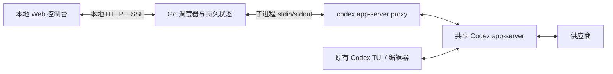

# Codex 会话保活：Go + Web 设计

> 历史设计参考：当前 Go 调度行为以 [GO_BACKEND.md](GO_BACKEND.md) 为准（临时日期探测、原生 Goal、持久天气保活、全权限）。Web 暂不实现，后续重新设计。

状态：Go 后端已实现，Web 按用户要求延后重新设计。实际入口、验证结果及兼容差异见 [Go 后端说明](GO_BACKEND.md)。下文保留 2026-09-28 续接 Claude 会话 `505bfa65-9d69-4b92-8aee-e4f7c70baeca` 时的设计依据；其中临时探测线程、分页协议和 Web 部分不代表当前实现。Python 入口保持独立。

## 1. 目标与已确认约束

保护用户选定的普通 Codex 交互会话：空闲时在**原会话**发送短保活消息；有任务时推进任务；人工使用优先。普通会话不需要开启 `/goal`。

用户已确认：**允许 Go 启动 `codex app-server proxy`，经它的标准输入输出发送本地 JSON-RPC；禁止 Go 或前端直连供应商。** Web 与本地 Go 的控制通信不属于供应商请求。

推荐一个本地 Go 进程、一个 Web 控制台、一个后台调度器。所有模型请求交给 Codex；每个选定会话独立计算保活时间。后台独立会话的成功不能替代目标会话的成功。

“保活”是定期产生真实模型请求，不是 WebSocket ping，不承诺供应商永久保留原 TCP 连接、上游路由或登录状态。空闲阈值和供应商按什么维度踢出仍需实测。

## 2. 能力依据

本轮只读核实结果：

| 项目 | 结果 | 设计影响 |
|---|---|---|
| `codex --version` | CLI `0.157.1` | 不能仅据此选择协议版本 |
| `codex app-server daemon version` | 运行中的 app-server `0.158.0` | 前端分别显示两者；能力按后台版本验证 |
| `codex app-server proxy --sock …` | 经管道完成 WebSocket 握手、`initialize`、`thread/loaded/list` | 接入路径可行，无须 Go 直连 socket |
| 0.158.0 导出的 schema | 包含队列 add/list/start/delete、轮次与 Goal 方法 | 用目标版本契约；schema 存在不等于并发语义已验证 |
| `turn/start.turnTrigger` 描述 | 请求可能 steer 已有活动轮次 | 人工会话保活不直接调用 `turn/start` |
| `effort`、`environments` 等字段 | 可影响当前及后续轮次 | 人工会话保活不覆盖配置；不存在安全的“先改再恢复”假设 |
| CLI `queue` / `agents` 帮助 | 有入队和交互浏览，无所需完整机器控制面 | 采用用户已允许的 proxy，而非解析 TUI |

先前项目实验发现：队列 add 在空闲时可能直接启动；相同 `clientUserMessageId` 不保证去重；start 可能因已有活动轮次被拒绝。这些是历史实验结果，**需要在 0.158.0 上重新做隔离验证**，不能视为本轮已通过。

## 3. 整体结构



- Go 不持有供应商 HTTP 客户端，不组装 Responses 请求，不读取或展示 API key。认证沿用 Codex。
- `proxy` 是原始字节转发；管道上仍需 WebSocket 握手及帧编解码，之后承载 JSON-RPC。不要把它误当成换行 JSON 模式。
- 固定 `CODEX_HOME`，用 `daemon version` 返回的稳定 socket 路径交给 `proxy --sock`；不解析并缓存符号链接目标。
- 独立的 `app-server --stdio` 不等于共享后台，不能用它接管当前 TUI。
- 连接断开只重建自己的 proxy，不停止、重启或更新共享后台。后台没启动时显示连接状态；“连接 Codex”可以调用 CLI 启动尚未运行的后台。
- 当前共享后台中的会话可登记。其他 `CODEX_HOME`、独立 `--no-daemon` 进程或远端会话显示“未接入”，不自动迁移正在工作的会话。需要共享模式时，可在正常交互入口使用 `codex --remote unix:///home/zzw/.codex/app-server-control/app-server-control.sock`。

## 4. 产品操作与保活范围

### 会话登记

默认关闭自动化。用户在会话列表中选择“开始保活”，只授予对该会话发送固定保活文本、撤销自己的队列项和管理自己的保活轮次的权限。

发现列表不等于自动登记。`disabled` 是持久状态，刷新、重连、重启都不得重新启用。后台任务会话由系统单独登记；来源标签仅用于辅助展示，不能单靠前缀认定所有权。

首次接入仅对已加载的目标调用无配置覆盖的 `thread/resume{threadId}` 建立订阅，实际无配置变更语义须通过版本验收。未加载目标显示“会话离线”，不自动恢复它并触发潜在 Goal。非选定人工会话只读观察。

### 空闲与人工回来

默认策略为“空闲自动恢复”：人工一有已提交消息或活动轮次，立即让路；人工本轮完成后重新计算空闲时间，达到间隔再保活。这使长期保活无需每次手动开启。

同时提供“人工回来后停止”策略：观察到人工活动就持久关闭该会话保活，需要再次点击开启。它替代旧文档含混的“停止后续接管”，并明确区分临时让路与关闭。

- 观察 `item/*`、`turn/*`、队列变更与状态变更；以本地 operation ID 对应的 `clientId` 识别自己的消息。其他消息保守视为人工或外部活动。
- 人工活动、已有队列、`waitingOnApproval`、`waitingOnUserInput`、外部 active Goal 都使目标不可保活。不给人工 Goal 发“继续”，不处理它的暂停/阻塞状态。
- 事件为主，约 5 秒只读核对一次作丢事件兜底。审批或输入等待不设超时后自动解除。
- 未提交的 TUI 输入不可见。Web 可提供“我在使用，暂停 15 分钟”，但不把它包装成输入检测。

### 固定保活消息

```text
[保活] 本条只用于维持会话活动。请仅回复 OK，不调用工具、不继续原任务，也不改变任务或 Goal 状态。
```

该消息与回复会出现在原会话历史，按正常模型调用计费；长会话上下文可能使短回复也很贵。不隐藏、不回滚、不删除人工历史。

这是一条行为指令，不是工具禁用机制。保留人工会话配置意味着不能硬性保证模型零工具调用。若出现工具调用或需要审批，停止后续保活、记录异常，不自动批准；不能声称观察事件一定早于已获权限工具的执行。

## 5. 三种不同状态

不要用一个绿色“在线”混合不同事实。

| 状态 | 取值 | 含义 |
|---|---|---|
| CLI 连接 | disconnected / reconciling / ready / incompatible | Go 是否能通过 CLI 控制共享后台 |
| 供应商健康 | unknown / healthy / stale / backing_off / attention | 指定路由的最近请求结果；不保证每个旧会话都可用 |
| 目标保活 | disabled / idle / due / sending / yielding / uncertain / attention / offline | 这个会话实际在做什么 |

供应商健康按配置目录、供应商、模型及相关路由配置版本分组；不跨不同路由复用成功结果。目标会话还保留自己的 `last_success_at` 和最近失败原因。

### 探测

首次启动自动化、健康过期或请求失败后，先用自有临时线程发送“只回复 OK”。临时线程复用至重连丢失、上下文过长或达到轮换上限；没有恢复需求时不持久化。

- 供应商和模型与目标一致。只对独立探测线程使用最小工作目录、受限权限和已验证支持的推理配置，不修改人工线程。
- `initialize`、CLI 进程启动或 `turn/start` 返回不等于供应商探测成功。
- 成功须看到对应 turn 的 `completed` 终态及非空最终回复。模型连接成功但文本不符合 `OK` 时，单独记“内容异常”，不能混成网络失败或无限重试。
- `willRetry=true` 是 Codex 内部重试通知，Go 不叠加并发重试。
- 网络中断、429、5xx：失败完成后退避 3、6、12…60 秒，加少量抖动；收到真实重试时间时遵守它，不捏造不存在的头信息。
- 401/403、配置错误、余额/用量限制、内容策略错误分别显示待处理；不当普通网络失败快速循环。
- 目标会话上下文满是目标问题，不把整个供应商标为故障，也不自动清空或换掉人工会话。
- proxy 断开是控制链路未知，不等于供应商故障。

探测成功只打开任务/保活执行入口，不把所有目标标为“已保活”。健康足够新鲜时不在每次目标保活前额外探测。

健康新鲜度单独计时：`fresh_until = route.last_success_completed_at + health_ttl`，初始候选 `health_ttl=120s`。同路由任务或保活成功也刷新它；失败立即覆盖旧健康状态。退避截止时间持久化，重启不绕过退避。

### 时间与调度

初始候选 `keepalive_interval=60s`、`probe_timeout=120s`、`keepalive_timeout=30s`，均为待校准参数，不是已测得的供应商阈值。上线前根据延迟和实际空闲阈值调整；30 秒在高推理配置下可能太短。

对每个目标：

```text
due_at = max(last_success_completed_at + interval, eligible_after)
```

`eligible_after` 在人工/外部轮次结束后重设；失败和中断不能更新成功时间。活动轮次持续多久都不插入保活。新登记会话用最近已知成功完成时间；未知时先探测并核对状态，不假造成功。进程内用单调时钟计时，持久化用 UTC，重启后重算且不补发所有错过的 tick。

任何真实成功的目标轮次都刷新其活动时间；其他会话成功只刷新同路由供应商健康。任务在 A 会话执行，不能刷新 B 会话的保活期限。

## 6. 调度顺序与任务

调度器串行处理状态变更，网络读写异步回报结果。决策是 `decide(snapshot, now) -> action`，不在决策函数里进行 I/O。

优先级如下：

1. 处理人工活动、关闭/暂停意图；撤销自己的待发消息。
2. 控制链路或操作结果未知：只对账，不再开始模型调用。
3. 已有自有轮次在途：跟踪它，处理让路与超时。
4. 用户暂停、人工活跃或审批/输入等待：等待；“立即探测”也不绕过让路。
5. 健康 unknown/stale 或退避到期：探测。
6. 已到期的目标会话：按最早到期顺序保活。
7. 当前任务可运行：推进一轮。
8. 没有任务或目标保活待办：等待下一期限；如单独开启供应商保活，则到期在自有探测线程发送。

“有任务做任务”仍保留**原会话保活到期优先**：供应商若按会话隔离，其他任务的请求保不住人工会话。默认一个后台模型轮次在途；人工轮次不受此锁约束。

长任务、多个目标与严格保活期限可能冲突。首版不承诺硬实时：任务在途时不强杀有副作用的工具，页面显示“保活延迟：等待任务本轮结束”。若要求零超期，需要另行选择并发额度或可取消任务执行机制，不能用轮询频率掩盖容量不足。

### 任务执行方式

首版用**调度器逐轮推进的任务**，而非激活会在后台自行续跑的原生 Goal。每轮结束重新检查人工活动、保活到期和健康，避免 Go 退出后自动任务仍无限续跑。

- 任务具有稳定 ID、文档快照、工作目录、权限、完成依据、运行次数/用量上限和专属 thread ID。任务权限显式展示，沿用已授权设置；不隐式升级人工权限。
- `current_task_id` 持久固定。重排只影响尚未开始的下一项；阻塞任务不被自动跳过。
- 每轮结果区分 `continue` / `blocked` / `complete`；结构化结果由模型提供，服务端校验形状。声明 complete 还需满足任务约定的验收依据，并且轮次结束；可执行检查在任务授权范围内运行。不能只凭退出码判整项任务完成。
- 断线后先找回当前线程、轮次和结果，再决定续跑。网络错误不证明工具没产生副作用。
- 人工开始使用时停止后续轮次；自有纯探测/纯保活可取消，任务默认等待本轮自然结束。用户点击“停止当前任务”才请求中断，已发生的修改不回滚。
- 同 cwd 或存在工作区重叠的人工会话优先阻止新任务轮次；任务建议使用已有隔离 worktree。已经在运行的工具不能保证瞬间释放所有资源。
- 人工直接进入任务专属线程并补充或修改要求时，任务转为“人工接管”，不在静默后自行恢复旧快照；由用户确认更新后的任务再继续。
- 原生 Goal 控制不作为首版依赖。已有 active Goal 会阻止对该人工会话发送保活；页面显示它的状态即可。

## 7. 发送、竞争与断线恢复

队列可撤销，但不是原子“仅空闲才发送”。这一点必须保留在产品承诺中。

### 正常路径

1. 在本地事务里持久化 `operation_id`、目标、文本摘要、授权版本 `watch_generation` 和 `activity_epoch`，状态为 prepared；获得后台执行槽。
2. 核对用户未暂停、目标已登记且加载、线程 idle、没有人工队列和外部 active Goal、没有 unresolved operation。订阅事件已生效。
3. 用 `clientUserMessageId=operation_id` 调用 `thread/queue/add`，只传 thread ID 和文本，不传模型/权限/推理配置。
4. 回读队列与最近轮次。如果已自动启动，按 `clientId` 找到 turn，直接跟踪，不再调用 start。
5. 若仍排队，重新核对 epoch、登记版本、线程和队列；只有自己的队列项且仍符合条件时，指定其 `queuedSubmissionId` 调用 `thread/queue/start`。绝不用无 ID 的“启动队首”。
6. 人工抢先时删除自己的队列项；start 被拒绝也先对账。删除回应丢失记 uncertain，不标 cancelled。
7. turn 终态按 completed / failed / interrupted 分开持久化。只有已确认成功的目标轮次更新保活时间。

### 人工在保活期间回来

- 已排队未开始：撤销自己的消息，不碰人工队列。
- 已开始且仍能确认是**仅包含我方保活输入**的 turn：按精确 turn ID 请求中断；等待终态后释放槽。
- 人工消息已 steer 进同一 turn，或归属无法确认：该轮视为人工接管，不中断、不删除人工输入；停止后续保活。
- 读状态与中断之间仍有外部输入竞态；若目标版本没有原子条件中断，就不能保证绝不打断极短竞态窗口内的人工输入。未知归属默认不打断，优先保留人工工作。
- “暂停全部”先停止新操作，然后完成自有待发送项清理；清理未知时显示“正在停止/待核对”，不能提前显示“已全部停止”。

### 不确定结果

本地 operation 状态为 `prepared → queued → running → succeeded/failed/interrupted/cancelled`，任何有可能送达但缺回应的调用转 `uncertain`。

重连按操作 ID 查所有相关队列页及覆盖该操作的轮次/items 页。找到记录就跟踪原操作；无证据不能证明未送达。若完整历史仍无法排除 pending 请求，保持待核对，不自动以同 ID 或新 ID 再发一次。request ID 和 client ID 都不是供应商幂等承诺。

只有确认尚未写入管道的失败，才允许无副作用重试。机器重启后先恢复所有 unresolved operation，才处理新任务。单实例文件锁防止两个 Go 进程共管同一状态目录。

## 8. 模块与持久化

| Module | Interface | 隐藏的复杂性 |
|---|---|---|
| `Guard` | `Apply(command)`, `Snapshot()`, `Events(after)` | 调度、授权范围、暂停、任务推进；Web 唯一入口 |
| `CodexRuntime` | `Observe(scope)`, `Execute(intent)`, `Reconcile(operation)` | proxy 生命周期、协议、分页、关联 ID、断线、版本能力；不向 Web 暴露任意 RPC |
| `Store` | 具体的事务操作 | 登记版本、operation 日志、当前任务、重启核对、事件序号 |

Runtime 是真实 seam：生产 adapter 使用 CLI proxy，测试 adapter 可重放竞争和断线；注入时钟验证计时。内部 JSON-RPC 客户端不承担业务策略。

建议目录：`cmd/netcap/`、`internal/guard/`、`internal/codex/`、`internal/store/`、`web/`。Go 用 `net/http` 提供本地页面和控制；前端用 TypeScript、小量组件与 CSS，静态产物由 `embed` 打包。不引入 SSR、Redis 或远端数据库。

SQLite 存在所选配置目录的独立 `netcap-web/` 中，不写 Codex 自身数据库。建议记录：

- `watches(thread_id, enabled, generation, resume_policy, interval, activity_epoch, last_success_at, eligible_after)`。
- `operations(id, kind, thread_id, watch_generation, activity_epoch, queue_id, turn_id, state, created_at, finished_at)`。
- `tasks(id, position, snapshot_hash, thread_id, state, completion_rule, limits)` 与唯一 `current_task_id`。
- `health(route_id, state, last_success_at, retry_at, reason)`；`events(seq, at, kind, operation_id, summary)`。

事务先记录意图，再发命令，之后记录结果；SQLite 事务不跨网络等待。敏感输出脱敏，默认仅显示摘要；完整会话历史不复制进 Web 日志。

默认仅监听 `127.0.0.1`。控制写入使用同源校验与本地会话令牌，避免任意网页触发本地命令。服务端校验 thread ID、枚举、间隔和操作授权；不提供 shell 字符串或任意 RPC 输入框。子进程使用参数数组，不经 `sh -c`。

## 9. Web 页面设计

一页控制台，主要任务是看清状态并启停。顺序为总览、会话、任务队列、最近事件；详情在侧栏渐进展开。实现预览见 [可点击原型](design-preview.html)，所有数据均为演示。

顶部只放三个主操作：“立即探测”“开始自动运行”“暂停全部”。开始保活在每个会话行内，避免用户误以为总开关会选中所有会话。手动探测经过同一调度器，可显示“已登记，等待人工结束”。

| 区域 | 主要内容 |
|---|---|
| 总览 | CLI 连接、供应商最近成功、当前动作、等待原因、下一步 |
| 会话 | 名称/cwd、是否登记、人工状态、最近实际成功、下一保活、开始/停止 |
| 会话详情 | 间隔、空闲恢复策略、最近错误、保活用量、原会话可见消息说明 |
| 任务 | 固定当前项、待执行顺序、完成依据、阻塞原因、添加/暂停/重试 |
| 最近事件 | 按时间显示探测结果、让路、撤销、对账、完成；支持脱敏导出 |

按钮等待服务端确认；双击使用本地控制命令幂等 ID。SSE 用事件序号与完整 snapshot 恢复；页面掉线显示“状态已过期”，禁用写入，不能把倒计时继续播放成后台仍在线。关闭浏览器不停止 Go，重开读取真实状态。

设计定位：本地运维控制台，面向经常用 Codex 的个人开发者，桌面约 1 米观看；克制、清晰、状态优先。无已有品牌资产，采用临时自定义系统。

- 设计刻度：布局变化 3、动效 2、信息密度 7、素材依赖 1、品牌继承 2。落到稳定表格、少量过渡、必要详情折叠、文字标识和可替换色板。
- 主画布暖白 `#f5f4ef`，文字 `#232b27`，主操作深绿 `#245c46`；绿/琥珀/红仅用于状态，并配文字。
- 中文使用本地 `Noto Sans CJK SC` / `PingFang SC`，数字与标识符用等宽；正文 16px，标题 28px。
- 8px 间距、6px 圆角、细分隔线，主要内容无投影；120ms 状态反馈并支持 reduced motion。
- 390px 单列、宽屏两栏；键盘焦点可见、控件有标签，事件列表不自动抢焦点。

## 10. 验收与实施顺序

先做协议切片，再做真实纵向路径；每片必须有可观察的验收结果，不先搭完所有层。

| 切片 | 结果 | 验证 |
|---|---|---|
| S0 | CLI proxy 连接与目标版本契约 | 已通过本轮只读握手/初始化/列表；队列竞争、订阅、配置不变及消息归属仍需隔离实验 |
| S1 | Web → Go → CLI → 独立探测 → Web | 本地模拟供应商；完成/失败/空回复/超时，CLI 之外无供应商流量 |
| S2 | 一个普通会话的开始、到期保活、停止 | 固定文本、真实终态、正确计时、关闭持久化 |
| S3 | 人工让路与重启核对 | 人工抢先/steer、queue add 自动启动、响应丢失、不重复发送 |
| S4 | 一个任务多轮执行、再扩展顺序队列 | 当前任务固定、逐轮让路、阻塞不跳过、失败不算完成 |
| S5 | 完整控制台和真实环境校准 | 指定测试会话，测空闲阈值、同会话请求是否有效、成本和延迟；不自动替换旧程序 |

关键场景必须通过调用方使用的 `Guard` interface 验证：

1. 探测失败期间不启动任务或目标保活；CLI 连上不算探测成功。
2. 普通非 Goal 会话可保活，其他会话成功不更新它的成功时间。
3. 成功完成后计时；失败、中断、旧事件、重复事件均不误推进时间或任务。
4. 人工轮次、队列、审批和输入等待均阻止新保活；未登记线程永不被写入。
5. 仅撤销自己的队列项；已混入人工输入的轮次不按纯保活处理中断。
6. 在意图落盘、add、start、delete、turn 完成各步骤断开连接，恢复后不重复发送、不假报取消。
7. 关闭保活后重新发现或重启仍关闭；暂停清理未完成时 UI 不报已停止。
8. 任务重排、重启、阻塞均不出现第二个后台执行任务；任务长轮次导致保活延迟时如实展示。
9. 人工会话模型、effort、权限、环境、Goal 在保活前后不变。
10. 模型调用网络只从 Codex 进程产生；Go 仅有本地 Web 监听和 CLI 管道。Web 不能触发未登记线程或任意命令。
11. 新旧版本不兼容时只显示状态并停发；不自动升级或重启共享后台。
12. Go 退出后无后续自有任务轮次；已经在共享后台执行的一轮可能继续，重启必须对账。用进程管理器缩短无人管理窗口，但不声称消除了它。

已有 7 个缺陷对应的防线：未知与取消分开、current task 固定、人工策略显式化、关闭登记持久化、去掉天气索引、终态区分成功失败、从完成时刻计时。旧程序及其测试保持原状；切换是后续实施任务。

## 11. 当前证据边界与来源

已验证的是本地控制通道和协议字段；**未进行真实供应商保活、队列写入、任务执行或 Go 后端实现**。无法据此声称不会被踢出、没有人工输入竞态或已满足全部验收。

官方页面本轮已实际获取；浏览器抓取 noninteractive 页面返回 403，但随后命令行抓取成功。文档未覆盖的 queue 细节以版本 schema 与隔离实验为准。

- [Codex CLI reference](https://developers.openai.com/codex/cli/reference/)：CLI、JSONL、exec resume、app-server 等公开能力。
- [Non-interactive mode](https://developers.openai.com/codex/noninteractive/)：事件终态、持久/临时会话和结构化输出。
- [Codex App Server](https://learn.chatgpt.com/docs/app-server)：生命周期、状态、订阅、轮次参数可能成为后续默认值。
- 本机 `codex app-server daemon version` 与 `proxy --help`；0.158.0 CLI 导出的 JSON Schema。导出位置为临时目录 `/tmp/netcap-schema-0158-20260928/`，实施时应重新生成并将所需契约固定在测试夹具中。
