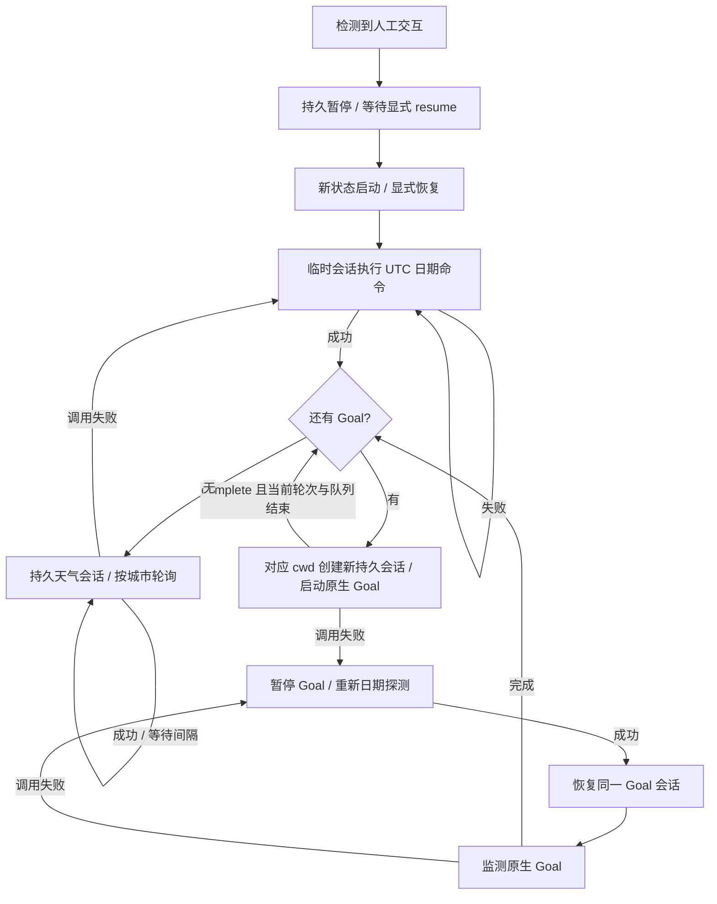

# Go 后端

当前流程：启动自动临时 UTC 日期探测 → 按清单执行 Codex 原生 Goal → 持久会话轮询城市天气。人工新开会话交互或 resume 天气会话交互时，后台持久暂停，等待显式 `resume`。Web 留待后续设计，原 Python 入口保持独立。

## 启动

需要 Go 1.26、Python 3、Linux/Unix，以及支持 `app-server proxy --sock`、消息队列和原生 Goal 的 Codex。当前验证版本为 CLI 0.157.1 / app-server 0.158.0。

在本项目目录中：

```bash
make build
cp netcap.example.json netcap.json
./bin/netcap --config netcap.json doctor
./bin/netcap --config netcap.json run
```

`doctor` 只读版本和已加载会话，不请求模型；共享后台尚未运行时会报连接错误。`run` 前台运行，**新状态默认自动开始**，Ctrl-C 退出。默认共享后台未运行时，托管器会通过 `codex app-server daemon start` 尝试启动；不会停止、重启或升级共享后台。自定义 `codex_socket` 需要自行启动对应后台。

也可以不提供配置，直接 `./bin/netcap run`：默认配置目录 `/home/zzw/.codex`，状态目录为其下 `netcap-go/`。示例使用项目内独立 `.netcap-go-v2/`，便于与旧状态分开。所有控制命令应使用与 `run` 相同的配置。

```bash
./bin/netcap --config netcap.json status
./bin/netcap --config netcap.json goals
./bin/netcap --config netcap.json events
./bin/netcap --config netcap.json pause
./bin/netcap --config netcap.json resume
```

重启保留运行/暂停选择、当前 Goal、天气城市位置和在途操作；恢复自动运行前重新探测。旧 Go v1 状态不自动迁移，遇到 v1 会明确拒绝启动；请选新的 `state_dir`，不要删除旧数据库。

## 调度逻辑



### 日期探测

Go 启动以下 CLI 调用，超时或人工介入时清理它自己的进程组：

```bash
codex exec --ephemeral --dangerously-bypass-approvals-and-sandbox \
  --skip-git-repo-check --json --thread-source UNIQUE_ID \
  '请执行 date -u +%FT%TZ，只返回命令输出。'
```

探测不保存 Codex rollout。成功必须同时满足：CLI 成功退出、`turn.completed`、没有 `turn.failed`、记录中确实执行日期命令且退出码为 0、最终回答与命令输出的 UTC 时间一致。只返回 `OK` 或没有工具执行的时间字符串不会通过。

失败持续重试；**high demand / rate limit 不增加 Go 层退避**，本次 CLI 调用结束后进入下一次探测。其他错误按约 3→6→12→24→48→60 秒指数退避并加抖动。Codex 内部的重连、重试与进程结束耗时仍由 CLI 控制，不承诺错误出现后立即发出网络请求。

`probe` 登记一次临时探测；暂停状态下也可使用，不会因此开启 Goal 或天气循环。主动探测仍等待自有在途操作核对完成。

### Goal 文件清单

编辑 `netcap.json` 的 `goals`，按数组顺序执行。例如以下路径需要替换成真实文件和已存在的工作目录：

```json
{
  "goals": [
    {"id": "first", "file": "./goals/first.md", "cwd": "/项目一的绝对路径"},
    {"id": "second", "file": "./goals/second.md", "cwd": "/项目二的绝对路径", "token_budget": 100000}
  ]
}
```

这是配置片段，合并到完整配置中使用。`token_budget` 可省略，未设置时不代填预算。相对路径基于配置文件所在目录。

每个文件首次登记时写入 `state_dir/goals/` 固定快照，原生 Goal 的 objective 指向快照。修改源文件不会静默改变已登记任务；要执行新版本，请使用新 ID。每个 Goal 都有新的持久会话，`cwd` 取该项配置。

托管器通过 `thread/goal/set` 启动原生 Goal，用 `thread/goal/get` 读取实际状态，与 Codex 的 Goal 模式共享状态。只有原生状态为 `complete`、当前会话空闲且队列清空后，才切换下一项；模型文字说“完成”不作为判断依据。验收条件应写在 Goal 文件中，完成状态由 Codex 依据任务执行情况设置。

- 调用失败：暂停当前 Goal，重新临时日期探测；成功后恢复同一个 Goal，不重复创建任务。
- `blocked`、外部暂停、`budgetLimited`、`usageLimited`：保留当前位置，不自动跳过。用量或预算限制不能通过重试绕过。
- 文件清单耗尽：自动进入天气保活。

```bash
./bin/netcap --config netcap.json goal-retry first
./bin/netcap --config netcap.json goal-order second first
```

`goal-retry` 仅重试当前阻塞/恢复中的 Goal；`goal-order` 要提供全部已登记 ID，不切换正在执行的 Goal。配置文件的顺序在下次启动时重新应用。移除当前未完成 Goal 会拒绝启动；移除其他未完成项后保留其记录并标记 `removed`。

### 天气保活与人工接管

没有 Goal 或全部 Goal 完成时，自动创建持久天气会话，不需要 `watch`。模型按原有提示词实际运行 `weather.py`，从纽约开始，依次循环原脚本的 31 个城市；城市列表由 `weather.py --list-cities` 读取，不复制维护。

天气成功需有最终回答，并确认对应城市的天气命令执行成功。成功后默认等待 10 秒，再查询下一城市；失败不推进城市。脚本执行失败时重试当前城市；模型调用失败时回到临时日期探测，恢复后继续原天气会话。上下文满时可新建天气会话，保留城市位置。

`status` 中 `state.weather.thread_id` 及 `weather_created` 日志提供可 resume 的 ID。人工需要连接**同一个共享后台**，例如：

```bash
# 新开人工交互会话
CODEX_HOME=/home/zzw/.codex codex \
  --remote unix:///home/zzw/.codex/app-server-control/app-server-control.sock \
  --dangerously-bypass-approvals-and-sandbox -C /你的项目目录

# 接管天气会话
CODEX_HOME=/home/zzw/.codex codex \
  --remote unix:///home/zzw/.codex/app-server-control/app-server-control.sock \
  --dangerously-bypass-approvals-and-sandbox resume THREAD_ID
```

检测到新的人工消息、人工队列或人工会话正在运行时，后台持久暂停。仅打开空会话或输入框内尚未提交的文字，不视为已经交互。`sessions` 可查看当前观察到的已加载会话。其他独立 Codex 后台、其他 `CODEX_HOME` 或远端会话不在观察范围内。

接管天气会话后，该 ID 交给人工使用。之后显式执行托管器的 `resume`，会先探测，再创建**新的天气会话**，从保留的城市位置继续；不会往已接管的旧会话追加天气请求。人工另开会话触发暂停而没有接管天气 ID 时，恢复可继续原天气 ID。

`pause` 返回表示暂停意图已持久保存。在途临时探测会取消，自有天气队列会删除，纯天气轮次可中断；混入人工输入的轮次不会主动中断。原生 Goal 设为 `paused` 后不再自动续跑，当前轮次可能继续到自然结束。

## 权限与连接

全部自动工作模式使用用户指定的**无审批、无沙箱**权限：日期 CLI 显式带 `--dangerously-bypass-approvals-and-sandbox`；Goal/天气通过 CLI proxy 创建线程时设置等价的 `approvalPolicy: "never"`、`sandbox: "danger-full-access"`。模型、供应商未配置时沿用 Codex 默认配置。

Go 仅启动 Codex CLI。Goal/天气的本地 JSON-RPC 通过 `codex app-server proxy --sock ...` 的 stdin/stdout WebSocket 帧传输。认证、供应商网络连接和工具执行全部由 Codex 负责；Go 不直接请求供应商。

本地控制只监听 `state_dir/control.sock`（0600），目录权限 0700；没有 TCP 或 Web 入口。接口为 `GET /v1/status`、`/v1/sessions`、`/v1/goals`、`/v1/events` 和 `POST /v1/command`。`tasks` 仅保留读取 Goal 清单的别名，旧 `watch` / `task-add` 已移除。

SQLite 保存原子状态、最近 500 个天气操作和 300 条摘要事件。操作意图先落盘，再发送。代理断线或回复丢失时回读队列和历史；无法确认结果则保持 `uncertain`，不盲目重发。文件锁防止两个进程共用同一状态目录。不要同时启动旧 Python 托管器管理同一后台。

## 配置

完整示例见 [netcap.example.json](netcap.example.json)。JSON 拒绝未知字段，修改后重启 Go；不会读取旧 `guard.example.toml`。

| 字段 | 默认值 | 作用 |
|---|---|---|
| `codex_home` | `/home/zzw/.codex` | Codex 子进程配置目录，不受外部 `CODEX_HOME` 覆盖 |
| `codex_bin` / `python_bin` | `codex` / `python3` | 可执行文件 |
| `codex_socket` | Codex home 下共享后台 socket | CLI proxy 的连接目标 |
| `state_dir` | Codex home 下 `netcap-go/` | SQLite、Goal 快照、本地控制 socket |
| `model` / `provider` | 空 | 沿用 Codex 默认模型和供应商 |
| `weather_script` | 配置目录下 `weather.py`，或构建目录上级脚本 | 原天气脚本路径 |
| `weather_interval_seconds` | 10 | 天气成功到下一城市的间隔 |
| `probe_timeout_seconds` | 120 | 单次临时日期探测超时 |
| `weather_timeout_seconds` | 120 | 纯天气轮次超时 |
| `poll_seconds` | 2 | 人工活动全量核对间隔；事件可提前触发 |
| `rpc_timeout_seconds` | 10 | 单次调度/连接操作的控制链路超时 |
| `auto_start_daemon` | true | 默认共享后台不可连接时，通过 CLI 尝试启动 |
| `goals` | 空数组 | 按顺序执行的 `{id,file,cwd,token_budget?}` 清单 |

## 验证与边界

```bash
make check
make integration NETCAP_SERVER_CODEX=/目标版本/codex
```

集成测试使用隔离的 Codex 配置目录、真实 CLI 和本地模拟供应商。日期命令和本地天气 stub 由真实 Codex 工具执行；Goal 测试实际创建文件并调用原生完成工具。覆盖顺序、不同工作目录与会话、人工接管、暂停、重启、临时会话不留 rollout，以及有效权限检查。测试不连接真实供应商或真实天气服务。

已加载会话与历史查询随 Codex 版本变化，版本升级需要重跑联调。当前兼容分页历史查询、尚未落盘的空闲新会话和旧式只读历史回退；不能完整读到历史时不推进未知操作。

人工检测依赖事件和轮询，无法保证提交与发送之间没有竞态。托管器退出不会杀共享后台，已开始的 Goal 当前轮次可能继续。保活只能持续产生有效请求，不保证供应商永久不回收连接；真实供应商空闲阈值和高压限流行为尚未实测。

协议依据：[OpenAI Docs — App Server](https://learn.chatgpt.com/docs/app-server)、[Non-interactive mode](https://developers.openai.com/codex/noninteractive/)，并以本机 schema 和真实 CLI 联调结果核对。
