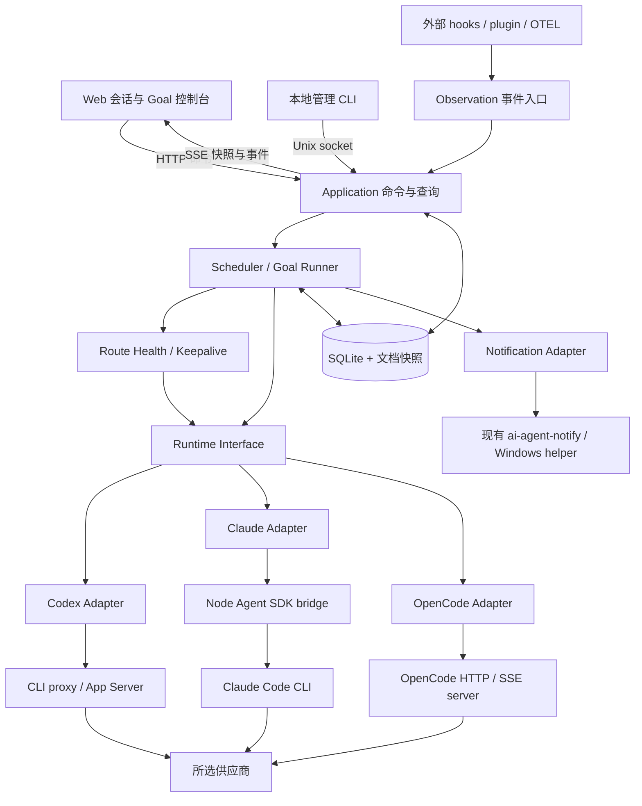
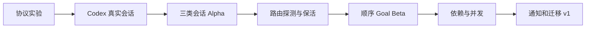

# 轻量多 Agent 会话管理：探索、需求与架构草案

日期：2026-09-28。状态：历史 Web 控制台设计，保留 T00–T15 的行为依据与验收记录。2026-09-30 新产品的权威范围改由 [需求分析](docs/requirements-analysis.md)、[产品 V0.3](docs/product-design.md) 和 [新实施计划](docs/implementation-plan.md) 管理；本文的后续优先级不再作为新工作台默认路线。当前实施状态与证据见 [PROGRESS](goals/PROGRESS.md)。本历史范围的首期 Agent：Codex、Claude Code、OpenCode。

## 1. 建议结论与范围

将当前 `codex-netcap` 演进为一个**本地优先的多 Agent 控制台**：统一管理会话、指定供应商路由、探测与保活、Goal 任务清单、自动派发和待处理通知。保留现有 Go 可靠性基础，将 Codex 协议与天气业务从调度器中移出。

建议技术形态：**Go 常驻控制进程 + SQLite + 内嵌 Web 静态资源 + 三类 Runtime Adapter**。Claude Code 使用按需启动的 Node/官方 Agent SDK bridge；Codex 和 OpenCode 分别走自己的控制协议。这里的轻量指部署和职责简单，实际还会存在 agent、bridge、工具子进程。

本轮已完成源码、现有文档、官方资料及仓库内 UI 素材探索；未启动真实模型任务、未发送通知、未修改用户 CLI 配置。三个远程仓库只读拉取到 `/tmp/multi-agent-research-20260928/`。

当前采用的工作假设：

- 首期为个人单机、Linux/WSL 优先，通过浏览器访问；关闭浏览器后后台继续工作。
- “多 Agent”首先指统一管理三类运行时、多会话及受控并发；任务由确定性调度规则分派。自动组织 Lead/Worker 团队放到后续。
- “指定供应商”指明确选择 agent 实例、账号配置、端点与模型；默认固定路由，失败不暗中换供应商。
- 保活分为控制链路恢复、供应商有效请求、目标会话有效请求；Goal 持续推进有独立策略。
- 顺序清单是默认交互，也支持显式依赖和独立工作区的并发。初始自动执行并发为 1，可配置提高。
- 以下新默认值均为提案，不修改现有程序，也不代表已经确认替换旧行为。

## 2. 探索记录：五份项目如何贡献

### 2.1 参考版本与证据边界

| 对象 | 本轮定位 | 证据范围 |
|---|---|---|
| T3 Code | `d15210cd3da79f9a1a495a6309d912d76362a046`，MIT | README、架构文档、ProviderAdapter、Claude/OpenCode 实现、账号隔离文档、Web 组件路径、桌面截图 |
| Cindy | `3440fda5f85c094d18e6adbfa605b527fc497a4f`，Apache-2.0 | README、Orca 文档、调度状态机、Claude manager 协议、模型选择逻辑、设计规范和设计证据图 |
| agent-notify | `1005996fb683ab51f1cd02d7a828a740895b0509`，MIT | 事件分发、OpenCode 映射、冻结/去重、CLI 配置 UI、README |
| 本地 `.ai-agent-notify` | `/home/zzw/.ai-agent-notify`；Git 尚无提交 | README、改造说明、事件转换、模块布局；不读取私密配置和运行历史 |
| 当前项目 | `/home/zzw/codex-netcap`；不是 Git 仓库 | Go 实现、测试场景、现行说明及历史 Web 草案 |

本机只读版本检查结果：Codex CLI `0.157.1`、Claude Code `2.1.280`、OpenCode `1.18.32`。现有实施记录记载 app-server `0.158.0`，本轮没有重新连接该后台验证。参考项目 SDK 版本不能直接当成本机兼容结论。

### 2.2 功能与取舍

| 来源 | 已观察到的能力 | 本项目采用的思路 | 首期不搬入的内容 |
|---|---|---|---|
| T3 Code [S1–S4] | 多运行时 adapter、多实例/账号、流式会话、审批与提问、项目侧栏、Diff、持久意图、能力声明；当前 README 已列出 Codex/Claude/OpenCode 等 | Adapter 隐藏协议差异；按实例隔离；项目→会话工作区；先持久化意图再执行；按能力展示按钮 | Electron、手机应用、隧道、完整事件溯源、检查点回滚、完整 Git/PR 工作台 |
| Cindy [S5–S8] | Harness 与模型分离；Lead/Worker 会话；定时任务、执行阶段、并发槽；Claude SDK manager；任务结果卡片 | agent 与供应商分开建模；Task/Attempt 分离；显式阶段机；等待与执行分别计数；结果和失败原因可回看 | 云账号/计费、双区域服务、IM 双向派活、插件市场、记忆系统、多种协议转换代理、自由布局引擎 |
| agent-notify [S9–S10] | 多 agent 事件归一化、多通知渠道、冻结、发送预留与去重、窗口聚焦、安装诊断 | 统一通知事件、渠道策略、只读 doctor、发送成功后记去重 | 全套渠道 SDK 和交互配置框架 |
| 本地 `.ai-agent-notify` [L1–L3] | 三类 agent hooks/plugin；Codex OTEL 错误补充；Windows Toast、返回终端、企业微信纯文本；延迟取消；按渠道去重 | 初期直接复用现有通知行为与 Windows helper；后续提炼为独立通知 Adapter | 一次性重写全部 Bash/Node 工具、替换用户现有 hooks |
| 当前项目 [L4–L8] | 临时日期探测、原生 Goal 文件快照/顺序执行、持久天气会话、人工介入暂停、SQLite/文件锁、未知结果核对 | 保留快照、原生 ID、先落盘后发、对账、暂停与人工优先的可靠性机制 | 把天气作为必需初始化、全局唯一健康状态、全局唯一任务/operation、调度器直接使用 Codex RPC |

需要特别区分：

- Cindy 的 `heartbeat-client` 上报客户端在线信息，不能作为模型供应商保活已实现的证据。[S8]
- Cindy 的 Orca 文档混合了现状与未来规划；其中 workflow_run 集成等仍属规划，不能当成已实现功能。[S6]
- T3 Code 把 Codex/Claude/OpenCode 称作 provider。本设计用 `agent_kind` 表示运行时，用 `provider_route` 表示模型供应商路由，避免两者混淆。
- 通知中的 `Stop`、`session.idle`、`run_completed` 只证明某轮/某次运行结束，不能据此完成整项 Goal。本地 OpenCode 已避免把普通 idle 重复映射成“等待输入”。[L3]

### 2.3 当前项目需要解开的具体耦合

1. `Guard.Client`、`Guard.Threads` 直接依赖 Codex 类型；事件消费也直接匹配 `thread/*`、`item/*`。[L5]
2. `Guard.Initialize()` 要求天气城市表存在；核心 `State` 内直接嵌入 `Weather`，普通多 agent 会话无法独立于天气运行。[L5–L6]
3. `State.Health`、`CurrentGoal` 和 `Operation` 都是全局单份，只适用于当前串行流程。[L6]
4. 当前 SQLite 是单行 JSON 快照，原子性适合已有小状态，但扩展到多个独立任务、事件流和查询时需要按聚合对象持久化。[L7]
5. 当前控制入口只有 Unix socket；历史 `design-preview.html` 是演示，尚无实际 Web 控制端。[L4、L8]

这些是演进接缝，不需要推倒现有恢复算法或把 Python 旧入口同时改写。

## 3. 首期功能清单

P0 为首期完成范围，P1 为首期后增强，P2 为明确延后。三类 agent 的基础路径必须全部打通，不能以只有 Codex 可用的版本宣称首期完成。

| 功能域 | 功能点 | 优先级 | 用户可见结果/约束 |
|---|---|---|---|
| 接入 | 检测 CLI、版本、配置来源、协议能力 | P0 | 看清未安装、未配置、连接失败、协议不兼容；检测本身不启动登录 |
| 接入 | 同类 agent 多实例、多配置档案 | P0 | 工作/个人/第三方路由分开；首期选择已有凭据来源 |
| 接入 | 网页内 OAuth 登录、自动安装升级 | P1 | 首期提供原 CLI 操作说明和诊断 |
| 会话 | 按项目聚合三类 agent、搜索/筛选、状态、最近活动 | P0 | 托管与仅观察有明确标签 |
| 会话 | 创建、流式发送、继续、停止当前轮次、历史读取、归档 | P0 | 能力缺失明确说明；停止不等于删除或撤销已产生修改 |
| 会话 | 待审批/待回答面板，返回原终端 | P0 | 审批对象、原生选项和状态完整保留；不可控制时跳回原端处理 |
| 会话 | 人工接管、自动化暂停/恢复 | P0 | 人工输入后停止自动续跑；恢复需要明确操作 |
| 会话 | 待核对操作的证据查看、重新核对、关联原生执行、转人工 | P0 | M1 起可操作；普通重试不能解除未知状态，转人工不自动释放占用 |
| 会话 | 分叉、压缩、任意历史会话热接管、完整 Diff/PTY | P1 | 按 agent 实际能力逐项开放 |
| 供应商 | 指定路由与模型、配置快照、并发额度 | P0 | 显示本次执行真正绑定的实例和路由 |
| 供应商 | 手动/按需探测、健康 TTL、错误分类、退避与恢复 | P0 | 控制连接正常和模型请求成功分别显示 |
| 保活 | 自有控制连接重连、进程恢复及核对 | P0 | 掉线后恢复真实状态，未确认结果不重复执行 |
| 保活 | 指定路由的定期有效请求 | P0 | 按路由启用，记录成功时间、频率与用量 |
| 保活 | 指定可控会话的空闲请求 | P0 | 只操作选定会话；人工活动、审批、在途任务时让路 |
| 保活 | 可选日期/天气动作、上下文轮换 | P0 | 天气由配置选择，不是核心依赖；只轮换自有保活会话 |
| Goal | 导入 Markdown 文件清单、快照、排序、工作目录、验收条件 | P0 | 编辑原文件不改变已在执行的任务版本 |
| Goal | 指定 agent/route，或在显式候选集合内自动分派 | P0 | 展示选择原因；无可用候选时等待，不自行扩大候选 |
| Goal | 顺序队列、简单 `depends_on`、受限并发、工作区互斥 | P0 | 独立工作区可并行；依赖未完成不能启动 |
| Goal | 持续推进、暂停、重试、阻塞、用量限制、完成证据 | P0 | 轮次结束与任务完成分开；每次尝试可追踪 |
| Goal | 自动拆解建议、Lead/Worker、自动创建 worktree、定时执行 | P1 | 基于已验证的单任务派发扩展 |
| Goal | 任意跨 agent 原生上下文迁移、自动合并/发布 | P2 | 首期只传递明确的产物与摘要 |
| 通知 | 待审批、待输入、失败、任务完成、路由故障/恢复 | P0 | 站内待处理列表；复用桌面/企业微信渠道 |
| 通知 | 去重、静默、延迟取消、发送失败记录 | P0 | 恢复通知不补发已失效提示 |
| 运维 | 事件时间线、重启恢复、脱敏诊断、独立状态目录 | P0 | 能回答“为什么没派发/为何暂停/是否已执行” |
| 平台 | 手机适配、原生桌面壳、多机器、多人权限 | P1/P2 | 首期保留可扩展接口，不搭建远程控制设施 |

首期有两条不同接入路径：

- **托管会话**：由控制台创建或已验证接入同一后台，能够确认原生身份与控制权，支持执行与调度。
- **观察会话**：由现有 hooks/plugin 提供活动和待处理事件，可以展示、通知和定位原端；观察事件不能自动授予控制权。

## 4. 核心对象与产品契约

| 对象 | 含义 | 关键字段 |
|---|---|---|
| Project | 一份明确工作区 | `id, root, canonical_path, workspace_key` |
| AgentInstance | 某类 agent 的一份运行配置和认证来源 | `id, agent_kind, executable, profile_ref, runtime_version, settings_policy_revision, capabilities` |
| ProviderRoute | 一条可实际执行的供应商/模型路径 | `id, instance_id, provider_key, endpoint_ref, model_id, credential_ref, config_revision` |
| Session | 可持续的对话历史 | `id, instance_id, native_session_id, project_id, origin, control_mode, parent_id` |
| Goal | 一个有目标、任务清单和验收规则的工作单 | `id, title, spec_hash, task_order, policy, status` |
| Task | 一项可独立派发的工作 | `id, goal_id, spec_hash, cwd, depends_on, candidate_routes, completion_rule` |
| Attempt | Task 的一次执行尝试 | `id, task_id, session_id, route_snapshot, runner_kind, status, usage, result_ref` |
| Operation | 一次对 agent 的副作用命令 | `id, attempt_id?, session_id, kind, expected_generation, native_refs, status, evidence_ref` |
| PendingAction | 尚未处理的审批/问题 | `id, session_id, native_request_ref, response_kind, options, status, generation` |

`Goal → Task → Attempt` 与 `Session → Turn` 是两组关联关系。重试可产生新 Attempt；重新连接仍跟踪原 Attempt。默认每个 Task 新建专属 Session，同一 Attempt 的续跑保留 Session。旧配置中的一个 Goal 文件，可导入为一个 Goal 下的一项 Task。

`native_session_id` 必须连同 `instance_id` 使用；不同账号/后台里的同名 ID 不视为同一会话。内部 agent subagent 可以作为父会话的子节点展示，不自动视为另一个可派发 worker。

### 4.1 会话与任务分别计状态

| 维度 | 状态示例 | 用途 |
|---|---|---|
| Runtime 连接 | `disconnected / reconciling / ready / incompatible` | 控制链路是否能使用 |
| Route 健康 | `unknown / healthy / stale / backoff / attention` | 指定路由最近一次真实调用的证据 |
| Session 活动 | `idle / running / waiting_approval / waiting_input / unknown / closed` | 当前是否可发送输入 |
| 自动化所有权 | `observed / managed / human_takeover` | 调度器是否可以继续操作 |
| Task | `pending / ready / running / verifying / succeeded / blocked / failed / cancelled` | 任务是否已经满足交付条件 |
| Attempt | `starting / running / reconciling / verifying / succeeded / failed / interrupted` | 某次实际执行走到了哪里 |

暂停作为持久的调度开关，不冒充执行终态；`paused=true` 时原轮次仍可能运行。UI 同时显示“已暂停续跑”和“当前轮次仍在执行”。`reconciling` 期间保留原生状态与未知原因。

### 4.2 供应商路由契约

健康键至少包含 `instance_id + provider_key + endpoint_identity + model_id + credential_revision + config_revision`。同品牌、同模型名称并不足以共享健康记录。

- 凭据继续由 CLI/profile 或既有凭据机制管理；控制台保存引用，页面不显示原始 key。
- 路由按一次 Attempt 固定。用户改配置产生新 revision，旧健康证据失效；下一次派发使用新配置。
- Profile 可能被外部编辑，发送前核对关键配置指纹。不能隔离配置或无法证明有效路由时，阻止“指定路由”执行并说明原因。
- 子进程环境由实例配置构造，排除冲突的继承认证变量；bridge 不通过修改全局 `process.env` 切换并发会话账号。无法按 query 隔离的配置必须拆成独立 bridge 进程。
- 显示配置端点和 CLI 回报的有效模型/来源，不能宣称识别了第三方代理背后的真实上游。
- 切换供应商意味着新执行尝试和明确上下文交接，不把 A 的原生 Session ID 交给 B。
- 自动分派仅在用户配置的候选列表中选择，按“兼容能力 → 健康 → 可用槽位 → 优先顺序”排序；P0 不用额外 LLM 做路由决策。

### 4.3 运行配置与探测隔离

每个 AgentInstance 记录 CLI 路径/版本、SDK 或协议版本、profile 引用和配置策略 revision；每次会话/Attempt 保存实际采用的策略快照。配置策略包括工作目录、系统提示配置、加载的设置来源、hooks/MCP 来源、权限及通知发送方，不以 SDK 隐含默认值代替契约。

| 使用场景 | 配置契约 | 验收依据 |
|---|---|---|
| 普通工作会话 | 沿用该实例明确约定的用户/项目/本地配置和权限；保留项目规则及所需 hooks | 测试项目规则和测试 hook 确实生效，通知由唯一发送方投递 |
| 自有探测会话 | 沿用指定 Route 的认证与模型，使用隔离 cwd、最小必要工具及经验证的配置来源；不加载无关业务集成 | 两个模拟端点证明路由未改变，测试 hook/sender 证明无额外业务动作 |

Claude bridge 显式指定 `pathToClaudeCodeExecutable`、`systemPrompt`、`settingSources` 和子进程 env。M0 记录固定版本组合的实际加载规则，M2 用 fixture 验证普通会话和探测策略。当前官方文档索引说明默认 `query()` 会加载 user/project/local 设置；哪些输入不受 `settingSources` 控制仍须按版本验证。[O4]

不能通过禁用全部项目规则来解决重复通知。若所选版本无法证明探测配置足够隔离，标记该模式未验证并阻止自动探测；先补实验或选择可验证的隔离方式，不静默退回用户日常配置。

## 5. 探测、保活与 Goal 续跑

### 5.1 四种行为独立管理

| 行为 | 是否调用模型 | 成功证明 | 范围 |
|---|---|---|---|
| 控制保活 | 否 | agent 后台/bridge 响应，订阅与核对恢复 | 自有连接和进程 |
| 路由探测 | 是 | 指定 route 上完整轮次成功并满足探测断言 | 独立、最小上下文探测会话 |
| 路由/会话请求保活 | 是 | 对应请求成功终态、必要的工具证据 | 专属保活会话，或用户选定的可控会话 |
| Goal 续跑 | 是 | 本轮结束后仍有可执行的已授权任务 | 托管 Task，遵守任务策略 |

本地 `/health`、WebSocket ping、CLI 成功启动只证明控制链路；不能把它们显示为供应商探测通过。定期模型请求也不保证供应商永久保留 TCP/WebSocket、账号活跃状态或服务器缓存，实际收益需要供应商实测。

### 5.2 探测规则

1. 用户选择具体 Route 后才登记探测；`doctor` 默认只做本地只读检查。
2. 单 route 同时最多一个探测。控制连接恢复后先核对旧操作，再决定是否需要新探测。
3. 默认采用与当前项目一致的“真实执行 UTC 日期命令”动作；在 Linux/WSL 下核对命令退出码、UTC 输出与最终响应。工具探测失败细分为模型、工具环境或断言错误。
4. 可配置纯响应探测，明确标注“仅验证生成能力”。不要求 OpenCode/Claude 具备与 Codex `--ephemeral` 完全相同的能力；无该能力时使用自有测试会话并按已验证接口清理。
5. 同 route 的真实任务或保活成功可刷新 route 健康。TTL 内不在每项任务前追加探测。
6. 运行时内部正在 retry 时保持该次调用在途，外层不同时发第二次请求。
7. 探测配置遵循第 4.3 节，与普通会话分别验证；认证/路由复用不意味着复制全部业务 hooks 或 MCP 配置。

### 5.3 错误分类

| 错误证据 | 处理策略 | 是否影响其他 Route |
|---|---|---|
| 自有 proxy/bridge 断线 | 重连并核对；路由状态标未知，不能断言供应商故障 | 否 |
| 网络/服务暂时故障 | 有限指数退避与抖动，再探测 | 只影响该 route；明确共享限制时可关联同账户 |
| 明确限流 | 使用可获得的重试时间；否则保守退避 | 同上 |
| 认证、权限、余额或配额限制 | `attention`，等待处理或明确的重置时间 | 不换账号绕过限制 |
| 工具命令失败、目录不存在、验收失败 | Task/环境错误 | 不把供应商整体标红 |
| 单会话上下文过长 | 会话级处理；普通人工会话不自动丢弃 | 否 |
| 发送可能成功但回执丢失 | Operation 转 `uncertain`，核对原操作 | 暂停相关 Session/Task 的新写入 |

当前程序对 high demand/rate limit 不加 Go 层退避；新方案建议统一路由级退避，这是**明确的行为变更提案**。迁移模式应保留旧策略，切换时展示差异。

### 5.4 保活调度

- 每个 Route 和目标 Session 分别启停、设置间隔与用量约束；不以总开关自动选中所有会话。
- 默认采用独立的路由保活会话；指定原会话保活需要明确选中，并接受消息进入原历史的行为。
- 对目标 Session，只有该 Session 的成功请求才能刷新 `last_success_at`；其他 Session 成功只刷新同 route 健康。
- 目标忙碌、有人工队列、待审批/输入、原生 Goal 活跃或结果未知时不注入保活消息。
- 天气作为 `weather` 动作保留；日期为 `utc-date`；可配置固定文本动作。任意脚本扩展不作为 P0 的通用插件系统。
- 固定保活文本只能表达意图；工具是否可运行由 runtime 的真实权限控制，不能靠提示词承诺零副作用。
- 自有保活会话达到上下文/轮次阈值可以轮换；原任务和人工会话不跟随轮换。
- 使用单调时钟等待，UTC 时间持久化。休眠唤醒后只安排一次到期动作，不补发所有错过的 tick。
- 原生 Goal 长时间占用路由容量时显示保活延迟；不能为满足倒计时强杀任务。需要独立保活容量时显式配置额度。

初始候选参数：route 健康 TTL 120 秒、保活间隔 60 秒、探测超时 120 秒；均待实测。导入旧天气配置时保留原 10 秒间隔并单独展示，不能静默改变它。

## 6. 三类 Runtime Adapter

| 能力 | Codex | Claude Code | OpenCode |
|---|---|---|---|
| 推荐控制通道 | App Server；现有共享后台使用 CLI proxy | 官方 Agent SDK 的 streaming input，经自有 Node bridge | 本地 `opencode serve` 的 HTTP + SSE |
| 原生身份 | thread ID、turn ID | SDK `session_id`、消息/工具 ID | session ID、message ID |
| 新建/继续 | thread start/resume、turn/queue | 持续输入流、`resume` | session 创建、prompt_async |
| 中止/交互 | 原生 interrupt、审批 RPC；异步问题需独立处理 | streaming query 的 interrupt、权限/提问回调 | abort、permission/question 回复 |
| Goal 执行 | 已验证版本使用原生 Goal runner | 调度器管理逐轮 runner | 调度器管理逐轮 runner |
| 外部已有会话 | 同一共享后台、已验证协议范围内可接入 | hooks 可观察；任意独立 CLI 进程热接管不承诺 | 同一可访问 server 可验证接入；独立 TUI 不直接视为可控 |
| 关键局限 | CLI/后台版本可能不同；队列/Goal 能力需协商 | bridge/CLI 生命周期、resume 存储及 SDK 版本需匹配 | server 配置、目录级 MCP/权限和 Session 隔离需验证 |

依据见 [S2–S3、S7、O1–O4]。各 adapter 必须把能力分成 `supported / unsupported / unverified`；只有已通过目标版本契约检查的能力才能用于自动化。

### 6.1 接入选择的理由

**Codex**：保留现有 `internal/codex` 的协议与恢复经验。共享 proxy 通道和独立 app-server stdio 是不同接入模式；前者当前实现包含 WebSocket 握手/帧，不能当成换行 JSON 重写。原生 Goal API 已在本次取回的官方文档中确认存在，但本机仍需按版本验收。[L4、O1]

现有 Client 只暴露 `Call/Drain/Close`，M1 必须增加服务端请求的回复通道。回复沿用原生 request ID 与当前有效请求身份，不能用创建新 ID 的 `Call()` 替代 JSON-RPC response。最小审批/拒绝/过期处理与首次可用 Web 会话一起交付，不改变会话权限来绕过这个缺口。

**Claude Code**：T3 和 Cindy 都采用官方 SDK 封装。建议 Go 通过版本化 NDJSON 控制一个按需运行的 bridge，由 SDK 承担 CLI 交互；不在 Go 中维护未经承诺的内部 control 消息协议。一个 bridge 可管理多个 query，按实例隔离配置和事件；全空闲时回收。需要保存原生历史才能跨进程恢复，不使用仅内存 Session Store 承诺重启恢复。[S3、S7、O2]

bridge 按第 4.3 节执行显式配置策略，并按第 10 节处理 hook/SDK 的事件归属。M0 的策略记录、M2 的加载测试和 M3 的自动探测必须使用一致的版本与配置快照。

**OpenCode**：Go 直接调用本地 HTTP 控制端并订阅 SSE。首期不做每会话动态 MCP 注册，共享相同不可变配置时才允许复用同一实例 server。T3 为避免目录级 MCP 互相覆盖使用每会话 server，这个条件性风险不能忽略；需要独立权限/MCP 配置时拆实例或进程，并接受资源开销。[S2–S3、O3]

三类 adapter 均只操纵自己拥有的子进程。断线重连不停止用户现有共享后台。完整进程树及原生后台任务是否结束需核对，单个 interrupt 回执不作为全部工具停止的证明。

### 6.2 Interface 设计

外部调用方通过以下概念接口使用 Runtime；这是设计契约，不是已实现 API：

```text
Describe(instance) -> VersionAndCapabilities
Observe(scope, cursor) -> Snapshot + normalized events
Execute(intent) -> DispatchReceipt
Reconcile(operation) -> NotSent(evidence) | Running(nativeRefs, evidence)
                      | Finished(result, evidence) | Unknown(reason, evidence)
```

`intent` 为类型化的 create/send/interrupt/respond/goal-control 操作，而非任意 RPC 或 shell 文本。`DispatchReceipt` 表示命令已被接受或送达，不表示任务完成。Observe 隐藏分页、原生状态和补查；Execute 隐藏身份映射与权限翻译；Reconcile 隐藏丢回执和恢复差异。

`respond` 必须关联有效的 PendingAction。`native_request_ref` 包含实例、原生请求 ID、会话/轮次及必要的连接身份，`response_kind` 区分阻塞 RPC 回答、异步问题消息等通道；具体原生字段留在 Adapter 中。请求被处理、清除或连接失效后更新其状态。持久保存请求信息不等于断线后仍可回复，必须重新核对原生请求是否有效。

`evidence` 记录来源、时间、相关原生 ID、查询是否完整及其限制；不记录密钥。`NotSent` 只用于能证明发送前失败的情况，“历史没查到”返回 Unknown。绑定原执行或接手处置通过 Application 业务命令完成，调用方不自行解析原生日志。

UI 不能直接调用 adapter。能力、事件映射和原生引用全部留在 Runtime seam，避免 Scheduler/Web 到处写 `if codex/claude/opencode`。

## 7. Goal 清单与自动派发

### 7.1 最小真实路径

```text
登记文件清单
  → 固定快照并校验工作目录/依赖/候选路由
  → 用户启用该 Goal 的自动派发
  → 路由健康与工作区检查
  → 原子认领 Task、预留执行槽与工作区
  → 创建专属 Session 和 Attempt
  → 执行/逐轮推进或监测原生 Goal
  → 收集完成证据、验收
  → Task succeeded
  → 派发下一项或可并行的独立项
  → 全部必须任务成功后 Goal 完成
```

导入纯 Markdown 文件时，每文件默认是一项 Task，不让模型自行把列表重解释为已授权的任意工作流。自动拆解可先输出建议清单，未来有明确授权策略再自动生效。

示例是**拟议 JSON 格式**，沿用项目已有 JSON 配置，不新增 YAML 解析依赖：

```json
{
  "id": "session-manager-v1",
  "title": "实现首期会话管理",
  "dispatch": { "enabled": false, "max_concurrent": 2 },
  "tasks": [
    {
      "id": "runtime-contract",
      "file": "./goals/runtime-contract.md",
      "cwd": "/work/session-manager",
      "candidate_routes": ["codex-work-primary"],
      "completion": { "mode": "command", "argv": ["go", "test", "./internal/runtime/..."] }
    },
    {
      "id": "review-contract",
      "file": "./goals/review-contract.md",
      "cwd": "/work/session-manager",
      "depends_on": ["runtime-contract"],
      "candidate_routes": ["claude-work-primary", "opencode-work-primary"],
      "completion": { "mode": "manual" }
    }
  ]
}
```

清单导入时拒绝重复 ID、缺失依赖、循环依赖、未知路由、无效目录和空文档。运行中修改产生新任务版本，当前 Attempt 仍绑定旧快照。依赖中途修改时重新验证，不能绕过已登记顺序。

### 7.2 谁负责持续推进

- **Codex native runner**：将 Task 快照交给原生 Goal，只监测、暂停和恢复该原生 Goal；Scheduler 不再同时发送自己的“继续”循环。原生 complete 后仍等待轮次/队列结束和本地验收。
- **通用 turn runner**：每轮结束后评估 `continue / blocked / complete` 的结构化报告；在预算、轮次、权限和人工状态仍允许时发送下一轮。报告是模型提交的完成声明，不能直接成为可信完成事实。
- 同一 Attempt 只能绑定一个 runner。目标版本不支持 native Goal 时，可以显式选择通用 runner，UI 显示能力差异。
- 遇到 `blocked`、用户暂停、待决定或配额限制，停止自动推进；不会定时回答用户问题或反复发送“继续”。
- native runner 收到暂停意图时要同步暂停原生 Goal；当前轮次仍可自然结束。需要失败后重新探测时，先核对原生续跑已暂停且在途调用已收敛，不能与 agent 内部重试同时启动探测。暂停结果未知时先对账。

### 7.3 完成与预算

Task 成功要求：运行已结束、没有未核对操作、没有阻塞的待处理事项、满足该项 completion rule。规则可为执行检查、验证产物或人工验收；人工模式留在 `verifying`，不能因 agent 说“完成”而自动通过。

逐轮模式还要设防空转上限，例如最大轮数、无进展轮数或时间上限；数值由任务策略设置，命中后显示原因。用户未给 token budget 时不擅自写一个预算。跨 CLI token 口径和计费信息可能不齐，缺失显示未知；Go 层预算只能限制下一轮，无法保证在途调用绝不超额。原生硬预算与外层估算分别展示。

### 7.4 并发、工作区与交接

- 同一 Session 只允许一个自动 Attempt；同一 Task 只允许一个非终态 Attempt。
- 入队等待不占模型执行槽；即将启动或原生运行中的工作占槽。原生 Goal 可自行续跑期间持续保留容量。
- 同一可写工作区互斥，解析真实路径和目录重叠；不同 worktree 仍需要对共享 Git 管理操作、公共输出目录等单独串行化。
- 首期使用用户已提供的隔离工作区；自动创建/删除 worktree 后续再做。主调度器不会假定多个 agent 在同一目录写文件一定安全。
- 这些锁只约束本系统；外部终端、编辑器或其他后台不受它们强制控制。观察到相同工作区人工活动时停止新派发，无法看见未提交输入或所有外部写操作。
- 后续 Task 可读取上项明确产物/报告。同 cwd 的串行任务能直接看到文件；不同 worktree 的未提交修改不会自动出现，必须有明确 patch/commit 引用和整合步骤。
- 已开始任务不自动换 agent。失败重试/换路由建立可追踪的新 Attempt，先说明已发生副作用和交接依据。关联依赖保持阻塞；无依赖项是否继续按 Goal 策略决定，默认顺序清单不会跳过失败项。

## 8. 整体架构与持久化



模型网络请求仍由对应 agent 发出。P0 不建立 OpenAI/Anthropic 协议互转代理，也不直接发送供应商 HTTP 请求替代 agent 探测。

### 8.1 Module 职责

| Module | Interface | 封装的复杂行为 |
|---|---|---|
| Application | `Apply(command), Snapshot(query), Events(cursor)` | 命令校验、权限、命令幂等、查询与 UI 事件；Web/CLI 唯一写入入口 |
| Scheduler | `Decide(state, event, now) -> intents` | 准入、依赖、工作区、并发、暂停、任务选择；纯决策，不做网络 I/O |
| Goal Runner | `Start, Advance, Reconcile` | native Goal 与逐轮执行、报告、验收、完成条件 |
| Runtime | `Describe, Observe, Execute, Reconcile` | 三类 agent 协议、版本、原生 ID、进程、事件和断线恢复 |
| Route Health / Keepalive | `Evaluate(route/target, now), Record(result)` | 健康证据、到期时间、退避、探测合并；动作统一交给 Scheduler 准入 |
| Store | 面向业务的事务方法 | Task 认领、Attempt/Operation、快照、命令回执、事件序号 |
| Notification | `Accept(event), SetPolicy, DeliveryStatus` | 聚合、渠道、冻结、去重、延迟取消、送达结果 |

按职责分 module，不要求一开始拆成多个进程或 package。Runtime 有三种真实实现，Notification 有现有脚本与未来 Go 实现，是值得保留的 seam；Store 不为假想远程数据库建设通用仓储框架。

Application 是 Web/CLI 的业务入口。Scheduler、Goal Runner 和 Health 可先作为其内部模块与纯策略组合；表中的职责不要求立即建设七层对外接口。

### 8.2 运行与调度

单进程持有写锁、串行处理状态变化；各 runtime I/O 在受控 worker 中运行，将结果投回事件循环。SQLite 事务不跨网络等待。

处理顺序：人工输入/暂停 → 未知操作核对 → 在途结果与交互 → 准入/必要探测 → 可执行 Task → 到期保活。同一 route 饱和时不抢占在途工具；保活单独额度也是配置项，不能隐式额外并发。

控制命令使用持久 `command_id` 防双击。外部执行不承诺 exactly-once：

```text
Operation: prepared → dispatching → acknowledged → running → terminal
                          └── 可能送达但未确认 → uncertain → reconcile
```

命令意图与 Task 认领/槽位预留同事务落盘，再发给 agent。重启后先核对未完成 Operation；确认原执行存在则继续观察，证据不足保留未知，不把“没查到”当成“肯定没执行”。会话 generation 防止接管、取消后迟到回调复活旧工作。

Unknown 从 M1 起具备以下处置入口，操作记录与证据持久保存：

| 操作 | 行为 | 不变量 |
|---|---|---|
| 重新核对 | 再次查询原生执行和历史，更新证据 | 不发送新任务，不因查询超时释放占用 |
| 关联原生执行 | 用户提供候选原生 ID，Adapter 验证实例、会话和输入等证据后绑定原 Operation | ID 或证据不匹配则拒绝；关联不会直接判定成功 |
| 转人工 | 停止自动续跑，交出调度所有权，保留只读核对和原生定位信息 | 不伪造成功/取消，不自动释放仍可能被占用的工作区 |

普通 `retry/resume/probe` 均不能直接清除 Unknown。自动核对或有记录的人工核查确认未发送，或确认原执行与相关子任务已结束后，才可释放对应占用；Task 成功仍需原验收规则成立。证据仍不足时可继续人工工作，但自动派发保持阻塞。不存在“强制清空未知状态后立刻重跑”的默认入口。

### 8.3 SQLite 与文件

建议逐步从单行快照演进为以下记录：

```text
schema_migrations / migration_checkpoints
agent_instances / provider_routes
projects / sessions
goals / tasks / attempts
operations / pending_actions
command_receipts / events
notification_deliveries
```

工作区占用、执行槽和认领信息绑定非终态 Attempt，与 Operation 同事务更新。可用唯一约束约束一个 Task 的活动 Attempt；目录重叠由串行 Scheduler 计算。单机不需要分布式租约或 Redis。进程重启不会自动释放未知任务的占用，要先核对或人工结束。

- 配置保存稳定引用与策略；SQLite 保存运行态；文档/产物快照按 hash 保存到独立目录。
- 持久业务状态是查询事实源，events 用于审计和客户端增量更新；不引入完整事件溯源重放框架。
- 完整原生会话历史优先按需读取；保存任务报告、验收结果和恢复所需 ID。流式文本采用有界缓存，历史保留策略独立于操作核对记录。
- events 单调序号供 SSE 恢复，缺口超过保留窗口时重新拉取 snapshot。UI 失联显示数据过期，停止把本地倒计时当成真实运行状态。
- 未决 Operation、待处理请求及关联证据不能被普通日志轮转清除。
- 从 M1 起保留 schema 版本、原生引用和可选 legacy ID。M6 导入检查点保存源快照标识、ID 映射及执行切换标记；恢复与回退以第 11.3 节的运行状态条件为准，不能只看旧文件是否存在。

### 8.4 部署与浏览器控制

| 候选 | 优点 | 代价与结论 |
|---|---|---|
| Go 控制进程 + Claude SDK bridge | 复用当前 Go 状态/恢复/测试；agent 协议差异集中；Web 静态部署 | 多一个按需 Node bridge；推荐作为当前项目演进路线 |
| TypeScript 控制进程 + SQLite | Claude/OpenCode SDK 接入直接，前后端语言一致 | 需要重写已有 Go 可靠性逻辑，常驻 Node；若从零独立立项可重新比较 |
| 纯 Go 调用三种 CLI | 分发简单，减少自有运行时种类 | Claude 完整双向交互需自行维护协议；首期不为纯二进制目标牺牲可靠交互 |

Go 使用现有 `net/http`、SQLite 和 WebSocket 依赖基础；前端建议 React + TypeScript + Vite，编译后 `embed`，无需生产 Node Web 服务器。路由、消息和日志按需加载；首期不安装 Monaco/xterm 等大型工作台依赖。Node 仅用于 Claude SDK bridge，也可继续承载已有通知脚本。

本地页面默认绑定 `127.0.0.1`，使用同源请求、Origin/Host 校验及本地会话令牌；不能让任意网页调用本机 agent。现有 Unix socket 管理入口保留。Markdown/工具输出按不可信内容渲染；路径、命令参数与 webhook 只接受对应明确配置，日志脱敏。

正常退出先持久暂停派发，通知 native runner 停止自动续跑并等待约定的收敛期限，再关闭自有 bridge/连接。崩溃不等同于 agent 停止：重启进入核对阶段，确认仍在运行的 CLI/后台任务后再释放占用；桥接进程失联但子任务归属不明时不立即新建替代执行。

暂定性能验收目标：100 个已登记会话时 Go 控制进程空闲 RSS 小于 80 MiB，首屏静态 JS gzip 小于 500 KiB；分别统计 bridge、agent 子进程和浏览器开销。它们是设计目标，尚无测量结果；高频 token 流需要合并推送，列表不加载所有聊天历史。

## 9. UI 参考与信息架构

本轮实际查看了 T3 桌面工作区截图、Cindy 任务历史/结果回执设计证据图，以及 agent-notify 的终端配置截图；没有启动这三个完整应用。Cindy 设计图按设计参考使用，不据此声称实机行为已验收。[U1–U4]

### 9.1 采用什么

| 参考 | 采用 | 调整 |
|---|---|---|
| T3 | 左侧项目/会话树，中间会话，右侧详情 | 右侧先放 Goal、待处理、路由状态；Diff 后续加入 |
| Cindy | 任务结果卡片、明确的完成/失败/停止状态、供应商身份与详情分开 | 默认显示真实派发与验收状态，不以角色形象和复杂面板布局占空间 |
| agent-notify | Agent 与渠道分别配置、诊断/预览/冻结入口 | 配置可在 Web 操作，桌面点击继续返回正确会话 |
| 当前预览 | 最近成功、当前动作、下一步、等待原因 | 拆成会话与供应商两个层级，摆脱全局单一在线灯 |

### 9.2 页面

1. **工作台**：待处理事项优先；按项目列出会话、agent、模型路由、当前活动、最近成功与自动化状态。
2. **会话详情**：流式对话、可折叠工具结果、发送/停止、待审批与问题、关联 Goal、历史和返回终端。
3. **Goals**：顺序清单为默认，展示依赖、当前执行者、验收状态、等待原因、尝试记录；重排只影响未开始任务。
4. **供应商**：实例/账号引用、端点/模型、最近探测、退避截止、保活频率、用量。手动探测与启停保活是不同操作。
5. **设置与诊断**：CLI/bridge 版本、通知渠道/静默、配置来源、日志导出。真实来源缺失的余额、成本显示未知。

宽屏工作台线框：

```text
┌ 项目与会话 ─────────┬ 当前会话 / Goal ─────────────────┬ 详情 ──────────────┐
│ 待处理 2            │ API 重构 · Codex · 工作路由      │ Task 2 / 5        │
│ 全部会话 / Goals    │ 运行中 · 最近事件 3 秒前          │ 正在执行          │
│ 供应商 / 设置       │                                  │ 验收：待执行      │
│                     │ 对话 / 工具输出 / 执行结果       │                   │
│ 项目 A              │                                  │ 路由：最近成功    │
│   Codex  执行中     │ [需要你选择：保留哪个接口？]     │ 保活：任务结束后  │
│   Claude 等待审批   │                                  │ 用量：可用则显示  │
│ 项目 B              │ ──────────────────────────────── │                   │
│   OpenCode 空闲     │ 输入框                 [发送]    │ [暂停自动续跑]    │
└─────────────────────┴──────────────────────────────────┴───────────────────┘
```

紧凑屏幕把详情收进抽屉；运行状态必须同时有文字和图标。保活用专属分组收纳，避免把天气轮询刷成主要工作列表。只有待处理事项使用明显提醒；普通成功事件保持低干扰。

### 9.3 必须讲清的交互

- “暂停自动化”停止新动作并持久保存；“停止当前轮次”单独执行，显示终止进度。
- “重试任务”与“重新探测供应商”分开，避免重复执行任务。
- “待核对”详情展示原操作、证据来源/时间/限制，并提供“重新核对”“关联原生执行”“转人工”。转人工后明确显示自动派发仍受占用限制，不能把它呈现成任务已停止或已完成。
- “仅观察”会话不显示可直接发送的假按钮；给出原终端或已支持的接入路径。
- UI 采用 `已登记 / 正在执行 / 已完成` 三段回执，不把 HTTP 200 显示为任务成功。
- 原生审批 option ID 与用户选择绑定；请求被其他客户端处理或进程失效时标过期，不能按显示文案猜测回复。
- 队列显示明确原因，例如“等待依赖 task-a”“工作区正被 Claude 使用”“路由限流至 18:30”“操作结果待核对”。

## 10. 通知整合

统一事件层保留 `session.turn_completed`、`task.succeeded`、`goal.completed` 的区别；同时提供 `permission_required`、`input_required`、`run_failed`、`route.unavailable/recovered`。

现有 `.ai-agent-notify` 的事件枚举不接受所有新领域事件。Notification Adapter 保留原领域类型，M2 确定事件信封和唯一发送方，M6 再实现常规投递入口的兼容扩展，不能直接把新事件名传给旧脚本或改用手动 `send` 绕过订阅。

事件信封至少包含 `event_id, kind, source, subject_type, subject_id, occurred_at`，以及可选的 `session_id, operation_id, attempt_id`。同一原生动作通过原生 ID 与 Operation 关联后归并；没有可靠关联时保留来源和证据，不能仅凭相同文案合并业务状态。路由事件使用 route ID，不伪造人工 Session ID。

| 领域事件 | 旧工具兼容关系 | 首期策略 |
|---|---|---|
| `permission_required / input_required / run_failed` | 已有同义事件 | 保留原订阅、渠道和去重行为 |
| `session.turn_completed` | 对应旧 `run_completed` | 旧完成订阅仍只表示轮次/运行结束 |
| `task.succeeded / goal.completed` | 无独立旧枚举 | 扩展常规入口和配置版本，独立订阅并明确显示 Task/Goal，不静默套用轮次完成开关 |
| `route.unavailable / route.recovered` | 无独立旧枚举 | 扩展路由级订阅和去重键，遵守渠道冻结；消息保留 route 身份 |

配置迁移保留所有旧事件的有效开关和渠道偏好，新事件初始关闭；用户启用对应新订阅后生效。扩展通过测试前仅展示站内新事件，不声称外部投递可用。支持版本写入 Notification Adapter 能力检查，旧版入口不认识新事件时明确报不兼容，不静默丢弃。

按托管/观察范围明确发送方：旧工具继续处理未迁移的原生事件；新控制台负责自身 Goal/route 事件及明确接管的通知范围。SDK 的 user/project/local 设置加载不得导致原 hook 与新发送链路各发一次；M2 使用测试 hook/fake sender 确认归属，M6 按范围切换，保留其他业务 hooks。

随后可把偏好、投递账本与事件采集迁到 Go；Windows Toast helper 保留。迁移时逐类明确唯一发送方，不能同时启用两套原生 hook 发送链路。

本地现有行为作为兼容依据：[L1–L3]

- 桌面与企业微信独立去重，发送成功后开始计窗口；失败释放相应渠道预留。
- 相同 agent 的相同失败正文可跨会话合并；但站内待处理列表必须保留每个受影响 Session，聚合通知不合并业务状态。
- 用户处理问题、新活动、冻结或设置变化会撤销失效延迟提示；解冻不补发旧通知。
- 通知路径失败不改变 Task 的执行结果；明确显示“任务成功，通知失败”。

## 11. 迁移与实施顺序

### 11.1 候选目录

```text
cmd/netcap/                  复用现有入口，扩展 serve / doctor
internal/app/                Web/CLI 命令与查询
internal/scheduler/          准入、队列、工作区、纯决策
internal/goal/               native / turn runner 与验收
internal/runtime/            统一接口与三类 adapter
internal/codex/              先保留原协议实现，逐步收进 adapter
internal/health/             route 探测与保活策略
internal/store/              持久化和迁移
internal/notify/             事件与现有通知 bridge
bridges/claude/              官方 SDK 的薄封装
web/                         前端与静态构建
```

目录随纵向切片生成，不提前创建空 package。命名是设计候选，未进行代码迁移。

### 11.2 实施顺序与版本节点

本节为 2026-09-28 合入可行性审查 F1–F5 后的实施顺序，取代初稿 S0–S6 的粗粒度排序；修订时所有阶段均未实施，后续实际状态以 [PROGRESS](goals/PROGRESS.md) 为准。首期总范围仍按第 3 节 P0，审查项的规划处理情况见第 14 节。

采用小步替换：先在隔离环境验证协议，再打通 Codex 的真实会话纵切，随后接入 Claude/OpenCode。**持久化、断线核对、人工接管从首次真实发送就具备**，不能留到末期补做；工作区互斥在首次 Task 派发时具备，并发阶段只扩展其容量。

| 阶段 | 可使用的结果 | 主要工作范围 | 进入下一阶段的条件 |
|---|---|---|---|
| M0 基线与最小协议实验 | 三类 agent 的最小调用样例和能力记录 | 隔离配置、精确版本、两轮交互、已结束会话恢复、路由证据 | 三类最小路径通过；配置策略和中途恢复/交互缺口明确记录 |
| M1 Codex 会话纵切 | Web 对话、最小审批、历史与待核对处置 | Application、最小 Store、双向 Codex Adapter、HTTP/SSE、工作台 | 两轮交互与真实审批闭环通过；丢回执不重发，Unknown 可核对/转人工；暂停及时持久化 |
| M2 三类会话统一 | 三类会话及交互，配置继承和事件归属可验证 | Claude bridge、OpenCode Adapter、共用 PendingAction、观察入口 | 各 Adapter 的交互/故障矩阵完成，配置与 hook 策略通过，缺失能力明确；交付 Alpha |
| M3 指定路由与保活 | 按实例/模型探测、路由保活、选定会话保活、人工让路 | Health、Keepalive、准入调度、供应商页面 | 多 route 不串健康/凭据，保活不干扰人工和待处理请求 |
| M4 Goal 顺序执行 | 文件清单自动按顺序派发，跨三类 agent 执行并验收 | Goal/Task/Attempt、native/turn runner、快照、验收、队列 UI | 完成两项任务、遇阻停下、重启接续、验收失败不提前推进；交付 Beta |
| M5 依赖与受控并发 | 独立任务并行、候选路由选择、清楚显示等待原因 | 依赖校验、容量计数、工作区占用、调度公平性 | 独立工作区并行，同工作区互斥，未知操作不被重新派发 |
| M6 通知、迁移与收尾 | 日常可用的首期版本 | 通知配置兼容扩展、UI、导入、受限回退/人工降级、打包 | 第 12 节 P0 通过；新执行后不会切回陈旧旧库；迁移与资源测量有证据；交付 v1 |



Alpha 是人工使用三类会话的阶段版本，Beta 增加串行自动化；只有 M6 完成才能声称首期 P0 全部交付。默认单代理顺序实施；实现中的模块并发与开发时使用多代理是两回事。

#### M0：验证最小接入，列明后续能力缺口

建立源码可回滚基线，记录当前目录无 Git 的事实；不把运行数据、凭据或抓包日志纳入源码基线。沿用现有 [Makefile](Makefile) 的检查入口，重新执行并记录当时结果，不能沿用历史“通过”代替本次验证。

M0 的退出条件限定为以下四项，每类 agent 都使用独立工作目录、profile 和自有后台：

1. 创建会话并完成两轮交互，取得稳定原生 ID，能区分请求接受与轮次结束。
2. 在上一轮明确结束后重启控制客户端，读取历史并继续同一会话；这不证明中途崩溃可以无损恢复。
3. 配置两个可辨识的本地模拟端点，确认指定 Route 的请求到达正确端点，并记录配置/认证来源。
4. 记录实际 CLI/SDK/后台版本和第 4.3 节配置策略；区分已经实测、未验证和不支持的能力，标明负责补验的工作包。

完整故障矩阵随 Adapter 实施：Codex 中途断线、审批、中止、丢回执归 T03；Claude 生命周期、配置加载和交互归 T04；OpenCode SSE、交互及目录配置隔离归 T05；三类一致性归 T06。上述矩阵在 M2 Alpha 前完成，未支持的恢复能力必须有转人工行为，不能把未知留到自动化阶段。

真实工具执行在 T03–T05 验证，自动日期探测在 T07 验证。Codex 原生 Goal 的创建、暂停、完成和队列清空在 T10 验证，首次 native runner 自动派发前必须通过。M0 可以提前调查这些能力，但不以完整 Goal 工作流作为最小接入的退出条件。

复用 [现有 CLI 集成测试](tests/go_cli_smoke.py) 的隔离方法和模拟供应商经验，按 agent 协议添加最小 fixture。假 Runtime 用于确定性竞争测试；真实 CLI + 模拟供应商用于接入契约验证，两者不能互相替代。若某 agent 无法使用本地模拟端点，则明确该证据缺口，改用已授权测试路由时记录费用与范围，不静默转向真实供应商。

产物是可重复运行的最小契约实验、脱敏 fixture、配置策略和能力记录。精确版本随实验记录并锁定；桥接协议和 Runtime 最小类型根据结果收敛，后续变更重跑相关契约实验。不先生成全部 module、数据库表或通用框架。

#### M1：第一条完整路径就包含恢复机制

新增 `serve` 路径，保留当前 `run` 的行为。新入口先选择自己的配置解析与数据目录，再创建新 Application；不能直接复用会调用 `LoadCities()` 的旧 `control.Run()`。开发构建使用单独产物，避免覆盖当前正在使用的 `bin/netcap`。

实现 `Describe/Observe/Execute/Reconcile` 的最小类型，并让 Codex Adapter 复用 `internal/codex`。Application 持有串行状态更新；耗时 RPC 在受控 worker 中执行，不能在事件循环中等待模型响应。先有一个真实 adapter 和竞争 fixture，M2 再用第二类协议检验接口是否合适。

数据库只添加这条路径需要的实例/路由引用、会话、Operation、PendingAction、命令回执与事件；保留 schema 版本和可选 legacy ID，任务/迁移记录随对应阶段加入。首次发送就执行“先持久意图 → 发送 → 确认终态”，支持重启核对、generation 和双击去重。

扩展现有 Codex Client 的服务端回复能力，最小实现审批/拒绝、请求清除/过期，以及所支持问题通道的处理。回复必须绑定原请求，双击或迟到回复不重复提交；不能让新会话强制采用 full-access 来替代交互支持。

按第 8.2 节实现 Unknown 的证据展示、重新核对、关联原生执行和转人工。自动派发继续遵守占用约束；转换所有权不伪造执行结果，普通 retry 不清空 Unknown。

Web 同时落地最小三栏工作台：会话列表、消息流、状态详情，具备真实加载/失败/断线状态。HTTP 写入的本地鉴权和来源校验随第一条写接口交付；SSE 使用独立的流式超时策略，不能照搬旧短请求服务器的固定写超时。

验收：连续两轮交互、关页重开、真实工具审批与拒绝、原端抢先处理请求、创建/发送回执丢失、daemon 重启、部分历史和人工接管。每个场景都能解释当前状态；永久缺失证据时可转人工，且不会重发未知操作或提前释放占用。

#### M2：接入 Claude/OpenCode，收敛共用契约

Claude bridge 保持薄封装，仅处理协议握手、query 生命周期、显式配置、输入、事件、交互回调和关闭；不在其中实现 Goal 调度或供应商切换策略。Go/bridge 使用自有版本化消息协议，SDK 原生变化封在 bridge 内。用测试项目规则、测试 hook 与 fake sender 验证第 4.3 节普通会话/探测配置策略，确认加载行为和通知发送方。

OpenCode Adapter 依据 M0 实测 schema 处理 session、message、状态和权限/问题；SSE 断开后通过查询核对，不能假设原生流支持任意历史重放。默认顺序先 Claude 后 OpenCode，但二者技术前置均为 M1，某一路受阻时可继续另一条。

将 M1 的 PendingAction、核对与转人工流程扩展到三类 runtime，保留能力差异。批准/回答只作用于明确的原生请求；已过期或被其他客户端处理的请求不能再次答复。观察会话先提供本地事件入口和列表展示，使用模拟 hook payload 验证；安装到用户实际 hooks 的步骤留到迁移。

本阶段固定第 10 节事件信封、原生事件关联方式、托管/观察范围的通知发送方，以及新增领域事件的配置版本契约；实际新渠道投递和旧工具兼容扩展在 M6 完成。不能到 M6 才决定哪些 SDK/hook 事件表示同一原生动作。

验收：完成 T03–T06 的交互和故障矩阵；三类使用相同产品流程创建/发送/停止/继续/处置 Unknown。两种不同 agent 同时运行时事件不串会话；bridge 关闭/崩溃后能识别遗留执行或明确转人工。配置加载、探测隔离和测试 hook 发送方有证据；记录 bridge/CLI 资源开销，必要时调整进程复用策略。

#### M3：路由身份先固定，再增加探测与定期请求

Route 的身份和绑定在 M1/M2 已存在；本阶段增加多个实例的管理、健康证据、TTL、失败分类、退避和周期策略。手动立即探测也经过同一准入逻辑，不越过待核对操作。

按以下顺序实现并验证：真实日期探测 → 独立 route 保活 → 指定 Session 空闲保活 → 可选天气动作。自动探测复用 M2 已验证的第 4.3 节隔离策略；每一步贯穿配置、执行、状态、页面，不先实现完整调度后台再补 UI。

本阶段即建立 `global/route/session` 容量约束和人工优先规则，供 M4/M5 复用。默认自动执行并发为 1；后台能力未知、待审批、人工接管和活动原生 Goal 都是具体的阻止原因。

验收：同模型名但不同 route 的隔离、工具故障与供应商故障区分、限流不重复外层重试、休眠后不补发所有 tick、目标会话成功时间不会被其他会话刷新。真实供应商的保活效果另列实测，不由模拟测试代替。

#### M4：先单 Task，再串行清单

第一片只做一个文件、一项 Task、一个指定 Route：快照 → 派发 → 执行 → 验收 → 保存结果。接着在 Codex 上接入 native runner，在 Claude/OpenCode 上接入通用 turn runner；最后扩展到有稳定顺序的多个文件。

通用完成报告的 schema、关联 Attempt 的方式及最大轮数在本阶段定稿。使用支持的结构化输出，或明确约定的报告产物；解析失败进入需处理状态，不能依赖搜索“任务完成”文本。验收命令由登记的 completion rule 指定，输出、退出码和输入快照要关联本次 Attempt。

首次派发就登记工作区占用，遇到人工接管或未知执行时保留占用。Codex native Goal 由 native runner 唯一推进；通用 runner 每轮重新检查准入和暂停。原生 Goal 自主续跑期间持续计入容量。

验收：三类 agent 各完成一个有明确产物的任务；两项串行任务只有第一项验收成功后才开始第二项；blocked/预算限制/报告无效/验收失败均不能算成功；重启恢复沿用原 Attempt 和 Session，不创建重复工作。

#### M5：在串行可靠后开放依赖与并发

先增加 `depends_on` 与环检测，再开放独立 Task 的并发，最后增加显式候选 Route 的自动选择。默认行为仍为固定路由和串行清单；配置并发上限不等于所有任务自动变成可并行。

占用检查覆盖真实路径、目录重叠、Session、Route 容量与已知共享资源。Task 的原子认领、Operation 意图与容量占用一起落盘；超时或重启不能直接释放结果未知的任务。候选路由选择发生在 Attempt 开始前，运行中不静默迁移。

验收使用至少两个 agent、两个工作区和有依赖/无依赖的任务组合，包含：相同目录拒绝并发、独立目录并行、queued 不占执行槽、暂停抢先、认领后崩溃、迟到完成事件、依赖失败和候选路由不可用。调度公平性至少保证连续到期的保活不会饿死可执行任务。

#### M6：整合现有通知，再演练切换

Application 从 M1 起维护 Codex 站内待处理请求，M2 扩展到三类并确定事件归属。本阶段按第 10 节扩展现有常规通知入口与配置版本，增加 Task/Goal/Route 的独立订阅，保留旧开关并让新订阅初始关闭。验证 hook/SDK/OTEL 交叠时的去重、延迟取消和旧版本不兼容提示；默认测试使用 fake sender。

完善历史分页、空状态、操作回执、待核对说明、断线恢复、键盘操作与较窄视口；原生桌面、完整终端、Lead/Worker、自动 worktree 和远程机器仍属后续范围。

交付单独的新状态目录、配置示例、打包入口和诊断说明；导入先输出报告，再写入新库。按第 11.3 节分别演练“尚未执行时回退”“新版执行完成后拒绝旧库自动恢复”“新版仍在执行时停止派发并转人工降级”。首期不做通用新状态反向转换；用户真实共享后台和 hooks 的切换属于最后一步，不能在开发时自动接管。

### 11.3 保留与变更清单

| 现有行为 | 新方案处理 |
|---|---|
| Go/Python 入口并存 | 初期保持，不同时管理同一任务或后台 |
| UTC 探测、原生 Goal、天气逻辑 | 作为 adapter/runner/action 复用，天气变为可选 |
| 全局 Running/人工暂停 | 旧配置保留全局语义；新建配置建议按 Session/Goal/Project 暂停，保留全局按钮 |
| 自动全部 full-access | 导入时原样记录权限及来源；新任务选择命名权限策略，不扩大已有会话权限 |
| 新状态立即自动运行 | 旧入口不改；新建控制台配置先登记，再显式启用其自动策略 |
| 旧 v2 SQLite 状态 | 独立新库导入，不覆盖旧库；旧 uncertain 不能导入成 ready |
| 退回旧入口 | 仅在执行切换前且原生状态核对一致时允许；切换后首期采用人工降级，不自动启动陈旧旧库 |
| 单 Goal 文件快照 | 保留 hash、原路径、cwd、原生 thread ID、完成/暂停/预算信息 |
| 旧通知 hooks/helper | 保留，逐类迁移，防双发 |

迁移按以下过程执行，不清空原生 agent 历史：

1. 暂停旧调度器的新派发与自有 native Goal 续跑，核对在途轮次和子任务。未收敛的执行保留为未知/待处理，不能当成空闲导入。
2. 使用一致性方式备份 SQLite，保存源快照标识、schema 版本、legacy/native ID 映射与导入报告。新库导入后自动派发关闭。
3. 在向导入范围发送任何可能推进工作的操作前，先持久设置 `execution_started` 切换标记，再记录/发送 Operation。即使回执丢失也保留标记；标记已写而发送未发生时保守进入核对，不因重启自行清除。
4. **执行切换前回退**：仅当该标记未设置、没有可能送达的未决操作，且原生状态与导入基线核对一致时，导入工具才可提供旧入口恢复步骤。导入失败也必须满足同样条件。
5. **执行切换后降级**：停止新派发，暂停自有 native Goal，核对已完成/在途操作并导出移交报告；继续通过原生 agent 客户端人工管理，旧自动调度入口保持关闭。首期不承诺把多 agent、依赖任务或新执行记录自动转换回 v2。

导入工具必须拒绝以旧库直接继续自动运行的切换后回退，并解释旧库可能缺失哪些执行记录。未修改的旧二进制本身无法读取新库标记，因此这个约束由切换工具和操作流程保证，不宣称可以阻止用户绕过流程手动启动旧程序。

迁移验收至少包含：导入后未执行；导入后新增任务已完成；原 pending 项在新版完成但旧库仍 pending；原生操作仍在运行；发送结果未知。后四类均不能把“旧库仍存在”视为可自动恢复的证明。

### 11.4 可领取的工作包与依赖

以下是本地实施任务粒度，没有创建 issue，也没有派发给 agent。每包应尽量对应一项可独立演示和验证的行为；后续提交按项目规范处理。

| ID | 工作包 | 技术前置 | 完成标志 |
|---|---|---|---|
| T00 | 建立源码基线、重跑已有 Go/CLI 检查、隔离开发目录 | 无 | 基线结果和复现入口可查，既有失败单列 |
| T01 | 三类最小协议实验与配置策略记录 | T00 | 两轮交互、结束后恢复、路由证据通过；精确版本与后续缺口归属明确 |
| T02 | Codex 新会话纵切：Application/Store/Adapter/最小 Web | T01 | 页面发两轮消息，重启能查同一 Session |
| T03 | Codex 双向审批、断线核对/转人工、停止与命令去重 | T02 | 审批闭环与故障矩阵通过，Unknown 不被 retry 清空；M1 可验收 |
| T04 | Claude SDK bridge、显式配置与 Web 会话流程 | T03 | 生命周期/交互矩阵和普通/探测配置 fixture 通过 |
| T05 | OpenCode Adapter 与 Web 会话流程 | T03 | HTTP/SSE、交互/恢复及目录配置隔离通过 |
| T06 | 三类交互统一、历史/观察入口、事件及通知归属契约 | T04、T05 | 共用核对流程成立；新事件配置契约、唯一发送方及缺失能力明确 |
| T07 | 多 Route 健康与真实探测 | T06 | 路由配置与请求证据吻合，错误分类正确 |
| T08 | 路由/Session 保活与人工让路 | T07 | 三类 runtime 均有相应路径，旧天气可选 |
| T09 | 单文件 Task、快照、验收与结果 UI | T08 | 一项 Task 完整执行并核验产物 |
| T10 | native/turn runner、原生 Goal 契约与顺序清单 | T09 | 自动派发前原生创建/暂停/完成/队列核对通过，三类逐项验收 |
| T11 | 依赖校验与工作区并发准入 | T10 | 依赖顺序正确，同目录互斥、独立目录并行 |
| T12 | 候选 Route 选择、容量恢复与等待原因 | T11 | 路由选择可解释，未知任务不重新派发 |
| T13 | 通知入口/配置兼容扩展、独立订阅与跨来源去重 | T06、T07、T10 | fake sender 下新旧订阅、冻结、去重和不兼容处理通过 |
| T14 | UI 完整状态、打包、资源测量 | T08、T10、T12、T13 | 功能可从生产构建使用，资源目标有测量记录 |
| T15 | v2 导入、受限回退/人工降级演练与文档 | T14 | 新执行后不自动重启旧库，已完成/在途/未知样例均有核对报告 |

T02/T03 合起来才构成 M1；在 T03 完成前，T02 只允许隔离 fixture 环境。每包的断线和竞争测试随行为实现，T15 只做全链路复核，不负责补齐此前遗漏的恢复机制。

表中为技术依赖，行顺序为默认单代理执行建议。T04/T05 可独立推进；T13 不依赖并发调度的完成，可在其实际前置具备后推进。调整工作顺序不改变 M2/M4/M6 的交付验收范围，也不表示启用多代理开发。

### 11.5 每个阶段的验证与范围控制

- **Go**：沿用 `go test` 的相关 package 和既有 `make check`（race + vet）。更改共享 Runtime、状态或 CLI 后运行相关回归；阶段交付时完成适用检查。
- **真实 CLI 契约**：沿用 `make integration` 验证旧路径；新增三类契约入口时同步 Makefile/文档。只对新增/变化的协议和未覆盖风险扩大测试。
- **Claude bridge / Web**：实际创建工程后添加固定版本依赖、typecheck、生产 build 和针对消息生命周期的测试；不提前承诺尚不存在的脚本可运行。
- **浏览器**：从 M1 起检查真实页面与后端交互；M2 检查三类 agent 的共同流程；M4/M5 检查队列、暂停和等待原因；M6 完成整体视觉与交互验收。
- **故障恢复**：在“准备后未发送、发送后无回执、原生运行中、验收中、终态落盘前”分别注入中断。以原生操作数量、文件产物和持久状态作判断依据，不只检查日志文案。
- **交互与 Unknown**：M1 验证原生审批回复、过期/重复处理、永久证据缺口和转人工；M2 扩展到三类。转人工不释放未知占用，普通 retry 不产生第二次执行。
- **配置与通知**：M0 记录版本和配置策略，M2 用项目规则/hook/fake sender 验证加载与发送方，M6 验证常规入口的配置迁移和独立订阅。
- **迁移**：使用第 11.3 节的五类样例；切换后应拒绝不安全自动回退，并保留人工移交所需的原生引用、进度和占用信息。
- **交付记录**：只更新本节阶段状态和适用的实现记录，附实际命令、结果和限制。历史 `GO_IMPLEMENTATION.md` 不重写成新系统已完成；协议发生变化时同步能力记录。

首批执行 T00–T03，拿到“能审批、可重启、Unknown 可核对/转人工且不重复发送的 Codex Web 会话”作为第一个可评审结果；M0 完成三类最小路径，不承诺已覆盖全部故障。之后按技术依赖推进 T04–T15，默认顺序保持单代理，不在早期插入桌面壳、插件市场或 Lead 自动拆解。

工期在 M0 后再估：主要变量是 Claude bridge 的生命周期、OpenCode 配置隔离和既有会话的恢复能力。本稿用可验收里程碑控制进度，暂不把未经协议实验的日期当作交付承诺。

## 12. 完成条件与尚待验证事项

首期验收至少包含：

1. 三类 agent 的托管会话和基本交互均可用，观察会话明确受限。
2. 任务指定 Route A 时，不能沿用 Route B 的健康记录或凭据；配置漂移能被识别。
3. 队列按顺序/依赖派发，两个不同 agent 可在独立工作区并行，同一可写工作区不会被系统重复分配。
4. 模型轮次结束但验收未通过时，Task 留在验证/失败状态，Goal 不提前完成。
5. 发送后丢回执、后台重启和用户接管均不触发未知任务的盲目重发。
6. 手动暂停和待处理请求记录跨重启保留；回复前重新核对原生请求是否有效，不可恢复时转人工；暂停后迟到事件不会再次启动自动化。
7. native Goal 与通用续跑不会同时管理同一 Attempt；原生后台继续工作时容量仍受约束。
8. route 保活和目标 Session 保活各自计时，人工活动或审批不会被保活输入覆盖。
9. 工具/工作区故障不会把健康供应商标故障；限流不形成外层并发重试风暴。
10. 通知冻结、延迟取消、渠道独立重试与 WSL 返回终端兼容；通知失败不改变任务结果。
11. Web 断线后可重新同步；旧事件缺口触发快照恢复，普通浏览器请求不能越权执行本机命令。
12. 原配置、原文档快照和未提交代码保留；只有执行切换前且原生状态核对一致时允许回退旧入口。切换后保留新执行账本并支持人工降级，不用陈旧旧库重新自动派发。
13. M1 即有原生审批/拒绝/过期处理和 Unknown 的证据查看、关联、转人工；普通 retry 不能解除未知操作的占用。
14. Claude 工作会话保留约定项目规则，探测沿用路由并隔离无关集成；配置策略在锁定版本上有 fixture 证据。
15. Task/Goal/Route 新事件具有独立订阅；旧完成开关仍对应轮次结束，配置迁移不静默启用新事件。

验证记录分开保存：初次探索完成了源码/文档读取、三类 CLI 版本读取和 UI 参考图目检；可行性审查的定向测试结果见第 14 节。本次调整仅修改规划并检查引用、示例和依赖，没有执行 M0 或新的代码测试。现有 `GO_IMPLEMENTATION.md` 的历史测试结果不作为新架构通过的证据。

Claude/OpenCode 官方站点直接抓取返回 HTTP 403，相关资料通过 Context7 的官方文档索引获取并与参考项目源码交叉核对；OpenCode 文档摘要里的部分参数形状与参考 SDK 源码存在差异，实际实现必须使用本机目标版本 OpenAPI/SDK 契约。Codex 官方 App Server 页面已实际获取，并确认 native Goal API。[O1–O4]

会影响后续实施但不阻塞本稿的产品选择：是否首期就要求原生桌面壳、供应商请求保活的真实目的与目标间隔、默认并发额度、是否需要由 Lead 自动拆解派发。当前工作假设见第 1 节。

## 13. 资料索引

源码引用固定到本次 commit；官方文档按本轮获取时间引用，后续可能变化。仅借鉴架构和 UI 思路；若后续移植代码或图标，应保留对应 MIT/Apache-2.0 的归属与许可文件。

- [S1 T3 架构：持久意图、执行归属、事件与检查点](https://github.com/pingdotgg/t3code/blob/d15210cd3da79f9a1a495a6309d912d76362a046/docs/internals/overview.md)
- [S2 T3 Provider 约束：实例隔离、OpenCode 配置、协议差异](https://github.com/pingdotgg/t3code/blob/d15210cd3da79f9a1a495a6309d912d76362a046/docs/internals/providers.md)
- [S3 T3 Runtime 实现目录：ClaudeAdapter、CodexAdapter、OpenCodeAdapter](https://github.com/pingdotgg/t3code/tree/d15210cd3da79f9a1a495a6309d912d76362a046/apps/server/src/provider/Layers)
- [S4 T3 ProviderAdapter Interface](https://github.com/pingdotgg/t3code/blob/d15210cd3da79f9a1a495a6309d912d76362a046/apps/server/src/provider/Services/ProviderAdapter.ts)
- [S5 Cindy README：客户端范围与 Harness](https://github.com/makecindy/cindy/blob/3440fda5f85c094d18e6adbfa605b527fc497a4f/README.zh-CN.md)
- [S6 Cindy Orca：当前协同与未来规划](https://github.com/makecindy/cindy/blob/3440fda5f85c094d18e6adbfa605b527fc497a4f/docs/dev-rules/orca-team-architecture.md)
- [S7 Cindy Claude manager 协议](https://github.com/makecindy/cindy/blob/3440fda5f85c094d18e6adbfa605b527fc497a4f/packages/maker-cc-manager/src/protocol.ts)
- [S8 Cindy 调度器](https://github.com/makecindy/cindy/tree/3440fda5f85c094d18e6adbfa605b527fc497a4f/packages/maker-scheduler/src)；[客户端在线心跳](https://github.com/makecindy/cindy/blob/3440fda5f85c094d18e6adbfa605b527fc497a4f/packages/heartbeat-client/README.md)
- [S9 agent-notify 功能与集成](https://github.com/hellolib/agent-notify/blob/1005996fb683ab51f1cd02d7a828a740895b0509/README.zh-CN.md)
- [S10 agent-notify 事件分发](https://github.com/hellolib/agent-notify/blob/1005996fb683ab51f1cd02d7a828a740895b0509/internal/agenthooks/dispatch.go)
- [L1 本地通知 README](../.ai-agent-notify/README.md)
- [L2 本地通知改造说明](../.ai-agent-notify/docs/reference-adaptation.md)
- [L3 本地 OpenCode 事件映射](../.ai-agent-notify/src/opencode_events.mjs)
- [L4 当前 Go 行为与配置](GO_BACKEND.md)
- [L5 当前 Guard](internal/guard/guard.go)
- [L6 当前状态模型](internal/state/state.go)
- [L7 当前 SQLite 持久化](internal/state/store.go)
- [L8 历史 Web 设计](DESIGN_GO_WEB.md)；[历史演示](design-preview.html)
- [O1 OpenAI Docs：Codex App Server](https://learn.chatgpt.com/docs/app-server)（`developers.openai.com/codex/app-server/` 本轮重定向到该页面）
- [O2 Claude Agent SDK 会话](https://code.claude.com/docs/en/agent-sdk/sessions)；[流式输入](https://code.claude.com/docs/en/agent-sdk/streaming-vs-single-mode)
- [O3 OpenCode Server](https://opencode.ai/docs/server/)；[SDK](https://opencode.ai/docs/sdk/)
- [O4 Claude Agent SDK TypeScript](https://code.claude.com/docs/en/agent-sdk/typescript)；[用户输入与权限](https://code.claude.com/docs/en/agent-sdk/user-input)
- [U1 T3 桌面工作区截图](https://github.com/pingdotgg/t3code/blob/d15210cd3da79f9a1a495a6309d912d76362a046/apps/marketing/src/assets/app-desktop.webp)
- [U2 Cindy 任务历史状态设计图](https://github.com/makecindy/cindy/blob/3440fda5f85c094d18e6adbfa605b527fc497a4f/docs/design-previews/agent-task-history-status/evidence/light.png)
- [U3 Cindy 结果回执设计图](https://github.com/makecindy/cindy/blob/3440fda5f85c094d18e6adbfa605b527fc497a4f/docs/pr-assets/teammate-reply-results/desktop-result-receipts.png)
- [U4 agent-notify 配置截图](https://github.com/hellolib/agent-notify/blob/1005996fb683ab51f1cd02d7a828a740895b0509/assist/launch-setting.png)

## 14. 可行性审查与修订落实记录

审查与修订日期：2026-09-28。结论：技术路线可行，**F1–F5 已落实到正文、实施阶段、工作包和验收条件；这是规划层面的处理完成，代码与协议验收尚未开始。** 第 11 节是当前执行顺序，本节保留审查依据和落实位置。

### 14.1 Skills 与方法

- `codebase-design` 及 `DEEPENING.md`：检查 Module 深度、真实 Adapter seam 和调用方接口上的测试。Application 作为业务入口，Scheduler/Goal Runner/Health 可以先作为内部实现。
- `openai-docs`：实际获取 OpenAI Docs App Server 页面，核对双向审批与原生 Goal。
- `find-docs`：通过 Context7 查询 Claude SDK/OpenCode 官方文档索引，并与 T3/Cindy 源码交叉核对；最终能力仍需目标版本实测。
- 全程单代理。保留 Go + SQLite、三类 Runtime Adapter、Goal/Task/Attempt 分离和先串行后并发的路线。

### 14.2 五项发现的落实

| 发现 | 原规划缺口与证据 | 已合入的契约 | 实施/验收归属 |
|---|---|---|---|
| F1 · 高 | 独立新库执行后，旧 v2 快照不知道新增进度；[旧 Store](internal/state/store.go) 只读旧快照，[startGoal](internal/guard/goals.go) 可能再次为 pending 项建线程 | 第 8.3、11.3 节：保留版本/原生/legacy 引用；切换前回退需核对，切换后首期只支持人工降级，拒绝自动启动陈旧旧库 | M1 保留标识；M6/T15 验证已完成、在途和未知执行，验收 12 |
| F2 · 高 | [现有 Client](internal/codex/proxy.go) 没有公开的服务端回复方法；[原测试](internal/codex/proxy_test.go) 只保留请求，未覆盖回复闭环；官方文档要求使用原请求 ID 回复 [O1] | 第 6.1–6.2 节：M1 扩展双向回复、最小 PendingAction、审批/拒绝/过期；M2 统一三类交互 | M1/T03，M2/T06，验收 6、13 |
| F3 · 中 | Unknown 不重发能避免重复副作用，但原稿未定义自动核对无结论后的处置 | 第 6.2、8.2、9.3 节：证据化 Reconcile；重新核对、验证关联、转人工；转人工不伪造终态或释放未知占用 | M1/T03，M2/T06，验收 5、13 |
| F4 · 中 | SDK 默认配置与 hooks 会影响工作规则、探测和通知；T3 显式配置 executable/preset/sources/env，不能只传 cwd/model | 第 4.3、5.2、6.1 节：固定版本与显式配置策略；普通工作会话和探测分别验证；保留项目规则并明确发送方 | M0/T01 记录，M2/T04/T06 验证，M3/T07 使用；验收 14 |
| F5 · 中 | [现有事件枚举](../.ai-agent-notify/src/preferences.mjs) 与 [常规发送入口](../.ai-agent-notify/bin/agent_notify.sh) 没有 Task/Goal/Route 新事件的独立策略 | 第 10 节：事件信封、领域到旧格式的映射、配置版本扩展、独立订阅；旧偏好保留，新订阅初始关闭 | M2/T06 定契约，M6/T13 验证兼容投递；验收 10、15 |

Claude 配置依据包括 [TypeScript SettingSource](https://code.claude.com/docs/en/agent-sdk/typescript)、[Claude Code features](https://code.claude.com/docs/en/agent-sdk/claude-code-features) 和 [T3 ClaudeAdapter](https://github.com/pingdotgg/t3code/blob/d15210cd3da79f9a1a495a6309d912d76362a046/apps/server/src/provider/Layers/ClaudeAdapter.ts)。这些资料用于制定测试契约，不能替代 M0/M2 在锁定版本上的验证。

### 14.3 实施顺序调整

- M0 只要求三类最小路径、已结束会话恢复、路由证据、精确版本和配置策略记录。中途故障/交互矩阵分配给 T03–T06，在 Alpha 前完成；native Goal 契约由 T10 在自动派发前验证。
- T02/T03 共同构成 M1，第一个可用版本即具备审批和 Unknown 处置。
- 技术依赖与默认单代理执行顺序分开：T04/T05 都依赖 T03；T06 等待两者；T13 依赖事件、路由和任务语义，不必等待并发调度。
- M2 Alpha、M4 Beta、M6 v1 的版本节点保留，首期 P0 范围没有缩减。
- 原稿无条件回退承诺已删除；首期采用第 11.3 节的受限回退和人工降级，不增加通用反向迁移工程。

### 14.4 验证记录与后续条件

- 前次审查已读取代码、参考实现和官方资料。App Server 页面确认 native Goal 与双向审批，但没有列出项目使用的 `thread/queue/add`；队列能力仍以目标 schema 和实验为准，不能据页面缺失判定其不存在。
- 前次 `go test -race ./internal/codex ./internal/state` 通过，两个 package 均命中缓存。本次仅调整文档，没有重跑或扩大代码测试。
- 本次检查规划引用、JSON 示例、工作包依赖与 F1–F5 的覆盖；文档之外的现有文件保持不变。
- 所有 M0–M6 工作仍待实施。SDK bridge、真实三类协议故障矩阵、通知配置迁移和状态切换均未验证，没有调用真实供应商、修改 CLI 配置或发送通知。

下一步按修订后的 T00–T03 推进。F1–F5 的规划处理完成不表示对应实现已经通过；每项仍须在上表规定阶段满足验收。
