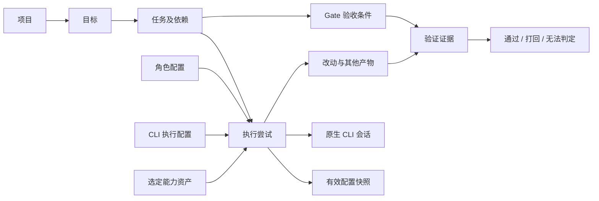
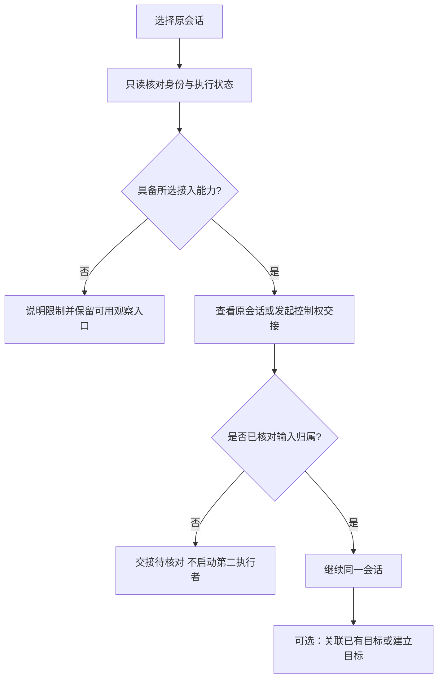
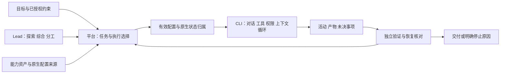

# Windows / WSL Agent 工作台产品设计

版本：V0.3 · 日期：2026-09-30 · 状态：经过首轮原生能力实验修订的可评审草案；完整产品与交互原型尚未实现。

本文把 [需求分析](requirements-analysis.md) 转为可设计界面、可验证流程的产品方案。术语沿用 [领域词汇表](../CONTEXT.md)，选型依据见 [开源研究](open-source-platform-survey.md)。已有需求保持有效；本文新增的页面结构、默认交互和策略均为设计建议，尚未代表用户确认或产品已实现。

V0.2 已纳入每次执行选配能力、多供应商并发、共享/专属能力库和两类插件。V0.3 根据 [原生能力实验](execution-capability-experiments.md) 细化日常入口、配置生效边界、原生后台接续、认证差异、辅助请求与证据等级。两本 Harness 书籍的理解见 [设计依据](harness-and-execution-config.md)，后续顺序见 [实施计划](implementation-plan.md)。具体界面默认值仍为设计建议。

不在本文决定桌面框架、数据库、通信协议或开源底座。当前 `codex-netcap` 作为功能插件的目标保持不变，既有代码和其他工具能力作为复用资产评估。

## 1. 产品定位与完成体验

一个面向个人开发者的 Windows 桌面 Agent 工作台：用户提交开发目标，Lead 组织 Explore、Implementer、Reviewer / Verifier，使用 WSL 中的 Codex CLI 或 Claude Code CLI，持续推进并交付可检查的项目改动。

用户日常主要完成三件事：**交代目标、处理需要自己的决定、检查交付结果**。工作台应减少复制上下文、反复催促、排查失联和整理多个终端的负担。

V0.3 将日常路径收敛为“选项目 → 描述目标 → 确认执行摘要 → 交给 Lead”。角色、供应商和能力默认取自已保存配置，用户可展开调整；不要求每次经过能力库、插件中心和全量设置。首次接入和出现配置差异时才进入详细检查。

理想体验是：打开项目并提出目标，看到 Lead 正在安排什么；离开后回来，能识别哪些任务已验收、哪些需要处理；点击结果即可看到改动与验证证据。切回原终端、关闭界面或重启后，仍能辨认同一项工作及其真实进展。

| 首版必须覆盖 | 首版不承诺 |
|---|---|
| Windows 桌面入口、WSL 项目与两类原生 CLI | 任意规模或无人干预完成所有项目 |
| 新建、实时接入、暂停后恢复，共六类入口 | 关机期间本机继续执行 |
| 四类角色均可选两种 CLI，Profile + Skill + Gate | 跨 CLI 共享同一份原生会话 |
| 多份供应商执行配置并发且会话隔离，每次执行选择 Skill/MCP/CLI 插件 | 配置目录分开就自动隔离所有文件、工具和外部账号 |
| 共享 Skill/MCP 与各 CLI 专属能力管理，展示实际生效内容 | 将能力库全部内容注入每个 Agent |
| Lead 协作、独立验证、打回、人工接手、异常恢复 | 自动发布、自动推送或合并至受保护分支 |
| 至少一个真实 netcap 功能插件及插件管理 | 公开插件市场、多人权限、多机器调度、任意 Windows GUI 自动化 |

“首版必须覆盖”是完整产品验收范围，内部实验可以逐项推进。某个实时入口仍不可行时，应保留未满足状态，不能把它改名为历史恢复后宣布首版完成。

## 2. 设计依据与建议默认值

| 项目 | 本版处理 | 性质 |
|---|---|---|
| 用户与设备 | 一位用户、一台 Windows 机器，开发执行在 WSL | 沿用工作假设 |
| 工作组织 | 以目标为中心，默认与 Lead 沟通，成员会话按需展开 | 设计建议 |
| 角色 | Lead、Explore、Implementer、Reviewer / Verifier；不要求四个常驻进程 | 已确认 |
| CLI | 每类角色和专家 Profile 可选 Codex/Claude | 已确认 |
| CLI 执行配置 | 同一 CLI 可登记多份供应商/原生配置，独立绑定状态与环境并发使用 | 新增已确认需求 |
| 本次能力 | 每次执行选配 Skill、MCP 和对应 CLI 插件，展示继承及实际加载结果 | 新增已确认需求 |
| 能力归属 | 共享 Skill/MCP、Codex 专属、Claude 专属分别管理；软件功能属于平台插件 | 新增已确认需求 |
| CLI 选择策略 | 提供“按 Profile 固定”和“由 Lead 在候选内选择”；默认前者，后者显式启用 | 待确认的设计建议，不授予当前自动切换权限 |
| 配置复用 | 从用户选择的 WSL 环境读取已有 CLI 配置来源，显示实际使用位置 | 沿用需求 |
| 并发 | 提供总运行上限与写任务上限；具体数值在运行配置中明确，不预设用户预算 | 待确认 |
| 插件首片 | 建议 netcap“状态展示 + 显式会话托管”，分步验证 | 待确认的功能范围 |
| 授权交互 | 已授权范围内自动推进；新增范围或额外授权集中在实际决策点 | 已确认的协作偏好 |
| 完成 | 当前产物满足 Gate 后标“已验收”；目标满足全部约定条件后标“已交付” | 沿用需求的界面表达 |

## 3. 核心对象与关系

产品页面使用“目标”“任务”“成员”“会话”“验证”，保留英文术语用于详细信息。底层字段名和进程信息只在环境、接续或诊断时展示。

| 对象 | 用户看到的含义 | 与其他对象的关系 |
|---|---|---|
| 项目 | 一份明确开发目录及对应执行环境 | 包含多个目标，也可包含尚未归入目标的已有会话 |
| Goal／目标 | 一次希望完成的开发结果、范围与验收条件 | Lead 组织其中的 Task；不同目标可先后使用同一项目 |
| Task／任务 | 有明确职责、范围和验收条件的一项工作 | 可有依赖；保留多个 Attempt 及验证结果 |
| Attempt／执行尝试 | 当前或过去一次执行的记录 | 关联实际角色、Backend、工作目录、会话与产物；重连延续原尝试 |
| Session／会话 | 可继续对话的上下文 | 有工作台身份和原生身份；一项任务可以使用多轮，会话不等于任务 |
| Agent Profile／角色配置 | 可复用的职责、工作方法和默认执行设置 | 实例化后才出现运行成员；配置数量不等于并发数量 |
| CLI 执行配置 | 工具、原生配置来源、会话状态归属和供应商路由等默认选择 | 可以被多个角色使用；与角色 Profile 分别编辑 |
| 能力资产 | 有来源、版本、适用工具的 Skill、MCP 定义或 CLI 插件 | 可被多次执行引用；共享定义不等于共享运行连接和认证 |
| 执行配置快照 | 本次计划使用及实际生效的配置和能力记录 | 启动时保留；显式改配产生新版本并记录生效边界 |
| Gate／验收关卡 | 判断任务是否完成的条件 | 每次检查产生针对具体产物的验证证据 |
| 平台功能插件 | 给工作台增加页面、托管等业务能力 | 运行在平台扩展边界；netcap 属于此类 |
| CLI 插件 | 原生工具加载的扩展包，可含 Skill/MCP/hooks 等 | 属于能力资产；按 Codex/Claude 的实际支持分别加载 |



一个目标有一个当前协调入口；Lead 失联可恢复原会话，跨 CLI 更换 Lead 则建立明确交接，保留目标与任务记录。已有外部会话可以先独立接入，再由用户选择归入目标；观察或恢复历史本身不启动团队，也不意味着用户授权了新目标。

## 4. 信息架构

建议采用固定侧栏与目标工作区。侧栏不为每个运行 Agent 增加一级导航，插件也不无限扩展主导航。

```text
工作台
  待我处理 · 进行中 · 最近交付
项目
  项目概览 · 目标 · 已有会话 · 项目设置
    目标工作区
      概览 · 计划 · 团队 · 改动与验证 · 活动
能力库
  角色配置 · 共享 Skill / MCP · Codex 专属 · Claude 专属 · Gates
执行配置
  Codex 配置 · Claude 配置 · 状态归属与兼容检查
平台插件
  已安装 · 添加插件 · 插件详情
设置
  WSL 执行环境 · 运行约束 · 通知 · 诊断
```

全局顶栏提供项目切换、搜索和环境状态入口。“待我处理”既可从首页进入，也可通过顶栏计数打开；两处指向同一批事项。搜索覆盖目标、任务、会话标题及 ID，不默认索引全部源代码或任意历史配置目录。

| 页面 | 用户需要回答的问题 | 主要操作 |
|---|---|---|
| 工作台 | 现在有什么需要我做，哪些工作在推进 | 处理事项、继续查看目标、新建目标 |
| 项目概览 | 这是哪个 WSL 项目，已有工作有哪些 | 新建目标、接续会话、打开目录/终端 |
| 目标工作区 | 离交付还有什么，下一步谁负责 | 补充要求、暂停、接手、查看验证 |
| 任务详情 | 这项工作为什么等待或被打回 | 看范围、依赖、执行尝试和证据 |
| 会话面板 | 正在操作哪个上下文，谁可输入 | 对话、处理原生请求、转回终端 |
| 能力库 | 本次可以选哪些共享或 CLI 专属能力 | 管理来源/版本，编辑 Profile，关联 Skill/MCP/CLI 插件与 Gate |
| 执行配置 | 哪个供应商配置和原生状态用于运行 | 登记/编辑配置、检查实际来源、查看关联会话 |
| 平台插件 | 哪个软件功能在哪里运行、影响什么 | 安装、启用、配置、禁用、更新；不展示原生 CLI 插件开关 |

## 5. 首次使用与项目接入

### 5.1 最短就绪路径

1. 在欢迎页选择已有 WSL 发行版和用户，再选择 Linux 项目目录；列表显示真实路径，避免把 Windows 路径当作 Linux cwd。
2. 检查所选环境中的 Codex/Claude 路径、版本、配置来源与连接能力。对同一 CLI 分别识别普通 CLI、SDK/共享服务、原生后台等实际连接方式；检查不自动安装、升级、登录或更换账号。
3. 展示结果：“可用”“未找到工具”“需要登录”“连接失败”“部分能力未验证”。一个 CLI 未就绪不阻止查看项目或使用另一个已就绪 CLI；依赖缺失能力的启动单独阻止。
4. 登记要用的 CLI 执行配置：Codex 指定所用 CODEX_HOME，Claude 指定 settings 文件及状态归属；保留原有来源，不自动搬迁或覆盖配置。再选择角色配置及运行约束。

已有 Git 状态只作为上下文展示，不自动提交、清理或移动用户改动。项目不是 Git 仓库时也可浏览、探索与单范围执行；需要分支/worktree 的并行策略标为不可用，不能悄悄初始化仓库。

### 5.2 环境摘要

项目页常驻显示“发行版 · 用户 · Linux 目录”，展开后显示 CLI 版本、配置位置与逐项能力。原生 session ID、服务端点和底层错误放入详情，正常派任务无需阅读这些字段。

执行配置名称与 CLI 并列显示，例如“Codex · 供应商 A”，不能只显示 Codex 而隐藏实际配置。多配置可同时显示就绪状态；它们不是切换一个全局供应商开关。两个别名实际指向同一状态目录时显示共享关系，不能宣称会话已隔离。

连接正常只说明控制链路可用；供应商可用性显示最近实际请求结果及时间。若需要发模型请求验证账号可用性，操作名应明确为“发送测试请求”，不能藏在免费的本地检测中。凭据只显示来源与必要的脱敏标识。

原生后台能启动但不能调用模型时，分别显示“会话已连接”和“认证未就绪”。本轮 Claude 普通 `--print` 与后台 supervisor 的合成认证实验存在差异；检查结果应绑定具体连接方式，不从其中一条成功路径推断另一条已就绪。

## 6. 从新目标到交付

### 6.1 新建目标

入口为工作台和项目页的“新建目标”。默认表单显示项目、目标描述、附件，以及采用的执行配置/本次能力摘要；“范围与完成条件”“团队与运行约束”可展开。用户可以用自然语言表达约束，无需先手工拆完任务。

| 内容 | 处理方式 |
|---|---|
| 目标描述 | 必填；标题可从描述生成，启动后可改标题而不改目标正文 |
| 完成条件 | 用户已有条件原样保留；缺失时由 Lead 提炼，区分推导条件和待用户决定事项 |
| 范围与限制 | 支持指定目录、不可修改区域、必须保留行为及明确不做事项 |
| 需求文档 | 启动时保留采用版本；文件后来改变时提示差异，不自动改写在途任务 |
| 团队 | 展示 Lead 的 Profile/CLI 及其他角色的选择规则；默认折叠成员数量 |
| 执行配置 | 角色 Profile 提供默认值；可以明确选择本次 CLI 配置与供应商，其他配置的会话继续运行 |
| 本次能力 | 分别选择 Skill、MCP、CLI 插件，显示共享/专属、默认继承、插件带入和不能关闭的项 |
| 运行约束 | 展示有效并发、时间、可支持的用量约束及继承来源；未知费用不填零 |

主要按钮为“交给 Lead”。它启动已选择的协作策略；不会另附一个“所有计划步骤均需批准”的默认流程。若描述包含尚未授权的外部发布，Lead 先完成可独立准备的工作，在实际发布点呈现具体对象和影响。

### 6.2 理解、分工与推进

Lead 的第一份可见输出包含目标理解、已有事实、必要未知项和当前安排。能通过项目读取解决的问题交给 Explore；缺少会改变范围或公共行为的决定时，生成一张待处理卡。

计划以任务列表为主，依赖关系为可切换视图。每项任务显示职责、负责人、CLI、工作范围、验收条件、依赖及当前状态。Lead 增加或调整任务时保留变化原因，进度计数随计划版本更新；界面不使用模型猜测的“完成百分比”。

每项派发同时记录 CLI 执行配置与能力快照。Lead 在用户给定的选择策略内挑选配置和资源；不能因发现能力库里有某个 MCP/插件就自行获得使用权限。所需资源不在允许范围时，说明缺失能力及受影响任务，继续可独立推进的工作。

任务默认依据已验收的依赖结果启动。工作范围冲突时展示“等待工作区”及占用方，Lead 可改为串行或重新划分。不同工作区的结果汇集也作为明确任务：指定整合者、目标基线与集成 Gate；局部通过不自动代表整体通过。

### 6.3 贯穿示例

以下为设计样例，不是当前要执行的开发任务：用户要求“为现有项目增加按筛选条件导出 CSV，并补齐测试和使用说明”。

| 步骤 | 可见安排 | 可检查结果 |
|---|---|---|
| 理解 | Lead 明确导出字段、权限约束与完成条件 | 目标摘要、必要问题、初始计划 |
| 探索 | Explore 查筛选逻辑、权限入口和测试位置 | 带代码位置的发现，未修改业务文件 |
| 实现 | Lead 按依赖安排 API、界面、文档任务 | 每项有目录和范围；可独立任务才并行 |
| 验证 | Reviewer 检查筛选与权限，发现权限样例未满足 | 一条失败证据和具体打回原因 |
| 修复 | Implementer 修复，Reviewer 复查当前产物 | 新版本验证记录；旧失败仍可回看 |
| 汇集 | 整合各任务结果并运行集成 Gate | 最终候选改动、验证摘要和交付说明 |

## 7. 目标工作区与任务详情

### 7.1 默认布局

建议以 Lead 对话作为概览主区，任务摘要与待处理事项放在右侧。切换到计划或改动页时使用更大的内容区；多个成员完整对话并排是可选查看方式，不作为默认首页。

```text
┌ 项目 / CSV 导出       推进中 · 当前 3 项已验收 / 共 7 项 ────────┐
│ 概览   计划   团队   改动与验证   活动     [暂停] [更多]         │
├─────────────────────────────┬─────────────────────────────────┤
│ 与 Lead 的对话               │ 待我处理                        │
│ 本轮安排、发现和进展          │ 当前没有需要你决定的事项         │
│                             │                                 │
│ Reviewer 打回：权限样例失败   │ 当前任务                        │
│ [查看证据] [查看修复任务]     │ 接口：修复中 · Implementer       │
│                             │ 界面：等待已验收接口             │
│                             │ 文档：待验证                     │
├─────────────────────────────┤                                 │
│ 给 Lead 补充要求…     [发送]  │ 环境、活动及用量摘要             │
└─────────────────────────────┴─────────────────────────────────┘
```

示例中的“3/7”是已验收任务数，不是剩余工时估计；新增任务时显示“计划已调整：新增 1 项”。“当前没有待处理事项”不等于任务无需后续验证。

### 7.2 计划与任务详情

计划页默认按依赖可执行性和工作阶段排列，可按角色/CLI/状态筛选。点击任务打开详情侧栏：目标与范围、依赖、工作目录、采用的 Profile/Skill/Gate、当前 Attempt、产物和历史尝试。

重连不增加 Attempt；明确重新执行失败工作才新建尝试并保留原因。运行中编辑目标范围先产生变更记录，由 Lead 评估对当前任务、工作区与验证的影响；不能把新范围直接覆盖到正在运行的成员提示中而不说明。

### 7.3 团队与成员会话

团队页按职责分组，显示角色、Profile、CLI 执行配置、当前任务、活动和容量占用。能力摘要可展开到具体 Skill/MCP/CLI 插件及生效情况；Codex-A 与 Codex-B 可以同时担任不同成员。没有任务的 Profile 留在能力库；不需要为了填满四个分组而启动四个 Agent。

点击成员打开其会话与任务并列详情。默认用户消息发给 Lead；“直接联系成员”明确收件人，并暂停该任务后续自动派发，记录人工介入供 Lead 汇总。只读旁观不改变控制权。成员级介入不自动暂停无依赖关系的其他任务。

## 8. 已有 CLI 会话接续

项目页提供与“新建目标”并列的“接续已有会话”。先选 CLI 执行配置和 WSL 环境，再列出该状态归属下可发现的会话；支持粘贴原生 ID 或选择该环境中的历史入口。搜索范围由用户选定，不自动唤醒全部历史任务。跨配置汇总时始终保留配置标签，不能仅按原生 ID 合并。

### 8.1 接续面板

每条结果显示标题、项目目录、CLI/执行配置、来源、最近活动、状态更新时间与接入能力。来源区分“独立前台 CLI”“原生后台会话”“平台创建”，详情显示原生连接方式。选中后先只读检查，展示可执行操作及前提。

| 操作 | 用户获得什么 | 未满足前提时 |
|---|---|---|
| 查看历史 | 阅读已保存对话或观察事件 | 标明缺失内容及数据时间，不提供虚假的输入框 |
| 实时观察 | 订阅原执行的后续活动 | 只支持历史则明确标注，不显示为实时 |
| 在工作台接手 | 连接原会话并完成输入权交接 | 无法核对原执行器时保留观察状态，说明原端处理入口 |
| 暂停后恢复 | 原 CLI 已释放执行后恢复同一原生会话 | 原端仍运行或是否释放未知时进入核对，不能直接新开执行器 |

六种入口对 Codex/Claude 分别记录能力。需要预先 wrapper、tmux 或共享服务时在接入前说明；历史恢复能力不补齐实时操作缺口。连接不支持时保留当前上下文，并给出具体前提与可用路径，不在后台自动安装扩展或改变原 CLI 启动方式。

本轮确认 Codex 预共享后台有第二客户端接续路径，Claude 原生 `--bg` 会话有 TTY `attach` 路径。两者仍需平台输入仲裁；独立前台的转换与工具在途交接未验收，不能把这些结果显示成六入口全绿。当前生产 Claude SDK Adapter 的限制与原生后台实验能力分别展示。

后续 [W01/W02 补验](workbench-boundary-results.md) 已跑真实 Codex TUI 串行接续与 Claude 双 supervisor。Claude 独立前台 `/background` 虽保留历史，但转换前后实际模型请求的原生 ID 不同，严格同 ID 条件未通过；界面不能将它冒充原会话恢复。

恢复默认沿用原生状态归属与当时能力配置。若用户在继续前改选 Skill/MCP/CLI 插件，先显示可否原会话生效及需要的操作；不能实现时明确保留原设置。改选供应商或状态目录不是普通恢复，应作为新执行与明确交接处理，不能把 A 的原生 ID 交给 B。

### 8.2 交接与归入目标



归入目标时由 Lead 读取已有事实并提出任务映射，不重复执行原任务。用户只选择“继续会话”时，保持普通会话模式；建立目标和安排团队是另外一个明确操作。

### 8.3 控制权的展示

会话顶部显示“仅观察”“工作台控制”“终端控制”“交接中”或“待核对”。只读观察与输入控制分开；多端可同时看，自动发送遵循唯一的协调归属。

工作台无法阻止用户在外部终端敲键，也不能可靠看到未提交文字。检测到外部已提交输入后，让出后续自动调度并撤销尚未执行的自有消息；已开始的动作保留真实状态。转回终端只打开或提示经过身份核对的同一会话入口，不能偷偷启动另一份独立任务。

接手操作先暂停对应自动化，再核对原执行器、在途轮次/工具和输入归属，最后开放输入框；任一步未确认就停在“交接待核对”。原生 attach 成功只确认连接，不自动取得平台的调度权。原生前台转后台若可能重启工具或子 Agent，先展示具体影响，不用“无缝切换”隐藏它。

## 9. 状态、控制与故障交互

### 9.1 分开表示结果、执行与调度

| 维度 | 用户看到的状态 | 判定依据 |
|---|---|---|
| 目标结果 | 草稿、进行中、已交付、已取消 | 目标条件与最终验证；模型最后一条消息不决定完成 |
| 任务结果 | 待安排、待执行、执行中、待验证、验证中、需修复、已验收、已取消 | 工作与验证记录 |
| 执行活动 | 运行中、空闲、等待审批、等待回答、已退出、未知 | 当前原生执行证据 |
| 调度 | 自动推进、暂停中、已暂停后续执行、人工接手 | 实际生效的调度控制 |
| 异常原因 | 等待依赖、等待工作区、工具不可用、达到约束、失败待处理、恢复核对中 | 可定位原因及关联对象 |

异常原因作为任务/目标的解释，不覆盖原有结果。无法验证保持未验收；任务没有自动重试路径时显示“失败待处理”。目标汇总优先展示需要人处理或状态未知的原因，并保留其他仍在进行的工作。

### 9.2 控制按钮的准确语义

| 操作 | 作用范围与结果 | 必须显示的边界 |
|---|---|---|
| 暂停后续执行 | 对所选目标或任务禁止新派发与自动续行，保留当前轮次 | “后续已暂停；1 个执行仍在运行”；原生续行尚未停住则显示“暂停中” |
| 停止当前执行 | 对指定原生执行请求中止，收到结果前显示“停止中” | 不撤销已经写出的文件；不把发出请求当停止成功 |
| 由我接手 | 暂停对应范围自动化并完成输入权交接 | 未决操作仍需核对；其他用户/终端输入不得丢失 |
| 恢复自动推进 | 重新核对当前状态、范围与约束后允许调度 | 不解除用户取消，不自动重做已验收任务 |
| 取消目标/任务 | 停止后续调度，对自有在途执行请求停止并核对 | 有执行尚未停止时显示“取消中”；保留产物和历史 |
| 重试任务 | 在明确可重做时创建新 Attempt | 未知是否已执行时先核对，不提供盲目重试 |
| 归档 | 从默认列表移走已经结束的工作 | 不停止活跃执行、不删除历史或修改产物 |

目标级操作影响所有归属任务；单任务操作仅影响该任务及等待它的依赖。继续运行的工具可能产生输出，界面持续展示。发生无法控制的外部执行时，应说明原端仍在运行而非显示“已取消”；清理工作区始终是独立操作。

### 9.3 恢复与失败面板

恢复中保留最后已知状态和时间，禁用会产生重复副作用的按钮。自动核对能确定原执行存活就重连；能确定已完成就恢复结果；证据不足则显示“需要核对”，不一律回到 Idle。

用户暂停、人工接手、插件禁用和已到达的运行约束在重启后仍然有效；自动重连只恢复观察与核对，不自行解除这些条件。对于正在自动推进、且原执行已被完整核对的工作，才恢复原先已授权的调度。

| 场景 | 提示重点 | 下一步 |
|---|---|---|
| 网络或控制连接断开 | 最后收到活动的时间；原执行可能仍在运行 | 自动重连并核对，允许查看已有记录 |
| 发送后回执丢失 | 消息是否被执行尚未确定 | 核对原消息/轮次，暂不重复发送 |
| CLI/配置发生变化 | 哪个版本或配置来源发生变化 | 查看差异、重新检查，保留原会话 |
| 达到调用或用量限制 | 已知限制及可用恢复条件 | 等待或由用户调整明确约束，不暗中换账号 |
| 工作区出现外部改动 | 改动范围、当前任务和受影响验证 | Lead 重新评估整合，保留外部改动 |
| 原生历史无法恢复 | 无法保留的上下文与现有产物 | 保留失败记录；如需新会话，作为明确的新操作 |

关闭窗口建议保持后台执行，并在首次关闭时清楚说明，可在设置中更改；它不改变既有授权。退出整个工作台与关闭窗口分开：退出前展示运行项，说明哪些能独立继续，哪些将中断。休眠/重启后进入核对，不承诺关机期间工作继续。

### 9.4 待回答与待审批

需要用户决定的事项显示在目标概览和统一待处理列表中。问题卡写明缺少的决定、影响的任务以及可继续的独立工作，支持建议选项与自由文本；没有收到回答不等于同意，等待本身不触发自动选择。

原生审批保留工具提供的操作对象、权限范围和有效选项，不自行发明“永久允许”等能力。提交答案时显示处理中，只有原端确认后才结束等待；原终端已经处理的卡片同步失效，不能再次提交。断连期间保留问题但暂停提交；工作台没有该能力时提供原终端处理入口。审批等待不因普通空闲超时被当成故障重试。

## 10. 改动、验证与交付

“改动与验证”页左侧按任务列出文件、文档及其他产物，主区展示 diff/预览，右侧显示对应 Gate。非 Git 项目或无法生成 diff 的产物明确说明可检查方式，不伪造版本对比。

验证卡至少包含：验收条件、被检查的产物版本或可核对标识、检查者、实际操作/命令、完成时间、结果和限制。测试通过、审查通过、未执行、执行失败、无法判定分别展示；条件不适用必须有理由，不能悄悄算通过。

Reviewer 打回时给出发现、证据、影响和建议修复范围，Lead 决定如何分派修复。Reviewer 不承担该项主实现；同一个 CLI 可承担不同角色，但不能让实现者在自己的原会话中自我批准。编译和测试产生约定范围内的缓存/产物不视为承担主实现。

修改发生后，旧证据继续保留，但不再直接批准当前产物；可以证明未受影响的 Gate 才沿用，并记录依据，否则重新检查。最后一个任务通过后仍需核对目标条件和整合结果。

“已交付”需要：目标范围内任务及整合 Gate 满足、必要证据有效、没有未说明的阻塞或仍可能改变交付产物的执行。交付页包含完成项、最终改动、验证摘要、已知限制和未纳入事项；不将推送、合并、发布作为交付按钮的隐藏副作用。

用户可以对交付继续评论。若要求新工作或产物变化使原条件失效，目标重新进入进行中并保留上一版交付记录；单纯阅读和讨论不改变验收状态。

## 11. 执行配置、能力库与每次执行选配

### 11.1 三个互相独立的选择

用户先明确“承担什么角色”，再选择“用哪份 CLI 执行配置”，最后决定“这次启用哪些能力”。角色 Profile 提供可复用默认值，但不把供应商或能力永久锁在角色名称中。

| 选择 | 示例 | 改变什么 |
|---|---|---|
| 角色配置 | Explore / 前端探索者 | 职责、工作指引、默认能力与 Gate |
| CLI 执行配置 | Codex / 供应商 A；Claude / 供应商 B | 原生配置来源、状态归属、模型/认证等默认选择 |
| 本次能力 | 共享代码导航 Skill + 文档 MCP + 对应 CLI 插件 | 本次提供的方法、工具和扩展；不自动增加权限 |

例如 `test-author`、`doc-syncer` 属于 Implementer，`frontend-verifier` 属于 Reviewer，均能选择 Codex 或 Claude 的执行配置；`data-calibrator` 依据本次是检查还是修正明确归入角色。模板更新不自动改写正在运行的成员。

### 11.2 CLI 执行配置页面

列表按 Codex/Claude 分组，每份显示名称、供应商标签、状态目录、关联会话数、最近检查结果；多个配置可同时使用。操作包括登记现有配置、复制配置定义、检查兼容性、查看关联会话与停用新派发。复制定义不复制凭据和历史；停用配置不杀死已有执行或删除状态目录。

详情分别记录：WSL 发行版/用户、CLI 路径/版本、原生配置文件、状态归属、供应商及模型默认值、凭据引用、继承来源、默认能力和运行约束。敏感值由现有凭据机制处理，页面和导出文件不保存明文。

高级详情还记录原生运行方式及控制服务的归属，例如 Codex 共享后台、Claude SDK 进程或原生 supervisor。它们属于同一 Backend 的不同连接方式。能力检查、认证检查、重连与清理都绑定实际执行器，不能以 CLI 名称或单个 PID 作为永久会话身份。

Codex 使用用户选择的 CODEX_HOME 及其原生配置层；Claude 使用用户选择的 settings 文件，并明确对应的配置/状态目录及进程环境。`--settings` 不会自动隔离 Claude 历史，独立状态可通过目标版本支持的 `CLAUDE_CONFIG_DIR` 等机制实现并验收。正式适配不假定只读取这一份文件，官方事实见补充设计依据。

会话身份绑定执行环境、原生状态命名空间与原生 ID。不同名字指向同一目录、符号链接或共享服务时提示真实共享关系；不能仅为界面分组复制一个“独立实例”标签。供应商或状态归属变更不覆盖旧会话绑定，后续新执行使用新版本。

并发执行各有自己的环境和设置组合，不交替改全局环境或同一个配置文件。状态隔离不代替工作区与权限隔离；如果能力适配需要额外运行目录，必须展示实际目录与原配置的关系，不能靠隐藏的新 home 破坏会话恢复。

### 11.3 能力资产库

| 分区 | 管理内容 | 适用范围 |
|---|---|---|
| 共享能力 | 共享 Skill、MCP 定义 | 可供两类 CLI 引用，分别检查脚本、工具名、路径、传输等兼容性 |
| Codex 专属 | Codex Skill、Codex CLI 插件 | 由 Codex 适配器加载，展示原生来源与版本 |
| Claude 专属 | Claude Skill、Claude CLI 插件 | 由 Claude 适配器加载，展示原生来源与版本 |
| 角色配置 | Role、默认执行配置、能力组合与 Gate | 提供复用模板，实例运行后保留采用版本 |
| Gates | 验收要求与证据规则 | 独立于 Skill/插件是否被安装或调用 |

资产卡显示来源、版本/内容标识、适用 CLI、平台管理或外部管理、兼容状态和引用关系。支持导入/登记、编辑、停用新绑定、更新、查看使用位置；已有目录默认登记为外部管理，不自动搬迁。编辑外部资产会影响哪些原生执行，应先显示实际作用范围。

共享 Skill 保存一份受管理定义，向不同 CLI 提供经过验证的适配版本；其脚本、文件引用和运行前提一起检查。相同显示名不合并身份，使用“来源 + 名称 + 版本”区分；Codex 和 Claude 对同名内容的处理分别尊重原生规则。

共享 MCP 管理连接定义和可复用参数。每次执行另绑定 cwd、凭据引用、工具范围和连接生命周期；默认不复用带认证或可变状态的实例。只有满足明确且验证过的条件才共享服务实例。MCP 可标必要或可选：必要项不可用就不启动依赖任务，可选项降级时显示受影响能力和 Gate。

CLI 插件详情展开包含的 Skill、MCP、hooks、子 Agent 或其他组件，标明它们如何生效。插件整体带入的不可拆组件不能显示成独立可取消开关；其原生子 Agent 也不能成为绕过平台并发、工作区或角色约束的隐藏执行，缺少观测/控制能力时明确限制。

资产共享不意味着会话共享，也不意味着所有会话自动安装全部资产。删除或更新库中条目不删除原生会话；仍被执行引用的版本保留，或明确标出不能再恢复的缺失条件。

### 11.4 本次执行配置面板

新建普通会话、交给 Lead、派发成员任务和继续原会话使用同一种面板。自动派发可沿用已配置策略，用户随时能查看采用结果；不是要求每一次派发都手工勾选。

默认只展示“角色 · CLI 配置 · 能力摘要 · 有效约束”。用户点击“调整本次执行”再展开逐项选择；“来源与差异”继续展开到继承、原生强制项和未验证项。保存角色模板、保存执行配置和应用本次选择是三个明确动作，不顺带修改彼此。

```text
角色：Implementer / 接口开发
CLI 执行配置：Codex / 供应商 A       [查看状态归属]
本次能力
  Skills       共享 2 项 · Codex 专属 1 项       [选择]
  MCP          文档查询 · 项目只读数据           [选择]
  CLI 插件     Codex 项目工具包 v1              [选择]
  Gate         行为测试 · 独立审查               [查看]
有效配置
  本次选择 · Profile 默认 · 项目继承 · 插件带入 · 原生强制项
  [查看差异与不支持项]
```

每个资产显示“采用默认 / 本次启用 / 本次禁用”及来源；受管或不可分组件展示实际限制，不提供失效的开关。额外列出 native/user/project 自动发现内容。用户明确排除的可选能力必须核对确实未暴露；无法保证时指出具体项目并阻止以“严格选配已生效”启动该组合，不能静默回到全量继承。

“禁用”指不再由该 CLI 的能力发现/加载机制提供对应资产，不承诺抹去历史中已经读到的内容，也不代替文件访问权限。原生内置能力独立显示；本轮 Claude 在测试资源全部排除后仍有内置 Skill，不能用空的库选择计数表示运行中没有能力。

配置组合先表达用户的选择意图，再由对应 CLI 适配器解析实际原生优先级。更高层权限与管理策略不会被本次勾选覆盖；不能统一写成“执行设置永远覆盖全部”，也不能通过清空 AGENTS.md/CLAUDE.md 来模拟资源隔离。

启动前预览变化，启动后展示“已计划、可发现、已加载、已使用、失败/未验证”。这些状态可按资源类型细分，不能用一个绿点混淆安装与使用。Skill 默认按需读取，选中不等于必须已经调用；需要验证其工作方法生效时通过对应 Gate 取得证据。

### 11.5 快照、变更与恢复

“每次执行”在用户界面指一次新建或派发时的运行选择；它可持续多轮。每条消息、每次断线重连都不自动生成新的 Attempt。续聊前显式改配是该执行的新配置版本，切换 Backend/供应商/状态归属则另建尝试并交接。

| 发生时机 | V0.3 的处理 | 核对依据 |
|---|---|---|
| 尚未启动 | 可修改本次选择；启动后保存首份快照 | 原生初始化、能力清单与配置来源 |
| 普通重连 | 沿用原绑定；外部漂移另行提示 | 原会话身份、快照和当前加载结果 |
| 轮次已结束，显式改配 | 预览差异与上下文影响；原生支持时从下一轮生效 | 保留原 ID、旧历史和前后快照；Claude 有本轮有限正例 |
| 仍有轮次/工具在途 | 保存为待应用选择，继续按旧快照解释当前动作 | 不显示“已生效”；经目标版本验证可热变更的能力另列 |
| 变更需重启或原生不支持 | 展示影响并保留原会话；用户选择明确操作 | 不能静默开新会话，也不能把重启成功当作旧工作已完成 |
| 外部文件/账号发生热更新 | 显示配置漂移，重新核对受影响行为与 Gate | 保存哈希不等于原生运行内容已经冻结 |

启动时保存不可变配置快照：角色/Profile 版本、CLI/执行配置版本、状态归属、实际配置来源、路由/凭据引用、能力版本与组件来源、权限和 Gate；执行后追加实际生效证据，不把明文密钥或完整用户环境写入快照。

普通重连沿用原快照。用户在续聊/恢复前显式改配时，先说明当前 CLI 能否在原会话中生效、何时生效、是否需要空闲或重启；可行时创建新快照版本并关联后续轮次，不覆盖历史。切换 Backend/供应商/状态归属走新的执行尝试和明确交接，不冒充恢复原会话。

共享资产更新不静默改写在途执行，优先固定所用资源版本。已有 CLI 若会监测外部文件或同步账号能力，记录这一来源；发现变化时标记“配置已变化”，重新核对受影响动作和验证，不能仅因保存了一个哈希就宣称运行内容已冻结。

能力不足时提供“保留原配置继续”或明确的新会话方案，但不能自行选择。额外试运行须显示具体执行配置、目录和能力；保存模板本身不启动 CLI 或产生模型调用。

## 12. 平台插件中心与 netcap 功能设计

### 12.1 平台功能插件管理

本页只管理软件本身的功能扩展；CLI 插件位于能力库和本次执行面板。两类插件均可包含代码或工具，但宿主与生命周期不同：前者扩展平台，后者由原生 CLI 加载。平台插件若还交付一个 CLI 插件，两份组件分别声明与启用，不能一次启用就隐式修改所有 CLI。

首版支持从明确的本地包或已配置来源添加插件，不要求公开市场。详情显示名称、版本、来源、兼容范围、所需能力、提供的入口和关联运行项；安装与启用分开，安装完成不自动托管全部会话。

插件状态为“已安装未启用、启用中、已启用、停用中、已停用、不兼容、加载失败”。更新失败保留原状态与错误；只有具备经过验证的数据兼容路径才能承诺回退，不把重新装旧包当作万能恢复。

启用后的业务入口位于项目工具区或插件详情，由贡献能力决定；不为每个 Skill 增加导航页。禁用时先停止该插件的新动作，撤销未执行的自有请求，核对在途操作并保留记录；若有无法脱离插件继续的工作，显示具体影响和可选处理，不无声停止其他角色。

卸载先完成停用和在途核对，再移除插件代码；业务数据默认保留。永久清理数据单独列出对象和影响，不能作为卸载的隐藏副作用。

### 12.2 netcap 的建议首个纵向功能

功能名暂称“会话托管”，名称与范围均待确认。项目内提供一个面板：所选会话、托管状态、最近动作及结果、停止原因、下一步条件；供应商健康与会话活动分开显示。

建议分三片：先读取平台的真实状态；再对一个显式选择的测试会话启用托管；最后验证人工接手、重启和禁用。托管开关初始关闭；展示预定发送策略及可能产生模型调用的影响后，用户对选定范围启用。

| 能力 | 建议归属 | 插件如何参与 |
|---|---|---|
| 原生会话身份、连接、输入控制、未决请求 | 平台公共会话能力 | 读取状态，向平台提交动作请求 |
| 目标、任务、Gate 和是否可以自动推进 | 平台协作能力 | 遵循当前调度策略，不自建第二套完成判据 |
| 空闲托管策略、启用范围、业务设置 | netcap 插件 | 决定何时提出托管动作，记录策略原因 |
| 具体发送、去重、核对、人工让路 | 平台公共执行入口 | 插件携带自己的动作来源，平台核对后执行 |
| 业务页面与托管结果 | netcap 插件贡献 | 复用平台对象链接和通知，不复制整套会话列表 |

这是一份职责建议，具体接口需要对照候选底座验证。平台正在执行原生自动续行或已安排后续任务时，插件不另发“继续”。会话保活、路由探测和 Goal 推进是不同策略，不在首片里混成一个“自动运行”按钮；既有功能的消息内容与策略不由本文自动修改。

## 13. 通知、容量与用量

可观测用量包括主任务及原生辅助调用，不按“用户发送次数”计算总请求数。本轮 Claude 后台单主请求还产生标题/状态/标签辅助请求；页面可折叠这些明细，但预算不能遗漏。不能可靠观测的调用标未知。原生 supervisor、插件子 Agent 或内置调度可能产生额外工作时，必须明确平台能控制到哪一层。

工作台首页按“待我处理、进行中、最近交付”组织。待处理卡显示问题、影响范围、已有证据、建议下一步和对应操作；它链接到原任务，不创建另一条无人同步的消息线。

| 事件 | 建议呈现 |
|---|---|
| 需要用户决定、原生审批或无法核对 | 站内待处理；按设置触发桌面提醒 |
| Reviewer 打回且 Lead 可安排修复 | 目标活动与状态更新，不默认打扰用户 |
| 一轮结束或成员空闲 | 普通活动，不当作目标完成通知 |
| 目标交付或停止且确需关注 | 汇总通知，链接交付页/停止原因 |
| 网络恢复 | 更新原故障，不重复补发已处理问题 |

通知设置控制提醒方式，不自动回答审批；多个来源描述同一事项应合并处理状态。默认不把对话正文或凭据放入系统通知，外部消息渠道不在本首版必需范围。

运行配置显示并发上限、当前运行数、等待原因及所选约束。等待用户、失联待核对与真正运行分别计数；已失联但可能仍写入的执行保留工作区占用，不能因为回收显示上的槽位便在同处派发另一个写任务。

费用与用量按实际可观测来源显示，包含时间范围和未知部分。无法可靠计费时显示“费用未知”，不承诺精确硬上限；可实现的时间/并发/原生用量限制分别说明。到达约束先停止新派发并显示在途工作，不能保证已经开始的调用立刻停止计费。

## 14. 视觉与可用性方向

建议采用安静、信息清晰的开发工具风格：浅中性色背景、清楚的正文对比、单一强调色；状态同时有文字和图标。现有 netcap 的米白/石墨/绿色可作为原型起点，最终样式服从选定平台，不要求移植旧三栏布局。

主要视觉优先级是：需要用户处理的事项 → 当前工作与下一步 → 验证结果 → 技术详情。长日志和原生 ID 默认折叠；错误摘要写清影响及下一步，完整信息可展开并脱敏复制。

建议以 1440×900 的 Windows 桌面为首个设计画布，兼顾缩放和较窄窗口；宽度不足时右侧详情进入抽屉，保留任务主体与主要操作。支持完整键盘导航、可见焦点和文本缩放；中文标题允许换行，不截断唯一能辨认任务的部分。颜色、动画或“在线绿点”不能成为唯一状态依据。

首个交互原型建议覆盖工作台、目标工作区、接续面板、改动与验证、执行配置、能力库、平台插件详情七个页面/面板，并共用本次执行配置面板；本轮仅定义结构和行为，未交付可点击原型或最终视觉稿。

## 15. 产品验收与需求映射

| 编号 | 验收场景 | 可观察的通过条件 | 对应需求 |
|---|---|---|---|
| P01 | Windows 选择 WSL 项目 | 发行版、用户、目录、CLI 和配置来源一致；不可用原因可定位 | R01、R02、R12、R16 |
| P02 | Codex/Claude 各自新建、实时接入、暂停恢复 | 六项分别通过；已有独立 CLI 与预托管样本分别记录；不新建第二执行者 | R02b、R17 |
| P03 | 四类角色分别选择两种 CLI | 八种组合实际运行，职责、Skill 和 Gate 生效 | R05、R14、R15 |
| P04 | 提交跨模块目标 | Lead 根据真实发现分工，依赖与范围可回看，交付条件清晰 | R03、R04、R05 |
| P05 | Reviewer 打回并修复 | 失败证据保留，新产物重新验证；集成结果也有证据 | R09、R19 |
| P06 | 断连、重启、丢回执 | 核对同一 Attempt 和原执行；不盲重试、不丢未提交成果 | R06、R18 |
| P07 | 暂停、接手、取消、返回终端 | 后续调度和当前执行分开显示，原输入不丢失，取消不自动复活 | R07、R17 |
| P08 | 插件安装、启用、禁用与失败 | 一个真实 netcap 功能贯通；状态可见、无双重调度、数据保留 | R11、R13、R20 |
| P09 | 达到约束及通知去重 | 停止原因真实，未知用量明确；轮次结束不冒充交付，不重复打扰 | R08、R10 |
| P10 | 关闭窗口后返回并检查交付 | 能识别原目标及状态，打开改动和有效证据；窄窗口/键盘仍可操作 | R06、R09、R12 |
| P11 | Codex A/B 与 Claude A/B 同时运行及重启 | 各自配置、路由、会话和控制端点正确；同名/同 ID 不串用 | R21、R25 |
| P12 | 同一角色两次选择不同 Skill/MCP/CLI 插件 | 明确选择与实际加载相符；继承/隐含资源可见，排除不失效 | R22、R25 |
| P13 | 共享能力用于不同 CLI 和供应商 | 定义可复用；脚本/工具兼容经过验证，MCP 认证/状态不串用 | R23 |
| P14 | 分别启停两类插件 | 宿主、影响及关联组件明确，不意外改变另一类插件或删除会话 | R24、R20 |
| P15 | 更新资产、原生热更新、带旧配置恢复 | 保留旧快照或准确报告漂移，显式变更有版本与生效边界 | R25、R19 |
| P16 | 大资产库、上下文压缩、MCP/hook 失败及交接 | 按需加载，关键约束可恢复，原生重试与平台调度不重复，Gate 独立有效 | R26 |

成功指标优先记录一次真实目标中的人工催促/复制上下文次数、重复执行与覆盖事件、恢复是否完整、Gate 通过情况和可观测耗时/用量。没有基线前不填“提效倍数”或任意成功率；P02/P06 中出现重复执行，不能用其他高分抵消。

## 16. Harness 设计约束

两本书在本产品中的落点是明确责任：平台管理目标/任务、配置与能力来源、控制归属和交付判据；Codex/Claude 负责其原生对话循环、模型调用、工具执行和上下文恢复。Lead 负责判断与综合，不能用一条“已完成”覆盖实际状态；平台插件与 CLI 插件各自服从所属宿主。



| 约束 | 产品如何体现 |
|---|---|
| 来源与作用域可解释 | 配置预览说明哪份原生文件、角色指引、Skill、MCP 或插件使行为生效；冲突有来源 |
| 能力和权限分开 | 可用资产不自动授权；实际工具动作服从用户授权及 CLI 有效权限 |
| 上下文分层且有预算 | 稳定项目规则、目标快照、当前任务、临时输出与持久记忆分开；大输出保留引用，不全量灌入 Lead |
| Skill 按需加载 | 先提供必要目录信息，再读取相关正文；已加载内容避免机械重复注入 |
| 保留继续工作的语义 | 压缩/恢复/交接后仍能核对当前目标、有效约束、执行配置、能力与证据，不要求重放全部聊天 |
| 恢复有界且单一协调 | 原生 CLI 正在处理重试/压缩时平台不再派发同一动作；失败次数、原因和停止出口可见 |
| 多 Agent 分离责任 | 子任务范围、配置和交接明确；Lead 综合发现后安排下一步，Reviewer 独立核对产物 |
| 生命周期完整 | 启动、等待、中断、结果未知、结束与清理分别说明；关闭窗口不等于取消全部 Agent |
| 改动和事实优先 | 已保存说明与现实冲突时重新核对；调用“验证 Skill”不等于 Gate 已通过 |

首期先证明少量共享/专属能力与多配置执行可控，再增加资源数量。无需照搬书中的固定阈值、企业治理流程或实现全部原生 hook 接口；缺少可靠观测的部分明确标为未验证。详细书籍章节与官方事实见补充设计依据。

## 17. 下一阶段与待决事项

已完成 [首批原生能力实验](execution-capability-experiments.md)、[新旧路线对齐](implementation-plan.md)、[功能盘点](netcap-feature-ownership.md) 与首轮 [W01/W02 边界补验](workbench-boundary-results.md)。[W03 核心流程原型](workbench-prototype.html) 已可运行并完成浏览器走查。W01/W02 继续补严格接续、控制权和能力绑定；随后按相同验收比较 Aion 与 AO 路线，完成真实 netcap 插件纵切后再形成平台实现决定。没有候选因 CLI 实验自动通过底座验收。

当前原型覆盖五条可操作路径：首次配置接入、带默认摘要交目标、Reviewer 打回修复、已有会话接手、恢复前配置差异。使用模拟数据时持续标明，不做全部能力均可用的假象。[走查记录](workbench-prototype-notes.md) 包含正常与失败路径；用户试用反馈仍待收集。

| 决定 | 本版建议 | 何时需要决定 |
|---|---|---|
| Backend 选择 | 固定 Profile 为默认，Lead 候选选择为显式可选模式 | 运行配置和派发交互定稿前 |
| 并发与费用 | 配置实际可承受的上限，区分可执行硬约束和仅可观测指标 | 启动真实协作实验前 |
| 首个真实目标 | 选择有多个模块、真实测试和可检查产物的现有任务 | 产品闭环验收前 |
| netcap 插件范围 | 状态展示 + 单会话显式托管 | 插件纵向实现前 |
| 配置与资产管理方式 | 保留外部配置归属；平台管理的资源版本固定，外部变化显式核对 | 执行配置/能力库交互定稿前 |
| 严格已有 CLI 接入 | 维持已确认要求；实验失败后呈现具体限制与替代方案 | 协议实验形成证据后，由用户决定是否调整 |
| 开源底座 | 对照 AionUi/Core、AO；CAO 作执行实验参考 | 关键入口与扩展验证后 |

完整首版仍按第 15 节 P01–P16 验收。W01–W07 是内部切片，不缩减首版硬要求。当前已交付产品 V0.3、实验记录、实施计划与可运行模拟原型；新增生产功能和完整六入口尚未完成，旧 T00–T15 的证据和范围按新计划保留映射。
