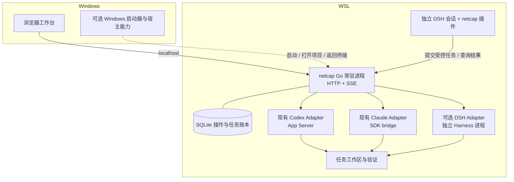

# Windows + WSL 多 CLI 长程编排：源码拆解与改造建议

研究日期：2026-09-29。本文回应 `research.md` 中的目标，并结合当前 `codex-netcap` 的实现重新判断选型。

**2026-09-30 需求更新：** 用户明确要求可通过插件扩展的 Windows 桌面工作台，当前项目应作为其中一个功能插件；协作采用 Lead、Explore、Implementer、Reviewer / Verifier 四类角色，所有角色和专家 Profile 都可选 Codex/Claude CLI，专家能力按 Profile + Skill + Gate 组合。首期还需要新建、实时接入已有终端任务、暂停后恢复原会话。下文“netcap 作为平台核心”是此前的技术候选，不是已确定路线；后续选型以 [最新需求分析](requirements-analysis.md) 为依据。

**以下为前一轮历史提案：** 保留当前 Go 控制台作为持久执行核心，Windows 提供界面、WSL 运行控制台与 CLI。该默认定位已被后续“当前项目作为功能插件”的需求修正；最新候选、维护状态和适配缺口见 [开源项目深度筛选](open-source-platform-survey.md)。当前项目已有的会话恢复、审批和操作账本仍可作为复用资产评估。

这是源码研究和工程提案，未安装三套产品、未启动模型任务、未改现有运行配置或实施计划。文中的“已验证”限于取回文档和检查源码；Windows/WSL 联调及跨产品兼容性仍须实验验收。

## 1. 先把目标变成可验收的行为

用户从 Windows 打开工作台，选中 WSL 里的项目和已有 Codex/Claude 配置，提交任务；可以查看进度、处理审批、回到终端。关闭网页后任务继续；控制台或 Windows 重启后，能核对原任务并继续处理未完成部分。不同 Agent 可以分工，代码修改有隔离和最终验收。

这里至少有三种不同能力，不能互相代替：

| 能力 | 实际含义 | 建议负责方 |
|---|---|---|
| 远程工作区 | Windows 找到正确的 WSL 发行版、用户、项目和运行环境 | Windows 启动器；先用浏览器访问 |
| 会话执行 | 原生会话、流式事件、审批、中止、历史恢复、CLI 子进程 | 当前 Runtime Adapter；DSH 管自己的会话 |
| 长程编排 | Task/Attempt、依赖、工作区占用、重试、预算、验证及恢复 | 唯一的持久任务控制方，建议为 netcap |

“可以从 Windows 操作 WSL”和“系统已经能可靠执行两天的大项目”是分别验收的两件事。

## 2. Harness Books 中值得采用的思想

阅读了两本书的目录，以及恢复、多 Agent 验证、十项原则、如何选择/构建和源码映射章节。它们是第三方的设计分析；其中对 Claude/Codex 内部实现的描述不作为当前公共接口保证，接口事实另查官方资料和实际源码。[B1–B5]

对这个项目最有价值的是以下五点：

1. **模型负责提出行动，运行系统负责控制行动。** 模型可以建议拆任务、选择专家、解释失败；可执行的状态转换、占用、审批和完成条件由程序管理。
2. **恢复路径属于主流程。** 网络断开、响应丢失、进程退出、上下文压缩失败都需要明确状态；“再发一遍”只能用于已确认未发送或允许重做的操作。
3. **按生命周期组织上下文。** 项目规则、任务快照、当前 Attempt 的证据和临时对话分别保存。跨 Codex/Claude 交接传递目标、基线、改动、验证结果及剩余问题，不假设两家能交换完整原生上下文。
4. **验证要产生独立证据。** 实现者报告完成后，运行针对当前产物的检查；审查意见和测试结果与具体 commit/diff 绑定。Reviewer 可以是单独一次调用，不需要常驻模型进程。
5. **多 Agent 适合分离工作责任。** 先串行验证，再对确实独立的任务增加并发。专家 Profile 的数量不决定运行进程数；“4 个角色”“11 个 Agent”都不是可靠性的必要条件。

现有 `Application` 已实现“持久化意图后再执行”和重启后的 `uncertain/reconciling`。这些机制符合上述方向，接入新 Harness 时应保留。[L1]

## 3. 原研究中需要补充的事实

| 原判断 | 本次核查 | 对选型的影响 |
|---|---|---|
| DSH 有真实 Codex/Claude backend | 有，但这两个 provider 是一次性、无人交互委派；使用包内固定的原生 payload，不回退到宿主机 CLI | 不能据此承诺直接管理你已安装的 CLI 或接续原会话 [D2–D3] |
| DSH backend 可用于长程多 Agent | Codex 每次创建新 app-server、ephemeral thread 和一个 turn；Claude 接收一次独立 query。结果主要是最终回答，缺少人机审批/续聊的完整控制接口 | 可以作为子任务执行者；不足以替换当前会话管理 [D2–D3] |
| 有 Agent Teams，所以 Codex/Claude 能直接成为队友 | Teams 调用 `startContinuable()`；上述一次性 provider 声明 `NO_START_CAPABILITIES` | 一次性子代理与可续行 teammate 不是同一能力 [D4] |
| 加上 worktree 即可补齐 DSH Teams | Teams 明确采用单进程、共享 cwd/checkout；`writeScopes` 仅提示。Codex/Claude provider 的 cwd 也取父 Session | 不只是额外创建几个目录，还需改变调用/工作区契约或在隔离的父运行实例里执行 [D2–D4] |
| DSH SDK 可接入统一控制台 | 有独立进程的 stdio JSON-RPC、Session、事件和持续调用；当前没有逐轮 cancel/session-close，也没有实际服务端审批请求 | 可做受限 Adapter；不能把交互审批、中止和恢复一律标为支持 [D5] |
| ZCode 的 Web/UI 可以直接 fork 接过来 | `web` 依赖 client/shared/ui，`ui` 继续依赖 provider/rpc/services/shared | 整体搬运会带入大量既有契约；优先借交互和低耦合实现 [Z1] |
| CAO 提供隔离 Agent | 默认隔离的是终端；工作目录隔离需显式启用 `use_worktree` | 终端隔离、会话隔离和文件隔离必须分别说明 [C1–C2] |
| SQLite 保存 unfinished tasks 就能恢复 | 数据库不能证明外部 CLI 的请求是否执行、工具是否仍在运行、产物是否完整 | 恢复必须核对原生身份、进程、工作区与未决操作，不能直接重新派发 [L1] |

DSH 的 README 将项目标为 developer preview，并明确存在不兼容更新。因此研究以固定源码快照为依据，接入时还需锁定实际包版本。[D1]

## 4. DeepSeek Harness：适合复用运行能力与插件体系

源码快照：`639ed015397290b3745d163aafe02ffee4aa3f84`。许可：MIT。[D1]

以下是与本任务有关的真实目录，省略测试、翻译和其他功能包：

```text
deepseek-harness/
├── apps/
│   ├── cli/                          # dsh 启动入口
│   └── web/                          # Web 应用相关资源与验证
├── packages/
│   ├── boot/plugin-manager/          # Profile 内插件管理
│   ├── bundle/
│   │   ├── base/                     # 公共运行组合
│   │   ├── web-app/                  # Web 组合
│   │   └── sdk-app/                  # SDK JSON-RPC 组合
│   ├── core/
│   │   ├── agent-loop/               # 输入、模型、工具、停止的主循环
│   │   ├── agent/
│   │   ├── session/
│   │   └── tools/
│   ├── session/session-persistence-jsonl/
│   ├── sdk/{protocol,client,server}/  # 外部进程控制入口
│   ├── subagent/
│   │   ├── subagent/                 # provider 注册和委派契约
│   │   ├── subagent-codex/           # 原生 Codex 一次性委派
│   │   ├── subagent-claude-code/     # 原生 Claude 一次性委派
│   │   ├── subagent-dsh-sdk/
│   │   └── tool-subagent/            # 暴露给模型的工具
│   ├── experimental/
│   │   ├── agent-team/               # roster、mailbox、task board
│   │   ├── tool-agent-team/
│   │   └── client-ui-agent-team/
│   ├── host/webserver/
│   └── client/web/
└── docs/{architecture.md,subsystems/,cordis-tutorial/}
```

最值得读的实际执行路径：[D2–D7]

| 源码位置 | 管什么 | 建议 |
|---|---|---|
| `packages/subagent/subagent-codex/src/index.ts` → `run.ts` → `wire.ts` | 注册 provider、取父 cwd、启动进程、App Server 协议、筛选终态 | 学习其小型调用路径；保留本项目现有 Codex Adapter 的续聊和审批能力 |
| `packages/subagent/subagent-claude-code/src/index.ts` → `run.ts` | 官方 SDK query、原生子进程、无人交互权限处理 | 对照本项目 Claude bridge；不整段替换 |
| `packages/experimental/agent-team/src/roster.ts` | 先记录 provisioning，再创建可续行子代理，恢复时核对 | 借鉴“先记意图再调用”的顺序 |
| `agent-team/src/mailbox.ts`、`task-board.ts`、`journal.ts` | 消息投递、任务版本、依赖及日志 | 可供设计对照；不与 netcap 同时保存同一份权威 Task |
| `packages/sdk/{protocol,client,server}` | 外部控制 DSH 自身运行时 | 候选 DSH Adapter 的首选入口；能力按协议逐项验收 |
| `packages/boot/plugin-manager`、`docs/cordis-tutorial` | 安装、组合、服务依赖及插件生命周期 | 直接沿用插件机制，自写小型 netcap 插件 |
| `packages/bundle/web-app` | DSH 自己的 Web 产品组合 | 独立试用时直接使用；无需先借 ZCode UI 才能获得图形界面 |

DSH 插件不是把任意 Go 包放进某个目录。它是 Cordis 模块，通过 `apply(ctx)` 等形式注册能力，按 Profile/Bundle 组合；包的 `dsh.bundle` 指向 patch。现有 Go 程序更适合保留为常驻进程，外面加 TypeScript 插件连接它。[D6]

官方 README 的 Web 启动入口为 `npx @deepseek-ai/dsh web`，默认监听 `127.0.0.1:3080`；这说明在 WSL 运行、Windows 浏览器使用已有基础。本次没有执行安装或启动。[D1]

## 5. ZCode：最值得借的是完整的远程工作区处理

源码快照：`29628c9acdb81b703bbd4080c207a0e7ce5e276e`。许可：Apache-2.0。[Z1–Z4]

```text
ZCode/
├── packages/
│   ├── desktop/src/main/
│   │   └── desktopWslTargetResolver.ts
│   ├── web/                          # 浏览器入口
│   ├── ui/                           # 产品 UI 与状态管理
│   ├── client/                       # 客户端调用
│   ├── rpc/                          # RPC 框架
│   ├── shared/                       # 共享协议和类型
│   ├── provider/                     # 模型、账号、配置解析
│   ├── services/                     # 产品业务
│   └── server/src/remote/
│       ├── backend.ts                # IRemoteBackend
│       ├── connect.ts                # 连接和运行环境准备
│       ├── wsl-detect.ts             # WSL 探测
│       ├── wsl-backend.ts            # 发行版、用户、路径、子进程
│       ├── wslProxy.ts               # Windows/WSL 代理连通处理
│       └── ssh-backend.ts
└── apps/zcode-cli/packages/core/src/
    ├── subagent/{profile.ts,runner.ts,...}
    └── runtime-task/registry.ts       # 运行中任务、消息、等待及终态
```

| 源码位置 | 已看到的价值 | 移植代价与采用方式 |
|---|---|---|
| `remote/wsl-backend.ts` | 明确发行版和用户、处理 UTF-16 输出、Linux 路径和 UNC、跟踪自有子进程 | 为将来的 Windows host helper 移植需要的部分；保留所属进程范围 |
| `remote/wslProxy.ts` | 先探测原 loopback 代理，失败再尝试宿主网关；日志隐藏认证部分 | 适合借鉴；避免把所有 `127.0.0.1` 无条件替换成宿主 IP |
| `remote/backend.ts`、`connect.ts` | 把探测、上传、执行、释放封装在远程连接模块 | 需要 SSH/多机时再扩展；首期只实现明确的 WSL 能力 |
| `desktopWslTargetResolver.ts` | 桌面端解析 WSL 目标身份 | 作为启动器选择发行版/用户的参考 |
| `subagent/runner.ts`、`runtime-task/registry.ts` | 前台/后台切换、子代理消息、完成通知与取消归属 | 借状态和生命周期设计；其具体类型耦合 ZCode contracts，不直接复制为调度核心 |
| `packages/web`、`packages/ui` | 成熟工作区、对话、设置与远端交互 | 先参考体验；逐个挑选独立组件，避免整体导入私有 workspace 依赖 |

特别注意：`subagent/runtime-task-registry.ts` 只是重新导出文件，真正的实现位于 `runtime-task/registry.ts`。看到一处目录名称还不足以判定其能力。[Z3]

ZCode 确实值得作为“现成产品是否已够用”的试用候选。但它的远程 WSL 支持，并不能单独证明它按你的要求控制本机 Codex/Claude 的原生会话；本次检查到的子代理执行属于 ZCode 自身运行体系。以它为底座就要承担它的 Session、RPC、Provider 和产品模型。[Z1–Z3]

## 6. AWS CAO：最接近完整原生 CLI 终端编排

源码快照：`db54caaafb23bf06b56eab3cecf7066c168f5a4d`。许可：Apache-2.0。[C1–C5]

```text
cli-agent-orchestrator/
├── src/cli_agent_orchestrator/
│   ├── api/main.py                   # cao-server，HTTP/SSE/PTY 等
│   ├── cli/                          # cao 命令
│   ├── mcp_server/                   # Agent 内使用的编排工具
│   ├── ops_mcp_server/               # 外部管理工具
│   ├── backends/
│   │   ├── base.py
│   │   ├── tmux_backend.py
│   │   └── herdr_backend.py
│   ├── providers/{codex.py,claude_code.py,...}
│   ├── clients/{database.py,tmux.py}
│   ├── services/
│   │   ├── session_service.py
│   │   ├── terminal_service.py
│   │   ├── inbox_service.py
│   │   ├── worktree_service.py
│   │   ├── workflow_service.py
│   │   └── workflow_journal.py
│   ├── plugins/                      # CAO 事件插件
│   └── agent_store/                  # 内置 Agent Profile
├── src/cao_workflow/                  # 工作流包
├── web/                              # 浏览器工作台
└── test/
```

| 源码位置 | 已看到的价值 | 建议 |
|---|---|---|
| `backends/base.py`、`tmux_backend.py` | 终端生命周期与特定 CLI 分开 | 新增只能通过终端控制的 CLI 时再借鉴 |
| `providers/codex.py`、`claude_code.py` | 启动真实 CLI，检测终端状态、提示和输出 | 原生终端体验有价值，但文本/画面解析增加版本适配负担；已有结构化协议继续保留 |
| `services/inbox_service.py` | 针对同一终端串行化投递，协调状态事件与核对路径 | 借并发与投递设计，不能把进程内锁当成跨重启 exactly-once |
| `services/worktree_service.py` | 按 terminal ID 创建独立分支和 checkout | 改造后借鉴；必须更换清理策略 |
| `services/workflow_service.py`、`workflow_journal.py` | 工作流运行记录、恢复及步骤状态 | 读实现取舍，不直接采用全部持久化策略 |
| `mcp_server/` 与 `ops_mcp_server/` | Agent 使用的委派工具和外部运维工具分开 | 适合作为 netcap 插件接口设计参考 |

两个与“大项目长程任务”直接有关的源码差异：

- `remove_worktree()` 执行 `git worktree remove --force`，会丢弃工作区未提交/未跟踪内容，再用 `git branch -d` 尝试删除分支。对本项目应改为：保留未验收工作区和产物，有明确归属与保留策略后再清理。[C2]
- 当前 `workflow_service.py` 部分 journal 写入是 best-effort，失败会记日志而继续运行。本项目已有“落盘失败停止新发送”的保证，采用 CAO 思路时不能悄悄降级这一点。[C3、L1]

CAO README 的常规安装路径要求 Python、tmux 和已认证 CLI；仓库现在还存在 herdr backend，不能把整个实现概括成“只有 tmux”。若希望最快试用现成的原生 CLI 团队，CAO 值得单独试跑；若要嵌入当前工作台，它是一套完整的第二控制系统，集成成本需要计算。[C1]

## 7. Windows 和 WSL 应如何分工

**界面在 Windows 上显示，执行环境留在 WSL。** Web 服务运行在 Linux，并不要求浏览器也运行在 Linux。



图中的两条 DSH 接入路径是不同用途：上游 DSH 会话通过插件委派到 netcap；netcap 也可以把独立任务派给 DSH Adapter。**同一个 Attempt 只走一条执行路径；第一版只实现其中需要的一条，避免递归转派。**

具体产品体验：

- 项目登记 `distro + Linux user + Linux path`，执行只使用 WSL 的规范路径；UNC 路径用于 Windows 展示、打开文件，不作为 Linux CLI 的 cwd。
- Codex、Claude、Git、Node、编译工具和工作区放在 WSL。Microsoft 建议 Linux 工具使用 Linux 文件系统以获得较好性能；`/mnt/c` 可访问，但不作为默认开发目录。[W2]
- Windows 浏览器访问 WSL Web 服务。默认 NAT 模式支持 Windows 通过 localhost 访问 Linux 服务；反向的 WSL→Windows 服务通常要宿主 IP，mirrored 模式行为不同。因此“UI 能打开”和“CLI 能访问 Windows 代理”要分开检查。[W1]
- 关闭网页不关闭任务控制进程。WSL/Windows 关机或休眠时不能承诺继续计算；重启后的恢复要由进程启动和状态核对完成。常驻服务不等于永不停止。
- 图形工具若本来是 Windows 应用，例如编辑器、文件管理器、GIS/CAD，应在 Windows 启动。先用人工打开/现有远程开发入口；有实际需求后才增加小型 host helper，暴露“打开已登记项目、定位产物、返回终端”等能力。
- 只有必须对 Windows GUI 本身自动操作时，才需要 Windows 侧执行能力；这不应迫使所有 CLI 和构建工具迁回 Windows。

首期继续使用现有同源 HTTP + SSE 即可，聊天和状态流不必为了名称统一改为 WebSocket。需要原生终端交互时，再为该功能增加 PTY 通道。Codex 下层沿用官方用于深度产品集成的 App Server；浏览器传输和 CLI 控制协议分别选择，不要求二者相同。[L2、O1]

## 8. 当前项目做插件，还是继续做核心

三种路线都有适用场景，但改造量不同：

| 路线 | 适合什么情况 | 对当前项目的判断 |
|---|---|---|
| DSH 主导，netcap 全部移入插件 | 接受 DSH 为主要产品，核心需求是它自己的会话、模型和工具生态 | 需要迁移 Go 状态机及既有协议保证；不优先 |
| CAO 主导，围绕其 Web/终端开发 | 原生 CLI 完整终端体验最重要，希望直接使用团队编排 | 可做独立试用候选；要接受第二套状态、终端解析与 Python 控制系统 |
| **netcap 主导，DSH 小插件/Adapter 接入** | 既要现有 Codex/Claude 会话控制，又要 Harness 扩展和长期任务 | **最符合当前已投入的代码和目标** |

当前 Alpha 已有 Codex、Claude、OpenCode 会话控制、审批、操作持久化、事件和 Web；新的 Task/Goal 并发仍未完成。进度文档记录 T07 blocked、T08–T15 pending，这是既有记录，本次没有重跑或重新判定阻塞环境。[L2–L3]

本次还检查到当前仓库尚无有效 HEAD，文件均未提交。实际创建基于当前代码的 worktree 前，需要先形成经用户授权的提交基线；其他已提交项目则按各自基线处理。本次研究不提交现有文件。

推荐的插件职责保持很小：

```text
DSH 模型工具
  └─ netcap 插件
      ├─ 请求执行一项明确任务，返回 task_id
      ├─ 查询状态、结果、验证证据
      └─ 请求取消自己拥有的任务
          └─ netcap Application 决定是否派发及何时完成
```

以上工具是**拟新增契约**，现有 `/api/commands` 还没有完整 Task 编排接口。不要先做一个名为“submit_task”的薄包装，却把可靠性留给模型轮询和猜测。

插件进程不直接读写 `console.sqlite`，不复制 CLI 凭据，不以自身退出表示任务取消。它使用独立、限定项目和操作范围的身份；这也需要服务端能力，现有 observer token 是只读事件来源身份，不能拿来派任务。[L2]

## 9. “直接拿、改造、自写”的具体工程目录

标记：`[保留]` 是已有本项目代码，`[依赖]` 是安装/调用上游能力，`[改造]` 是扩展现有模块或移植小段设计，`[新增]` 是确有缺口时自己实现。下列是拟议目录，**本次没有生成这些代码骨架**。

```text
codex-netcap/
├── cmd/
│   ├── netcap/                       [保留] WSL 常驻控制台入口
│   └── netcap-host/                  [新增·后续] Windows 启动/宿主操作
├── internal/
│   ├── app/                          [保留+改造] 唯一命令与持久状态控制方
│   │   ├── application.go
│   │   ├── store.go
│   │   ├── tasks.go                  [新增] Task/Attempt、依赖与认领
│   │   ├── task_recovery.go          [新增] 重启后的原执行核对
│   │   └── task_verification.go      [新增] 产物与验收状态
│   ├── workspace/                    [新增] 工作区分配/占用/保留与核对
│   │   └── worktree.go               [改造思路] 参考 CAO，不继承强制清理
│   ├── runtime/                      [保留] Describe/Execute/Observe/Reconcile
│   │   ├── codex*.go                 [保留] 原生 App Server
│   │   ├── claude*.go                [保留] 现有 SDK bridge
│   │   ├── opencode*.go              [保留] 既有第三运行时
│   │   └── dsh.go                    [新增·可选] 映射 DSH 的真实能力
│   ├── console/                      [保留+改造] HTTP/SSE 与任务查询
│   ├── events/                       [保留+改造] Task/Attempt 事件
│   ├── notify/                       [保留] 通知契约
│   └── hostbridge/                   [新增·后续] WSL 目标/路径/宿主能力
├── bridges/
│   ├── claude/                       [保留] 当前固定 SDK 版本
│   └── dsh/                          [新增·可选] 官方 TS SDK 的进程桥接
├── plugins/
│   └── dsh-netcap/                   [新增] DSH → netcap 的小型插件
│       ├── package.json              [依赖] DSH/Cordis 固定兼容版本
│       ├── cordis.patch.yml          [新增] Bundle 组合
│       └── src/
│           ├── index.ts              [新增] 注册与生命周期
│           ├── client.ts             [新增] 有身份的 netcap 调用
│           └── tools.ts              [新增] 委派、查询、取消
├── profiles/dsh/                     [新增] 经过验证的组合，不复制用户密钥
├── web/src/                          [保留+改造] 现有会话 UI + 任务视图
├── tests/                            [保留+新增] 协议/恢复/跨端验收
└── docs/research-analysis.md          [本次新增] 研究结果
```

关键取舍：

| 对象 | 直接复用 | 必须适配/自写 |
|---|---|---|
| Codex/Claude 执行 | 当前已经实现的 Adapter 与 bridge、原生产品协议 | 新任务和现有会话之间的生命周期映射 |
| DSH | 上游程序、插件加载、SDK、模型和工具循环 | netcap 插件；需要时再做 DSH Adapter |
| ZCode | 可独立移植的路径/连接处理思路与必要小段代码 | Windows host helper 与自己的工作区模型；UI 保持现有契约 |
| CAO | 独立试用时可整体使用；开发时参考 worktree、inbox、workflow 实现 | 本项目的可靠认领、保留策略、验证及集成行为 |
| 多 Agent 组织 | 按需启用 Profile/Skill，调用现有 CLI | 依赖、文件占用、产物交接、预算和结果核对 |

直接复用优先指“使用上游发布能力”，不等于把三个 monorepo 的内部源码拼在一起。若复制 MIT/Apache-2.0 源码，保留对应许可和适用 NOTICE；实际引入资产或依赖时再检查其单独许可。

从深模块角度，最有价值的两个接口已经很明确：Runtime 隐藏不同 CLI 的协议复杂性；任务模块隐藏认领、依赖、恢复、验证的复杂性。Windows 和 DSH 插件都应调用这些接口，不再各写一套调度器。[L1]

## 10. 长程任务必须补上的运行规则

这里是提案，不代表目前 Alpha 全部实现：

- **Task 与 Attempt 分开。** 重试创建可追踪的新 Attempt；原结果不清空，原生会话 ID、配置、基线和产物引用保留。
- **每个 Attempt 只有一个推进者。** 原生 Codex Goal 在推进时，不再叠加外部“继续”循环；DSH/CAO 也不能同时驱动同一原生会话。
- **同一可写工作区一次一个写任务。** 并发修改使用独立工作区；Git 管理操作、共享端口、数据库、输出目录另行协调。worktree 只隔离 checkout，不隔离网络、进程、账号或外部系统。
- **恢复先核对。** 超时不等于失败，回执丢失不等于没发送。未证实原执行结束时保留 Unknown 与占用；不因租约过期就并行再开一个写者。
- **完成要有证据。** Agent 的 completed、CLI idle、进程退出分别只是执行信号；Task 成功还需验收具体产物。集成分支变化后，旧基线的测试不能证明新基线通过。
- **重启恢复不等于复原内存。** 保存目标、任务快照、已完成结果、未决操作与交接材料，让可恢复的原生会话继续；不支持续聊的 backend 则明确为新尝试。
- **控制成本和无进展。** 预算、轮数、时间及无进展阈值按任务策略执行；统计不到的用量标 unknown，不能编造精确 token 总数。相同失败不无限更换 Agent 重跑。
- **连接保活与任务推进分开。** 连通探测、定时模型请求和 Goal 续行分别有自己的条件；天气或日期请求成功不能证明开发任务有进展。

## 11. 建议的实施次序与验证

不为本次研究修改原有 T07–T15 顺序。先把下面的选择与原计划对应，新增工作在明确接缝上进行；现有 T11 明确不默认自动创建 worktree，因此自动 worktree 属于后续扩展，而非已经承诺完成的现状。[L3]

| 阶段 | 最小可见结果 | 通过依据 |
|---|---|---|
| 1. Windows/WSL 闭环 | Windows 浏览器管理 WSL 中一个 Codex 和一个 Claude 会话 | 两轮交互、审批、取消、返回终端、刷新页面；核对实际 distro/user/cwd/CLI/profile |
| 2. 单任务长程执行 | 一项真实代码任务跨轮完成 | 有可核验改动；中途关闭网页不影响后台；控制台重启先核对原执行 |
| 3. 恢复和验证 | 实现 → 验证 → 必要修复 | 丢发送回执不重复执行；验证失败不解锁后续任务；保留修改和失败证据 |
| 4. 最小多 Agent | 两项独立任务分别交给 Codex/Claude，再统一验证 | 两个隔离目录受控并发；共享目录串行；集成后重新检查 |
| 5. DSH 插件 | DSH 委派一个 netcap 任务并取回结果 | 插件掉线不丢任务，重复命令不重复派发，取消仅影响所属任务 |
| 6. DSH 作为执行者 | 可选的 DSH 原生任务 | 单独验证 SDK 的结束、取消、隔离与恢复限制；未支持能力不显示为可用 |
| 7. Windows 产品包装 | 双击启动、诊断、打开工作区和产物 | 启动器消除发行版/PATH/代理混淆；不因关闭窗口误杀共享 CLI |

故障验收至少包括：控制台在“持久化后、发出前”退出；CLI 接受请求后控制连接断开；审批未处理时掉线；Windows 睡眠后恢复；worker 遗留未提交文件；相同任务重复提交；验证失败后重试。它们比同时启动很多 Agent 更能证明长程能力。

## 12. 证据与研究范围

本次读取原文时发现：`research.md` 共 49,152 字节，其中 26,924 个 NUL 字节；包含失效的 `chatgpt-content-reference` 占位引用。本次保留原文件，结论另存本文，避免覆盖用户材料。

已完成：检查当前项目相关实现与进度；取回三仓库的目录树及关键源码；阅读指定书籍的相关章节；取回 OpenAI App Server 与 Microsoft WSL 官方文档。未完成也未声称完成：三套上游产品安装运行、Windows 端操作、真实供应商调用、性能/成本比较、实现新插件。

### 阅读材料

- [B1：Harness Books](https://harness-books.agentway.dev/en/)
- [B2：恢复与错误](https://harness-books.agentway.dev/en/book1-claude-code/chapter-06-errors-and-recovery.html)
- [B3：多 Agent 与验证](https://harness-books.agentway.dev/en/book1-claude-code/chapter-07-multi-agent-and-verification.html)
- [B4：如何选择或构建 Harness](https://harness-books.agentway.dev/en/book2-comparing/chapter-08-how-to-choose-or-build.html)
- [B5：Harness Engineering 十项原则](https://harness-books.agentway.dev/en/book1-claude-code/chapter-09-ten-principles.html)

### DeepSeek Harness 固定版本来源

- [D1：README](https://github.com/deepseek-ai/deepseek-harness/blob/639ed015397290b3745d163aafe02ffee4aa3f84/README.md)
- [D2：Codex provider 契约](https://github.com/deepseek-ai/deepseek-harness/blob/639ed015397290b3745d163aafe02ffee4aa3f84/packages/subagent/subagent-codex/README.md)、[入口源码](https://github.com/deepseek-ai/deepseek-harness/blob/639ed015397290b3745d163aafe02ffee4aa3f84/packages/subagent/subagent-codex/src/index.ts)、[wire](https://github.com/deepseek-ai/deepseek-harness/blob/639ed015397290b3745d163aafe02ffee4aa3f84/packages/subagent/subagent-codex/src/wire.ts)
- [D3：Claude provider 契约](https://github.com/deepseek-ai/deepseek-harness/blob/639ed015397290b3745d163aafe02ffee4aa3f84/packages/subagent/subagent-claude-code/README.md)、[执行源码](https://github.com/deepseek-ai/deepseek-harness/blob/639ed015397290b3745d163aafe02ffee4aa3f84/packages/subagent/subagent-claude-code/src/run.ts)
- [D4：Agent Teams 契约](https://github.com/deepseek-ai/deepseek-harness/blob/639ed015397290b3745d163aafe02ffee4aa3f84/packages/experimental/agent-team/README.md)、[roster 源码](https://github.com/deepseek-ai/deepseek-harness/blob/639ed015397290b3745d163aafe02ffee4aa3f84/packages/experimental/agent-team/src/roster.ts)
- [D5：SDK client](https://github.com/deepseek-ai/deepseek-harness/blob/639ed015397290b3745d163aafe02ffee4aa3f84/packages/sdk/client/README.md)、[SDK protocol](https://github.com/deepseek-ai/deepseek-harness/blob/639ed015397290b3745d163aafe02ffee4aa3f84/packages/sdk/protocol/README.md)
- [D6：架构与 Profile/Bundle](https://github.com/deepseek-ai/deepseek-harness/blob/639ed015397290b3745d163aafe02ffee4aa3f84/docs/architecture.md)、[第一个 Cordis 插件](https://github.com/deepseek-ai/deepseek-harness/blob/639ed015397290b3745d163aafe02ffee4aa3f84/docs/cordis-tutorial/01-first-plugin.md)
- [D7：Agent loop](https://github.com/deepseek-ai/deepseek-harness/blob/639ed015397290b3745d163aafe02ffee4aa3f84/packages/core/agent-loop/README.md)

### ZCode 固定版本来源

- [Z1：仓库说明](https://github.com/zai-org/ZCode/blob/29628c9acdb81b703bbd4080c207a0e7ce5e276e/README.en.md)、[Web 依赖](https://github.com/zai-org/ZCode/blob/29628c9acdb81b703bbd4080c207a0e7ce5e276e/packages/web/package.json)、[UI 依赖](https://github.com/zai-org/ZCode/blob/29628c9acdb81b703bbd4080c207a0e7ce5e276e/packages/ui/package.json)
- [Z2：WSL backend](https://github.com/zai-org/ZCode/blob/29628c9acdb81b703bbd4080c207a0e7ce5e276e/packages/server/src/remote/wsl-backend.ts)、[WSL proxy](https://github.com/zai-org/ZCode/blob/29628c9acdb81b703bbd4080c207a0e7ce5e276e/packages/server/src/remote/wslProxy.ts)
- [Z3：Subagent runner](https://github.com/zai-org/ZCode/blob/29628c9acdb81b703bbd4080c207a0e7ce5e276e/apps/zcode-cli/packages/core/src/subagent/runner.ts)、[Runtime task registry](https://github.com/zai-org/ZCode/blob/29628c9acdb81b703bbd4080c207a0e7ce5e276e/apps/zcode-cli/packages/core/src/runtime-task/registry.ts)
- [Z4：桌面 WSL 目标解析](https://github.com/zai-org/ZCode/blob/29628c9acdb81b703bbd4080c207a0e7ce5e276e/packages/desktop/src/main/desktopWslTargetResolver.ts)

### CAO 固定版本来源

- [C1：源码地图](https://github.com/awslabs/cli-agent-orchestrator/blob/db54caaafb23bf06b56eab3cecf7066c168f5a4d/CODEBASE.md)、[README](https://github.com/awslabs/cli-agent-orchestrator/blob/db54caaafb23bf06b56eab3cecf7066c168f5a4d/README.md)
- [C2：Worktree provisioning 与清理](https://github.com/awslabs/cli-agent-orchestrator/blob/db54caaafb23bf06b56eab3cecf7066c168f5a4d/src/cli_agent_orchestrator/services/worktree_service.py)
- [C3：Workflow 执行](https://github.com/awslabs/cli-agent-orchestrator/blob/db54caaafb23bf06b56eab3cecf7066c168f5a4d/src/cli_agent_orchestrator/services/workflow_service.py)、[Journal](https://github.com/awslabs/cli-agent-orchestrator/blob/db54caaafb23bf06b56eab3cecf7066c168f5a4d/src/cli_agent_orchestrator/services/workflow_journal.py)
- [C4：Inbox 投递](https://github.com/awslabs/cli-agent-orchestrator/blob/db54caaafb23bf06b56eab3cecf7066c168f5a4d/src/cli_agent_orchestrator/services/inbox_service.py)
- [C5：Codex 终端 provider](https://github.com/awslabs/cli-agent-orchestrator/blob/db54caaafb23bf06b56eab3cecf7066c168f5a4d/src/cli_agent_orchestrator/providers/codex.py)

### 官方接口与本项目来源

- [O1：OpenAI App Server](https://learn.chatgpt.com/docs/app-server)：深度产品集成入口，支持原生会话、审批和流式事件；stdio 与 Unix/WebSocket 传输需按实际版本核对，不能混为同一种 wire format。
- [W1：Microsoft WSL 网络](https://learn.microsoft.com/en-us/windows/wsl/networking)
- [W2：Microsoft WSL 文件系统](https://learn.microsoft.com/en-us/windows/wsl/filesystems)
- L1：[Runtime Interface](../internal/runtime/runtime.go)、[Application](../internal/app/application.go)、[持久化](../internal/app/store.go)
- L2：[工作台说明](../CONSOLE.md)、[HTTP/SSE](../internal/console/server.go)、[Claude bridge](../bridges/claude/package.json)
- L3：[实施进度](../goals/PROGRESS.md)、[原架构草案](../MULTI_AGENT_DESIGN.md)、[T10](../goals/T10-goal-queue.md)、[T11](../goals/T11-task-concurrency.md)、[T12](../goals/T12-route-dispatch.md)
