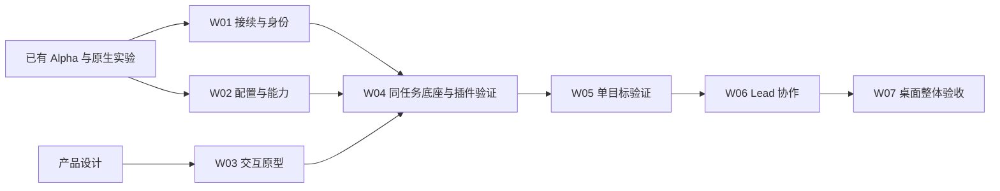

# W 系列工作台实施入口

本目录是 Windows/WSL Agent 工作台 W01–W07 的执行入口。需求与产品行为分别以 [需求分析](../docs/requirements-analysis.md)、[产品设计](../docs/product-design.md)为准；[路线与旧资产映射](../docs/implementation-plan.md)保留总体取舍。创建这些任务文件只完成规划，不代表已执行或创建了原生 Goal。

## 从哪里开始

1. 读 [PROGRESS](PROGRESS.md)：当前状态、证据、下一可执行项和需决定的条件。
2. 读 [EXECUTION](EXECUTION.md)：本主线的执行、验证和收尾规则。
3. 继续新主线时按 [IMPLEMENT](IMPLEMENT.md)选取前置满足的子任务；只做指定项时读取对应工作包的子任务即可。

下一项、当前状态和已有验收统一由 [PROGRESS](PROGRESS.md)维护。工作包正文保留已有基础及其边界，供实施时复用。

## 工作包与依赖

共 7 个工作包、40 个可验收子任务。编号用于定位；实际先后看各子任务“前置”和进度，不按最小编号机械重跑。

| 工作包 | 子任务数 | 用户可见交付 | 主要依赖 |
|---|---:|---|---|
| [W01 接续与输入控制](W01-session-continuity.md) | 6 | 原会话身份、经验证的接续入口、输入权与恢复 | 现有 Alpha / 原生实验；与 W02 交错 |
| [W02 执行配置与能力](W02-execution-capabilities.md) | 9 | 多配置、共享/专属资产、逐次选择、有效版本 | 现有绑定与快照；依具体原生路径推进 |
| [W03 核心交互](W03-core-interactions.md) | 3 | 五流程可操作原型、试用反馈、实现对照 | 产品 V0.3；无需等待全部协议通过 |
| [W04 底座与 netcap 插件](W04-platform-plugin.md) | 5 | Windows/WSL 最小通路、同任务候选比较、真实插件 | W01/W02 能力结论、W03；最终决定需硬缺口闭环 |
| [W05 单目标验证](W05-goal-verification.md) | 5 | Goal/Task/Attempt、修改、独立 Gate、故障恢复 | W04 及所用 W01/W02 能力通过 |
| [W06 Lead 协作](W06-lead-collaboration.md) | 6 | 八种角色组合、真实分工/打回、并发、长程约束 | W05；真实运行前确定目标与约束 |
| [W07 桌面交付](W07-desktop-delivery.md) | 6 | 安装、关窗/休眠恢复、通知、迁移及整体验收 | 前序所需能力完成；最终逐条核对所有要求 |



图示是工作包关系；W04 的最小控制/候选试验与最终底座决定有不同门槛，具体见 [IMPLEMENT](IMPLEMENT.md)。未满足项不能被其他实验的“通过”抵消。

## 文件职责

- `PROGRESS.md`：W 系列状态的唯一更新位置；子任务正文定义工作和验收，不另维护勾选状态。
- `W01-…md` 至 `W07-…md`：各包目标、已有基础、40 项任务的前置/实施/验收。
- `ACCEPTANCE.md`：27 个需求条目（含 R02b）及 P01–P16 的责任与证据入口；映射不等于通过。
- `evidence/`：本目录建立后新增的实际验证记录。已有证据继续引用 `goals/evidence/`，保留原路径和哈希。
- `IMPLEMENT.md`、`EXECUTION.md`：持续实施入口与公共规则；不作为单独业务任务加入队列。

旧 [goals](../goals/README.md)继续保存 T00–T15、历史状态和原始证据，不搬走、不重命名旧工作包。后续 W 状态只写本目录；新需求/行为变更同步上游设计。

## 可复制的执行目标

继续主线：

```text
在 /home/zzw/codex-netcap 读取 goals_W/IMPLEMENT.md 和 goals_W/PROGRESS.md，按前置与最新进度持续推进 W 系列；复用已有实现，每个切片完成实现、验证和证据后更新进度。保留尚未满足的硬要求。
```

只执行指定子任务（示例）：

```text
在 /home/zzw/codex-netcap 读取 goals_W/EXECUTION.md、goals_W/PROGRESS.md 和 goals_W/W02-execution-capabilities.md，只完成 W02.04 原会话改配与快照版本，并记录实际验证与剩余限制。
```

以上是目标文本。使用任务快照时仍以项目根目录解析源码与指令；浏览用 Markdown 相对链接按本目录定位。不要把 `README`、进度、规则或验收表作为业务任务；也不把本目录直接接到旧 `netcap run` 自动队列。原生 Goal 是否创建、预算和状态更新遵循实际用户要求与工具规则。
